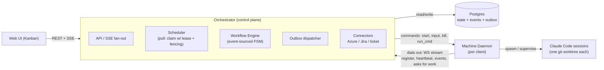

# 01 · Architecture

## Components

| Component | Responsibility | Never does |
|---|---|---|
| **Web UI** | Kanban board, session detail (recent output, pending question, workflow state), answer box, workflow JSON editing | Holds board state of its own (columns are queries) |
| **Orchestrator** | Single decider: claims, transitions, outbox dispatch, connectors, SSE fan-out, ring buffer of terminal output | Reaches into a machine (daemons dial in) |
| **Postgres** | System of record: machines, repos, tickets, workflows, sessions, input requests, event log, outbox | Store raw terminal output |
| **Machine daemon** | Register, heartbeat (live cpu/mem/disk), repo inventory, asks for work, creates worktrees, spawns and supervises Claude Code, runs command states, buffers events to disk, replays with seq numbers | Decides the next workflow state |
| **Claude Code session** | Does the work inside one agent state. Signals `complete_state` / `ask_user` through structured tools ([U-002](../tracking/UNKNOWNS.md)) | Moves the ticket by itself: it can only name one of the transitions it is offered ([ADR-0011](../adr/0011-transition-rules.md)), and the engine checks it and its requirements |

## Key flows

1. **Ticket → session**: a ticket is `ready`. A daemon with a free slot asks for work. The orchestrator claims the best-matching ticket in one transaction ([04](04-scheduler.md)) and sends `start_session`.
2. **State execution**: the engine emits an effect for the current state (agent prompt, command, connector call, wait). The outbox dispatcher delivers it ([05](05-workflow-engine.md)).
3. **Outcome → transition**: the daemon reports an outcome (exit code, `complete_state` result with an optional transition name and reason, `ask_user`), or a human takes a transition from the board. The engine applies it as a pure function and writes the event, new state and effects in one transaction. A transition with `requires` first runs its checks, review, actions and conditions while the card stays in its column ([05 §Transitions](05-workflow-engine.md#transitions-adr-0011-m1b-t03)).
4. **Human input**: the session goes to `needs_input`. Its card moves through SSE. The user answers. The answer goes down to the daemon, or the session resumes elsewhere ([06](06-human-input.md)).
5. **Live view**: board-level changes go over SSE to every browser. Terminal output streams only for the open session ([03](03-protocols.md)).

## Credentials split

- **Skill states** (open PR, Slack post) run *on the machine* through Claude Code skills, with the machine's credentials.
- **Connector states** (ticket status, Azure build, Jira task) run *in the orchestrator* with its stored secrets. Writes to shared systems come from one audited place.

## Deployment (target)

- Orchestrator: a single Node process in v1. Pull scheduling means no leader is needed ([ADR-0001](../adr/0001-pull-scheduler.md)). A second replica is safe later because claims are row locks.
- Postgres: docker-compose locally, managed later.
- Daemon: a Node process installed on each machine, configured with the orchestrator URL and an enrollment token ([U-008](../tracking/UNKNOWNS.md)).
- Web: a static React app served by the orchestrator.
