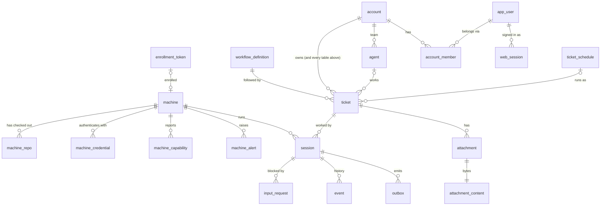

# 02 · Data model

`session` is the hub. It runs on a `machine`, works on a `ticket`, can be blocked by an `input_request`, and has an `event` history. `ticket` follows a `workflow_definition`. `machine_repo` belongs to `machine`. Every one of those rows belongs to an `account` ([ADR-0012](../adr/0012-hosted-multi-user-github-sign-in.md) §Tenancy); people (`app_user`) sign in ([ADR-0017](../adr/0017-own-sign-in-and-self-hosting.md)) and own their account through `account_member`.

## Tables

The exact DDL is `packages/orchestrator/migrations/1761100000000_initial-schema.sql` (M1-T02, plain node-pg-migrate SQL) plus the later migrations in that directory (`1761200000000_machine-claude-code-version.sql`, M1-T07; `1761500000000_ticket-kind.sql`, M1b-T04; `1761600000000_accounts-and-auth.sql`, M2-T03; `1761700000000_machine-credentials.sql`, M2-T09; `1762000000000_agent-team.sql`, UX-13a; `1762400000000_ticket-schedules.sql`, ADR-0032; `1762700000000_input-request-options.sql`, Questions UX; `1762800000000_attachments.sql`, Images; `1763000000000_agent-attachment-idempotency.sql`, agent attachments), and this doc is updated when it diverges. `packages/orchestrator/test/schema.test.ts` checks every column's name, pg type and nullability against the row types, and every enum against `shared/src/domain.ts`. Enums are Postgres enum types named `<table>_<column>` (`machine_status`, `ticket_status`, `ticket_kind`, `session_status`, `input_request_kind`, `outbox_kind`, `outbox_status`). Nullability follows the row types exactly (a `| null` field is a nullable column, everything else is `NOT NULL`), including columns this table doesn't mark null (e.g. `lease_expires_at`, `worktree_path`, `port_range`); `jsonb` maps default to `'{}'`, `text[]` to `'{}'`, counters and money to 0, timestamps to `now()`, uuid keys to `gen_random_uuid()`. The TypeScript row types are pinned in `packages/orchestrator/src/db/types.ts` (M1-T12, [10](10-contracts.md)); they use node-postgres' default parsing (`bigint`/`numeric` → string, `timestamptz` → Date, `bytea` → Buffer).

**Tenancy (M2-T03).** Every table carries `account_id uuid NOT NULL REFERENCES account (id)`, except the instance-level tables (`account`, `app_user`, `account_member`, `web_session`, `invite`, `password_reset`, `login_throttle`) and `pgmigrations`. `packages/orchestrator/test/schema-isolation.test.ts` enforces it (ADR-0012 §Proving isolation 1), so a new table either carries the column or joins that allow-list in review. Migration `1761600000000_accounts-and-auth` inserts the `local` account (`LOCAL_ACCOUNT_ID` = `00000000-0000-4000-8000-000000000001`, `packages/shared/src/domain.ts`) and adds `account_id` to the eight M1 tables with a constant `DEFAULT` of that id, which backfills every existing row into `local`. **The default is temporary** (TD-109): it lets M1 code keep inserting without naming an account, and M2-T21 drops it once every write is scoped. The down migration drops the column, the seven tables and the `machine_lost` kind (deleting any such requests), restoring the M1b schema. In the account_id rows below, "account_id (M2-T03)" means: uuid FK `account`, NOT NULL, backfilled to `local`, temporary default TD-109 until M2-T21, indexed (`<table>_account_id_idx`).

### machine
| column | type | notes |
|---|---|---|
| id | text pk | stable daemon id |
| hostname, os, arch | text | |
| tags | text[] | e.g. `gpu`, `macos`, `build-server` |
| status | enum | `online` · `draining` · `offline` |
| last_heartbeat_at | timestamptz | lease liveness |
| cpu_total, mem_total_mb, disk_free_mb | int | from heartbeat |
| cpu_free, mem_free_mb | int | live usage, reported |
| budget_cpu, budget_mem_mb | int | advertised budget minus the owner reserve ([07](07-multi-session-isolation.md)) |
| max_sessions | int | hard cap |
| max_concurrent_builds | int | daemon build semaphore size |
| last_seq | bigint null | highest daemon `seq` processed; the `(machine_id, seq)` dedupe and `registered.last_seq` ([10](10-contracts.md#daemon-seq-dedupe)) |
| claude_code_version | text null | `register.claude_code_version` (`claude --version`), stored on every register so stream-json drift can be tied to a CLI version ([U-015](../tracking/UNKNOWNS.md), [U-032](../tracking/UNKNOWNS.md)). null = the daemon couldn't run the CLI. M1-T07 migration |
| git_identity_missing | bool null | the last `inventory.git_identity_missing` (WF-T02, migration `1762800000000`): true = the daemon found no commit identity, so agents commit as `conductor <conductor@localhost>`; the Machines page warns. null = not reported (an older daemon, or no inventory yet) |
| skip_permissions_default | bool | default false. [ADR-0039](../adr/0039-skip-permissions-per-ticket-and-machine.md) (migration `1764000000000`): the machine's default for "skip permissions" (working agents run with `--permission-mode bypassPermissions`); a ticket's `skip_permissions` wins. Interim until M2-T28c's `machine_settings.permission_mode` |
| account_id | uuid fk account | M2-T03 (see Tenancy above) |
| name | text null | display name (M2-T09; rename is M2-T17's). Enrollment and the local-mode register set it to the hostname, the migration backfills it; null = show the hostname. Nullable because M1 inserts don't name it |
| daemon_version | text null | `register.daemon_version` (enrollment's first), written on every register |
| protocol_version | int null | `register.protocol_version` (absent = 1); null = never registered |
| revoked_at | timestamptz null | `revokeMachine` (M2-T09): its credentials stop upgrading (401) and `register` is closed 4003 in both modes |
| repo_allow | text[] null | repo rules ([ADR-0013](../adr/0013-machine-enrollment-inventory-routing.md) amendment 2026-10-30, migration 1762100000000): the repo patterns (`host/org/repo` or `host/org/*`, `RepoPatternSchema`) this machine may take; null = any. Edited from the Machines drawer (`PATCH /api/machines/:id`) |
| repo_exclusive | text[] default '{}' | repo patterns only this machine takes: every other unrevoked machine of the account skips matching tickets, even while this one is offline. Ignored once revoked |
| features | text[] default '{}' | [ADR-0033](../adr/0033-workflow-advisor.md) P2: the known `register.features` of the last register (`DAEMON_FEATURES`; e.g. `assistant_job`). Analyst jobs go only to a machine with `assistant_job`. Migration `1762500000000_session-insight` |
| created_at, updated_at | timestamptz | |

### machine_repo
| column | type | notes |
|---|---|---|
| machine_id | fk machine | |
| repo | text | the row's key on the machine: an M1 `repo_inventory` row's repo name (e.g. `github.com/org/app`); an `inventory` row's `path` (M2-T16a: unique per machine, while two checkouts may share a remote). Routing reads `remote`, never `repo` |
| path | text | the **shared clone** (agents never edit it) |
| head_commit | text | |
| tree_clean | bool | describes the shared clone, not the worktrees. `DEFAULT true` since M2-T09: the M1 `repo_inventory` handler writes it until M2-T16, M2-T21 drops it |
| updated_at | timestamptz | |
| account_id | uuid fk account | M2-T03 (see Tenancy above) |
| default_branch | text null | M2-T09; from `inventory` (M2-T16) |
| mode | text | `CHECK (mode IN ('reference','checkout'))`, default `reference` (U-060); existing rows become `reference` |
| remote | text null | canonical remote (`CANONICAL_REMOTE_RE`); null = no allowed remote, listed but never routed to. With `inventory` (M2-T16), `path` is the user's checkout |
| pk | (machine_id, repo) | |

### enrollment_token
M2-T09, ADR-0013 §Enrollment. One-time, 30 minutes (`ENROLLMENT_TOKEN_TTL_MS`).
| column | type | notes |
|---|---|---|
| id | uuid pk | |
| account_id | uuid fk account | the account the machine joins (no default) |
| token_hash | bytea unique | SHA-256 of the 128-bit token (32 bytes, checked); the token is shown once, inside the install command |
| created_by | uuid null | audit user id ([U-042](../tracking/UNKNOWNS.md)); no FK because `local` mode's `LOCAL_USER_ID` has no `app_user` row; null = the CLI or conductor |
| created_at, expires_at | timestamptz | |
| used_at | timestamptz null | `enrollMachine` consumes it with `UPDATE … WHERE used_at IS NULL AND expires_at > now() RETURNING`, so two concurrent uses make one machine |
| used_by_machine | fk machine null | |

### machine_credential
M2-T09. Sent as `Authorization: Bearer <credential>` on every daemon WS upgrade.
| column | type | notes |
|---|---|---|
| id | uuid pk | |
| machine_id | fk machine | |
| account_id | uuid fk account | |
| secret_hash | bytea unique | SHA-256 of the 256-bit credential (32 bytes, checked); the credential is returned once by `enrollMachine` |
| created_at | timestamptz | |
| last_used_at | timestamptz null | updated on every authenticated upgrade |
| revoked_at | timestamptz null | set by `revokeMachine` |

### machine_capability
M2-T09 (10-contracts §Machines protocol v2, Storage). One row per element of `capabilityKeys(c)` for each reported capability: an authed cli gives `cli:<name>` **and** `cli:<name>:authed`; a repo-scoped skill or agent's key carries `@<repo>`, so `skill:review` and `skill:review@github.com/o/app` are separate rows. **Routing reads only `key`**; the other columns are for display. Written by the `inventory` ingest (M2-T16), replaced wholesale on each inventory.
| column | type | notes |
|---|---|---|
| machine_id | fk machine | cascades on machine delete |
| account_id | uuid fk account | |
| key | text | `capabilityKey` grammar |
| kind | text | `CHECK` `cli` · `mcp` · `skill` · `agent` · `claude` |
| name | text | (`claude` for the claude kind) |
| version | text null | cli / claude |
| detail | jsonb | display extras (e.g. `authed`, `repo`), default `{}`; never secrets |
| updated_at | timestamptz | |
| pk | (machine_id, key) | |

### machine_alert
M2-T09; written from the daemon's `alert` message (M2-T16).
| column | type | notes |
|---|---|---|
| id | uuid pk | |
| machine_id | fk machine | cascades on machine delete |
| account_id | uuid fk account | |
| session_id | fk session null | the session it was raised after, if any |
| kind | text | `CHECK (kind IN ('git_tamper'))` (`MachineAlertKind`) |
| detail | jsonb | `git_tamper`: `{repo, files}` |
| created_at | timestamptz | |
| cleared_at | timestamptz null | set by the owner (`POST /api/machines/alerts/:id/clear`) |

The migration's down drops these four tables and the new `machine` / `machine_repo` columns (and `tree_clean`'s default), restoring the M2-T03 schema; enrollments, credentials, capabilities and alerts are lost.

### ticket
| column | type | notes |
|---|---|---|
| id | uuid pk | |
| external_ref | text | e.g. `JIRA-123` ([U-003](../tracking/UNKNOWNS.md)) |
| repo | text | target repo |
| title, body | text | |
| workflow_id, workflow_version | fk | version is null until pinned when the first session starts; re-pinned to the newest version on a reopen and on a human move on a parked session (M2-T34, [05 §Versioning](05-workflow-engine.md#versioning)). One composite FK to `workflow_definition (id, version)`, MATCH SIMPLE: checked only once the version is set |
| parent_ticket_id | fk ticket null | child tickets from a plan state |
| required_tags | text[] | hard constraints for the claim |
| repo_allow_machines | text[] null | hard allow-list of machine ids for the claim ([04](04-scheduler.md)); `null` = any machine. Kept, nullable ([U-009](../tracking/UNKNOWNS.md), M1-T12) |
| status | enum | `ready` · `claimed` · `in_progress` · `done` · `failed` · `cancelled` |
| priority | int | default 3. 0–4 (`CHECK`), the lower is the more urgent and claimed first; P0 is reserved for work that interrupts other running work ([ADR-0036](../adr/0036-ticket-priority-p-scale.md)). Migration `1763200000000_priority-p-scale` rewrote the old higher-is-urgent values |
| queue_position | int null | [06 §Queue order](06-human-input.md#queue-order): the hand-set place in the queue (1 = next); null = not reordered (after the ranked ones, by priority (lowest P first) then age). The claim clears it |
| kind | enum `ticket_kind` null | `work` · `personal` ([ADR-0011](../adr/0011-transition-rules.md)): filters transitions (`kinds`). NULL for tickets created before M1b, matching both kinds ([U-062](../tracking/UNKNOWNS.md)); new tickets must set it (create form until triage, M4). Added by migration `1761500000000_ticket-kind` (M1b-T04; existing rows keep NULL, the down migration drops the column and the type). `POST /api/tickets` returns it in `TicketDto.kind` and every card carries it (`BoardCard.kind`) |
| session_allow | text[] | default `{}`. M2-T29c ([ADR-0023](../adr/0023-permission-prompts-through-conductor.md) §2): the exact allow rules "Allow always" recorded for this ticket's sessions, each once, until the machine override exists (M2-T28c). Not yet passed to `start_session` (that needs daemon changes); the live process gets the rule through the decision itself |
| skip_permissions | bool null | [ADR-0039](../adr/0039-skip-permissions-per-ticket-and-machine.md) (migration `1764000000000`): "skip permissions" for this ticket's working agents: true = on, false = off, null = the machine's `skip_permissions_default`. Set by `PUT /api/tickets/:id/skip-permissions` in any column |
| account_id | uuid fk account | M2-T03 (see Tenancy above) |
| schedule_id | uuid fk ticket_schedule null | [ADR-0032](../adr/0032-recurring-tickets.md): the schedule whose run created the ticket; `ON DELETE SET NULL` (deleting a schedule keeps its tickets). NULL = not from a schedule. Migration `1762400000000_ticket-schedules` |
| scheduled_for | timestamptz null | ADR-0032: the run time it was created for (a manual run: now, to the second). `(schedule_id, scheduled_for)` is unique where `schedule_id IS NOT NULL` (`ticket_schedule_run_key`): a run's idempotency key, so a retried or concurrent sweep never inserts a second ticket |
| agent_id | uuid fk agent null | UX-13a: the teammate working the ticket ([agent](#agent)). Set by the claim that starts work and never cleared, so retries, requeues and reopens keep the same agent. NULL = not assigned yet (queued, or a ticket from before UX-13a; existing rows keep NULL). Indexed `ticket_agent_id_idx` (`WHERE agent_id IS NOT NULL`) |
| created_at, updated_at | timestamptz | the claim orders by `created_at` |

### workflow_definition
| column | type | notes |
|---|---|---|
| id | text | e.g. `pr_flow` |
| version | int | immutable once saved |
| definition | jsonb | see [05](05-workflow-engine.md) |
| | | [ADR-0010](../adr/0010-one-workflow-columns-are-states.md): the orchestrator seeds `conductor` v1 (`docs/design/workflows/conductor.v1.json`, a copy in `packages/shared/src/workflow/conductor.ts`) on startup when no `conductor` version exists (one guarded INSERT, `ON CONFLICT DO NOTHING`: idempotent, safe on concurrent starts). Older workflows (`m1_*`) stay so their tickets still render |
| account_id | uuid fk account | M2-T03 (see Tenancy above). The primary key stays `(id, version)` here; M2-T12 makes it `(account_id, id, version)` |
| created_at, created_by | | `created_by`: the saver's email over REST (UXR-70), `mcp:<email>` over MCP, `conductor` for a seeded version; null when unknown |
| note | text null | UXR-70 (migration `1763100000000_workflow-version-note`): an optional note (≤ 500 chars) written when it was saved (the Save review dialog), `Applied proposal: <title>` for an applied change proposal. `created_by` and `note` are shown only to the account that saved the version (`account_id`): workflows are shared by every account |
| pk | (id, version) | |

### session
| column | type | notes |
|---|---|---|
| id | uuid pk | |
| ticket_id | fk | |
| machine_id | fk null | null while parked/released |
| workflow_id, workflow_version | | pinned; moved to the newest version only while no agent runs (M2-T34, [05 §Versioning](05-workflow-engine.md#versioning)) |
| workflow_state | text null | current FSM state name; null until the first `session.assigned` enters `start`. During a gate step the synthetic label `<from> → <to> (review)` ([ADR-0009](../adr/0009-transition-requirements-review.md) transition review) or `<from> → <to> (entry)` ([ADR-0010](../adr/0010-one-workflow-columns-are-states.md) requirements to enter a column), which names no state |
| status | enum | `queued` · `assigned` · `running` · `needs_input` · `waiting_external` · `done` · `failed` · `lost` |
| lease_expires_at | timestamptz | renewed by heartbeat |
| fencing_token | bigint | default `nextval('fencing_seq')`: bumped on every claim / requeue, **and** by the EngineService wrapper on a non-ignored `start_session` `command.refused` (incl. `ack_timeout`), so a process that command spawned anyway is stale ([10](10-contracts.md#refusals)), on gate-step changes, and when the session becomes terminal (BUG-1: a leftover process is stale, [10](10-contracts.md#orphaned-processes) rule 6) |
| worktree_path, branch | text | branch is per session: `sessionBranch(ticket, session)` = `<JIRA-KEY>-<title-slug>-<first 6 of session_id>` or `conductor/<title-slug>-<first 6 of session_id>` ([10-contracts §Claim](10-contracts.md)), set by the claim and never renamed (sessions before this change keep `conductor/<ticket_id>/<first 8>`). `worktree_path` (and `branch` again) from `session_event started` |
| claude_session_id | text | for resume. Always the worker's conversation: a requirements reviewer's id is kept in the review step, never here ([ADR-0009](../adr/0009-transition-requirements-review.md)) |
| agent_command_id | uuid null | `command_id` of the current `start_session`; `started` / `exit` with another id are ignored ([10](10-contracts.md#agent-process-correlation)) |
| agent_process_live | bool | a live Claude process exists for `agent_command_id`; false → an answer resumes via `start_session` instead of `send_input` |
| pending_answer | jsonb null | `{input_request_id, answer}`: set by apply on `input.provided`, used as the prompt of any resume `start_session`, cleared once the agent runs on it ([10](10-contracts.md#pending-answer)). A reopened session ([ADR-0008](../adr/0008-transcript-history-and-reopen.md)) is created with `{input_request_id: null, answer: <the human's text>}` |
| retry_counters | jsonb | per-loop counters, e.g. `{"build->implement": 2}`; a requirements gate's unmet loop counts under `"requirements:<from>:<outcome>"` |
| spend_usd, wall_seconds | numeric | against the workflow budget. `spend_usd` grows only by positive deltas (below). `wall_seconds` is maintained by apply (queued time excluded; a human's budget raises live in `context.__budget`, [09](09-security-and-budgets.md#budgets)): on each transition it adds `now − state_entered_at`, except for `human`/`event` states ([10](10-contracts.md#wall-time)) |
| claude_spend_totals | jsonb | `{<claude_session_id>: <last cumulative total_usd>}`. Claude's `total_usd` is cumulative per Claude session and survives `--resume` ([ADR-0005](../adr/0005-claude-code-driver.md)), so a `spend` report adds `max(0, total − claude_spend_totals[id])` to `spend_usd` and stores the new total. Replays and duplicates are no-ops (`packages/shared/src/engine/spend.ts`) |
| context | jsonb | state results, e.g. `{"open_pr": {"pr_url": "…"}}`, plus each review's last verdict under its label (`{"implement → build (review)": {"verdict": […]}}`). The PR conductor opened is recorded only under the reserved key `__pr` (`{"__pr": {"pr_url": "https://github.com/o/r/pull/7", "state": "waiting_external"}}`), written by the engine from open_pr's result and shown on the card; a `pr_url` in an agent's result is ignored ([ADR-0010](../adr/0010-one-workflow-columns-are-states.md)). Also holds the in-progress gate step under the reserved key `__entry` (below) |
| port_range | int4range | allocated by the daemon; `[base, base+count)` from `session_event started` |
| return_to | text null | state that routed into the current `human` state; the answer returns there ([05](05-workflow-engine.md#needs_input-semantics)) |
| state_visits | jsonb | `{<state>: <times entered>}`; the `visit_n` of connector idempotency keys ([05](05-workflow-engine.md#idempotency)) |
| notified_transitions | text[] | [ADR-0037](../adr/0037-workflow-primitives-for-self-healing-process.md) P6 (`1763600000000_notify-policy`): the `once` transitions that already pushed on the ticket; a reopen copies it, so `once` is per ticket. Written by apply only under a workflow `notify` policy |
| state_entered_at | timestamptz | when the current state was entered |
| state_deadline | timestamptz null | when the current state's `timeout` fires; read by the timeout sweep (M1-T04) |
| watch_deadline | timestamptz null | [ADR-0037](../adr/0037-workflow-primitives-for-self-healing-process.md) P1 (`1763800000000_session-watch-deadline`, T6): when the current human / event state's `watch` checks next; read by the same sweep (`watch.fired`), set to now by a merge or push on the repo (the nudge). Partial index where not null. The watch's checklist lives in `context.__watch` |
| waiting_for_build_slot | bool | card badge, **not** a status ([10](10-contracts.md)); set from session_event `build_slot` |
| account_id | uuid fk account | M2-T03 (see Tenancy above) |
| created_at, updated_at | | |

**Reopen (ADR-0008, no migration).** `POST /api/sessions/:id/reopen` inserts a new `queued` session for the ticket that copies the old one's `workflow_id`/`workflow_version`, `branch`, `claude_session_id`, `context` and `claude_spend_totals` (Claude's cost is cumulative across `--resume`, so only new spend is added), sets `pending_answer` to the human's text, and leaves everything else at its default (`retry_counters`, `state_visits`, `spend_usd`, `wall_seconds`, `worktree_path`…). Two sessions of one ticket then share a `branch`; the claim uses that to pin the new one to the old one's machine ([04](04-scheduler.md#2--claim-query-ticket-side)). The human's text is kept durably in an `operator.reopen` event row on the new session (`{text, reopened_from, actor}`). The gate step (`__entry`, or a legacy `__review`, below) is never carried.

**Gate step (ADR-0009, ADR-0010, no migration).** While a gate step runs (an ADR-0009 transition review, or the ADR-0010 requirements to enter a column), the snapshot's `step` field (`GateStepSchema` in `packages/shared/src/engine/types.ts`: `{kind: 'transition'|'entry', from, outcome, to, attachment, subject, claude_session_id, nudged, phase: 'checks'|'review'|'actions', index, head_sha}`) is stored inside `context` under the reserved key `__entry` (`STEP_CONTEXT_KEY`). Rows written before ADR-0010 have it under `__review` (`REVIEW_CONTEXT_KEY`); it is still read (as `kind: 'transition'`, `phase: 'review'`) and rewritten under `__entry`. Neither name, nor `__pr`, may be a state (validator rule 8). `toSnapshot` lifts it out and `writeSession` puts it back (`orchestrator/src/engine/rows.ts`). `GET /api/sessions/:id` leaves it out of `context`. Status stays `running` (no new `session_status` value) and the unmet / failed review questions use the existing `retries_exhausted` and `timeout` `input_request_kind`s, so neither enum changes.

Constraints: `CREATE SEQUENCE fencing_seq` (bigint) is the only source of fencing tokens, global across sessions. `CREATE UNIQUE INDEX session_one_live_per_ticket ON session (ticket_id) WHERE status NOT IN ('done', 'failed', 'lost')` enforces one live session per ticket (the claim re-uses a `queued` one, [10](10-contracts.md#claim)).

### input_request
| column | type | notes |
|---|---|---|
| id | uuid pk | |
| session_id | fk | |
| kind | enum | `agent_question` · `budget_exceeded` · `retries_exhausted` · `timeout` · `approval` · `machine_lost` (`MACHINE_LOST_KIND`: the session's machine was lost or revoked, [10](10-contracts.md#machines-protocol-v2); added by M2-T03) · `handoff` (a `handoff: true` transition handed finished work over for review; `question` is the agent's summary; [ADR-0037](../adr/0037-workflow-primitives-for-self-healing-process.md) P8, added by T3) · `check_config` (a gate's setup failed on the branch and on the base branch: conductor's check config; not counted; [05](05-workflow-engine.md#requirements-to-enter-a-column-adr-0010) "Setup failures", migration 1763900000000) |
| question | text | shown as the card badge |
| return_to | text null | copy of `session.return_to` when created |
| answer | text null | |
| answered_by | text null | user id or `slack:<user>` |
| account_id | uuid fk account | M2-T03 (see Tenancy above) |
| created_at, answered_at | | needs-input column sorts by created_at |
| options | jsonb null | Questions UX (`1762700000000_input-request-options`): the clickable choices of an agent's `ask_user` question, `{multi_select, items: [{label, description?}]}` (`QuestionOptionsSchema`, [06 §Agent question options](06-human-input.md#agent-question-options)); null for every other request |
| notify | jsonb null | [ADR-0037](../adr/0037-workflow-primitives-for-self-healing-process.md) P6 (`1763600000000_notify-policy`): `{via, mode, decision}`, the workflow notify policy's decision for the move that opened the request; the request pushes only on `decision: 'push'`. Null in legacy mode (no top-level `notify`: every request pushes) |

### event (append-only)
| column | type | notes |
|---|---|---|
| id | bigserial pk | also the SSE `Last-Event-ID`. Board rows are inserted only via `insertBoardEvents` under `pg_advisory_xact_lock`, so they commit in id order ([10](10-contracts.md#board-events-and-the-event-table)) |
| session_id | fk null | null for machine-level events |
| type | text | an `EngineEvent.type` (e.g. `agent.exited`), `state.entered` (`{from, to, visit, transition?, reason?, actor?, cause?}`; `cause` since ADR-0037 P7), `conversation.reset` (`{claude_session_id, reason}`: apply forgot the conversation, `not_on_machine` when a start was refused `no_conversation` ([10](10-contracts.md#refusals)), `user_requested` on "Start fresh conversation…" ([10](10-contracts.md#fresh-conversation))), `operator.reopen` (ADR-0008, written by the reopen route, not an engine event), or a board SSE type (`card.upserted`, `card.moved`, `session.status`, `input.requested`, `input.answered`, `card.badge`: one row per SSE event, [10](10-contracts.md#board-events-and-the-event-table)) |
| payload | jsonb | |
| fencing_token | bigint null | stale tokens are rejected *before* insert; null on board-event rows |
| account_id | uuid fk account | M2-T03 (see Tenancy above) |
| ts | timestamptz | |

Only state changes and summaries go here. **Raw terminal output does not** (see [U-005](../tracking/UNKNOWNS.md)).

### outbox
| column | type | notes |
|---|---|---|
| id | bigserial pk | |
| command_id | uuid unique | the daemon dedupes on this |
| target | text | `machine:<id>`, `connector:<name>`, or `user:<id>` (a `push_needs_input` row, UX-15) |
| kind | enum | `start_session` · `send_input` · `send_message` · `run_cmd` · `run_action` · `kill` · `connector_call` (one engine `Effect` each, [10](10-contracts.md)). `send_message` was added by migration `1761300000000_outbox-send-message` ([ADR-0007](../adr/0007-live-messages-to-agents.md)), `run_action` (an entry action such as `open_pr`) by `1761400000000_outbox-run-action` ([ADR-0010](../adr/0010-one-workflow-columns-are-states.md)). `push_needs_input` (UX-15, `1761900000000_push-subscriptions`) is the one kind that is **not** an Effect: the EngineService wrapper writes it when it inserts an `input_request`, the push dispatcher sends it, and it has no WS message ([10 §Web Push](10-contracts.md#web-push)) |
| session_id | fk session null | |
| payload | jsonb | the WS command payload verbatim (`commandPayloadForEffect`). Once a `start_session` row is terminal (`acked`/`failed`) its `prompt` is set to JSON `null` in the same guarded UPDATE, other fields kept: the prompt can carry the `attach: output` command tail ([U-039](../tracking/UNKNOWNS.md)). A terminal `send_message` row gets the same treatment for its `text` (the message's record is its `operator.message` event row; [ADR-0007](../adr/0007-live-messages-to-agents.md)) |
| idempotency_key | text null | connectors and `run_action` rows: `<session_id>:<state>:<visit>`, see [05](05-workflow-engine.md#idempotency); `push_needs_input` rows: the input request id, or `permission:<permission request id>` for a permission prompt (UXR-32), unique per target (`outbox_push_idem_idx`) |
| fencing_token | bigint null | `session.fencing_token` when the row was written; the WS envelope's token. A row below the session's current token is failed `stale_fencing_token`, not sent. null for `connector:` rows ([10](10-contracts.md#effect--ws-fields)) |
| status | enum | `pending` · `sent` · `acked` · `failed` ([10](10-contracts.md#outbox-state-machine): dispatcher writes `sent`, gateway writes `acked`/`failed`, all guarded) |
| attempts, next_attempt_at | | |
| account_id | uuid fk account | M2-T03 (see Tenancy above) |
| last_error | text null | |
| created_at | timestamptz | |

### permission_request
M2-T29c, migration `1761800000000_permission-requests` ([ADR-0023](../adr/0023-permission-prompts-through-conductor.md), [10 §Permission prompts](10-contracts.md#permission-prompts)). One row per daemon `permission_request`; the session's `needs_permission` card fields are derived from its `pending` rows, never stored.
| column | type | notes |
|---|---|---|
| id | uuid pk | the daemon's `request_id`, the idempotency key (`INSERT … ON CONFLICT (id) DO NOTHING`) |
| account_id | uuid fk account | the session's |
| session_id | fk session | |
| machine_id | fk machine | the machine that sent it |
| fencing_token | bigint | the envelope's (= the session's when stored) |
| tool | text | Claude's `tool_name` |
| input | jsonb | the tool input (≤ 64 KiB of JSON) |
| suggestions | jsonb | Claude's `permission_suggestions`, shown only; default `[]` |
| tool_use_id | text null | informational |
| always_rule | text null | `alwaysRuleFor(tool, input)` (U-100 grammar in 10); null = no "Allow always" |
| status | text | `CHECK IN ('pending', 'allowed', 'denied', 'expired')` |
| behavior, scope | text null | `allow`/`deny`, `once`/`always`; set exactly when `allowed`/`denied`; a deny is always `once` |
| message | text null | the human's note (or conductor's own deny reason) |
| rule | text null | the recorded rule, only with `scope = 'always'` |
| decided_by | uuid null | the deciding user's id (no FK: may be the virtual local user); null = conductor itself |
| decision_command_id | uuid null unique | the `permission_decision` command_id sent, matched against the daemon's `command_ack` |
| expired_reason | text null | `timeout` · `agent_gone` · `session_moved`; set exactly when `expired` |
| created_at, expires_at | timestamptz | `expires_at` from the daemon (the sweep expires it then) |
| resolved_at | timestamptz null | when decided or expired; null exactly while `pending` |

The migration's down drops the table and `ticket.session_allow`.

### account
Instance-level (not on the isolation check). ADR-0012 §Tenancy.
| column | type | notes |
|---|---|---|
| id | uuid pk | `LOCAL_ACCOUNT_ID` is the `local` account, inserted by the migration: every pre-M2 row, `local` mode, and the bootstrap admin's claim (U-056) |
| name | text | a personal account is named after its owner's `display_name` |
| created_at | timestamptz | |

**account_member**: `account_id` fk account, `user_id` fk app_user, `role` text `CHECK (role IN ('owner','member'))`, `created_at`; pk `(account_id, user_id)`, index on `user_id`. Personal accounts only in M2 (U-051): each user owns exactly one account and nobody else is a member.

### app_user
Instance-level. ADR-0017 §Auth. `local` mode's `LOCAL_USER_ID` is virtual: no row.
| column | type | notes |
|---|---|---|
| id | uuid pk | |
| email | text | as entered; unique on `lower(email)` (`app_user_email_key`). Plain `text`, no citext extension |
| display_name | text | |
| password_hash | text | PHC string `$argon2id$v=19$m=…,t=…,p=…$salt$hash`, so its parameters travel with it |
| is_admin | bool | instance role, default false; an admin still sees only their own account's data |
| disabled_at | timestamptz null | |
| password_changed_at | timestamptz | default `now()` |
| created_at | timestamptz | |

### web_session
Instance-level. One signed-in browser.
| column | type | notes |
|---|---|---|
| id_hash | bytea pk | SHA-256 of the cookie's 32 random bytes (`CHECK octet_length = 32`); the cookie value is never stored |
| user_id | fk app_user | |
| account_id | fk account | the account the session acts in |
| created_at, last_seen_at | timestamptz | `last_seen_at` is updated at most every 5 minutes; 7 days idle ends it |
| expires_at | timestamptz | 30 days absolute |
| user_agent, ip | text null | shown in the account menu; `ip` is text (the trusted client IP, ADR-0017 §Rate limiting) |

### invite
Instance-level. One-time sign-up link.
| column | type | notes |
|---|---|---|
| id | uuid pk | |
| token_hash | bytea unique | SHA-256 of the 256-bit token (32 bytes, checked) |
| created_by | fk app_user null | null = the CLI (`conductor-admin`) |
| email | text null | set → sign-up must use this email |
| is_admin | bool | the new user is an admin |
| claims_account | fk account null | only bootstrap sets it (`LOCAL_ACCOUNT_ID`): sign-up claims that account instead of creating one |
| created_at, expires_at | timestamptz | default 7 days, max 30 |
| used_at, used_by | null | `used_by` fk app_user |
| revoked_at | timestamptz null | |

### password_reset
Instance-level. One-time, 1 hour.
| column | type | notes |
|---|---|---|
| id | uuid pk | |
| token_hash | bytea unique | SHA-256 of the token (32 bytes, checked) |
| user_id | fk app_user | |
| created_by | fk app_user null | the admin, or null for the CLI |
| created_at, expires_at | timestamptz | |
| used_at | timestamptz null | a used reset revokes all of the user's sessions |

### push_subscription
UX-15, migration `1761900000000_push-subscriptions` ([10 §Web Push](10-contracts.md#web-push)). One browser's Web Push subscription (`PushSubscription.toJSON()`), per user and account-scoped. The endpoint is never returned by the API.
| column | type | notes |
|---|---|---|
| id | uuid pk | |
| account_id | uuid fk account | the subscriber's account (the scope of the enqueue) |
| user_id | uuid | the subscriber (no FK: may be the virtual local user) |
| endpoint | text unique | the push service URL, a per-browser secret; `POST /api/push/subscriptions` upserts on it |
| p256dh, auth | text | the browser's message-encryption keys (RFC 8291) |
| user_agent | text null | the subscribing request's, clipped to 512 chars (informational) |
| created_at | timestamptz | |
| last_ok_at | timestamptz null | the last accepted send |
| failures | int | consecutive failed sends (not 404 / 410), default 0, `CHECK >= 0`; the 5th deletes the row. A 404 / 410 deletes it at once |

The migration's down drops the table and `outbox_push_idem_idx`, deletes the `push_needs_input` rows and rebuilds `outbox_kind` without the value.

### agent
UX-13a, migration `1762000000000_agent-team` ([10 §Claim, Agent assignment](10-contracts.md#agent-assignment-ux-13a)). One agent on an account's **team**, hired from the hiring pool (`AGENT_NAMES`, `packages/shared/src/agents/names.ts`) only when no teammate is free. Account-scoped: a team is never seen or used by another account.
| column | type | notes |
|---|---|---|
| id | uuid pk | |
| account_id | uuid fk account | indexed `agent_account_id_idx` (the claim's team query) |
| name | text | from the hiring pool; `UNIQUE (account_id, name)` (two accounts can both have an Ada) |
| hired_at | timestamptz | default `now()`; breaks `last_assigned_at` ties |
| last_assigned_at | timestamptz null | set by every claim that assigns the agent (the hire included) |

A teammate is **busy** while another ticket assigned to it has a session that is not `done`, `failed` or `lost` (`session_status` has no `cancelled`: a cancel ends the session `failed`). A queued session counts, so a reopened ticket waiting in Queued still holds its agent. The migration's down drops `ticket.agent_id` and the table.

### oauth_client, oauth_code, oauth_token
[ADR-0028](../adr/0028-simple-oauth-for-mcp.md), migration `1762200000000_oauth`: conductor as the OAuth 2.1 authorization server for `/mcp` ([10 §MCP and OAuth](10-contracts.md#mcp-and-oauth-adr-0028)). Secrets are 32 random bytes; only their SHA-256 is stored (`CHECK octet_length = 32`). `user_id` has no FK on the two account-scoped tables: in `local` mode it is the virtual local user.

`oauth_client` (instance-level: a client registers before anyone signs in; on the isolation allow-list):
| column | type | notes |
|---|---|---|
| id | text pk | random, base64url (22 chars): the `client_id` |
| name | text | self-declared by the client, ≤ 60 chars, default "Unnamed client" |
| redirect_uris | text[] | 1..5 (`CHECK`); `https://`, or `http://` on a loopback host |
| created_at | timestamptz | |

`oauth_code`:
| column | type | notes |
|---|---|---|
| code_hash | bytea pk | SHA-256 of the code |
| client_id | text fk oauth_client | cascade on client delete |
| account_id | uuid fk account | the consenting user's account |
| user_id | uuid | the consenting user |
| grant_id | uuid | carried by the tokens issued from it |
| redirect_uri | text | the token request must repeat it |
| code_challenge | text | PKCE S256 |
| created_at, expires_at | timestamptz | 60 s |
| used_at | timestamptz null | single use; a second exchange revokes the grant's tokens |

`oauth_token`:
| column | type | notes |
|---|---|---|
| token_hash | bytea pk | SHA-256 of `cnd_at_…` / `cnd_rt_…` |
| kind | text | `access` (1 h) or `refresh` (30 d), `CHECK` |
| grant_id | uuid | one per consent; a refresh keeps it. Indexed `oauth_token_grant_idx` |
| client_id | text fk oauth_client | cascade on client delete |
| account_id | uuid fk account | the scope of every `/mcp` call |
| user_id | uuid | indexed `oauth_token_user_idx WHERE revoked_at IS NULL` (password reset, disable, `revoke-sessions`) |
| created_at, expires_at | timestamptz | |
| revoked_at | timestamptz null | set on rotation (refresh), code replay and the user cascades |

The migration's down drops the three tables.

### repo_checks
[ADR-0030](../adr/0030-per-repo-checks-and-mcp-workflow-tools.md), migration `1762300000000_repo-checks`. A repo's own pre-PR checks, replacing the workflow's at every gate that runs real checks ([05 §Repo check overrides](05-workflow-engine.md#repo-check-overrides-adr-0030)). Edited with `/api/repo-checks` and the MCP tools `set_repo_checks` / `clear_repo_checks` ([10](10-contracts.md)).
| column | type | notes |
|---|---|---|
| account_id | uuid fk account | part of the pk |
| repo | text | `repoChecksKey(repo)`: canonical `host/org/repo`, lower-cased (else the repo as given, trimmed, lower-cased); `CHECK repo <> ''`; part of the pk |
| config | jsonb | `RepoChecksSchema`: `{setup?, checks: [{name, cmd, timeout?}]}` (1..20, unique names), validated on write; a row that no longer parses reads as none |
| updated_at | timestamptz | default `now()` |
| updated_by | text null | the user's email; `mcp:<email>` over MCP |

The migration's down drops the table.

### ticket_schedule
[ADR-0032](../adr/0032-recurring-tickets.md), migration `1762400000000_ticket-schedules`. A recurring ticket: a template plus a cron rule. The orchestrator's schedule sweep (every 30 s) inserts one ticket per due run ([10 §Schedules](10-contracts.md#schedules-adr-0032)). Edited with `/api/schedules` and the MCP tools `list_schedules` / `save_schedule` / `delete_schedule` / `run_schedule_now`.
| column | type | notes |
|---|---|---|
| id | uuid pk | |
| account_id | uuid fk account | indexed `ticket_schedule_account_id_idx` |
| name | text | `CHECK name <> ''`; `UNIQUE (account_id, name)` |
| cron | text | 5 fields, read in `timezone` (`validateSchedule` in shared: runs at least 15 min apart) |
| timezone | text | IANA, default `UTC` |
| enabled | bool | default true; false = paused (`next_run_at` null) |
| title, body, repo | text | the ticket template; `repo` canonical in `password` mode, as `POST /api/tickets`. Each ticket's title is `<title> · <YYYY-MM-DD HH:mm in timezone>` |
| workflow_id | text | default `routine` (the shipped workflow of recurring tickets) |
| kind | `ticket_kind` | NOT NULL |
| priority | int | default 3; 0–4, as `ticket.priority` ([ADR-0036](../adr/0036-ticket-priority-p-scale.md)) |
| required_tags | text[] | default `{}`; copied to each ticket |
| machine_ids | text[] null | copied to each ticket's `repo_allow_machines` (the claim's hard allow-list); null = any machine. Given as ids or names, stored as ids |
| next_run_at | timestamptz null | when the sweep fires it next; null while disabled (or a cron that never runs again). Partial index `ticket_schedule_due_idx (next_run_at) WHERE enabled` |
| last_run_at | timestamptz null | when the last ticket was created |
| last_ticket_id | uuid fk ticket null | the last run's ticket (`ON DELETE SET NULL`); a due run is skipped while it is `ready` / `claimed` / `in_progress` |
| last_skipped_at | timestamptz null | the last due run that made no ticket |
| last_skip_reason | text null | `CHECK IN ('previous_run_open', 'invalid_schedule')` |
| created_by | text null | the user's email (`mcp:` prefixed over MCP) |
| created_at, updated_at | timestamptz | `updated_at` changes on every edit (the PATCH guard `expected_updated_at`), not on runs |

The migration's down drops `ticket_schedule_run_key`, the two `ticket` columns and the table.

### assistant_job

[ADR-0033](../adr/0033-workflow-advisor.md) P2 (MA-T04): one analyst sub-agent job. Migration `1762500000000_session-insight`, which also adds outbox kind `assistant_job` and `machine.features`.

| column | type | notes |
|---|---|---|
| id | uuid pk | the WS `job_id` |
| account_id | uuid fk account | the analysed session's account; `(account_id, created_at)` indexed for the daily cap (20 per 24 h) |
| kind | text | `session_insight` (CHECK) |
| session_id | uuid fk session | `ON DELETE CASCADE` |
| ticket_id | uuid fk ticket | `ON DELETE CASCADE` |
| schema_version | int | `SESSION_INSIGHT_SCHEMA_VERSION` when written |
| machine_id | text fk machine | the machine that ran the session (it holds the transcript); `ON DELETE CASCADE` |
| command_id | uuid unique | its `outbox` row (kind `assistant_job`, `session_id` null) |
| status | text | `queued` → `sent` (accepted ack) → `done` / `failed` / `dropped` (malformed result) (CHECK); `(created_at) WHERE status IN ('queued','sent')` indexed for the expiry sweep (30 min) |
| error | text null | why it failed or was dropped, ≤ 500 chars |
| idempotency_key | text unique | `insight:<session_id>:<schema_version>`: at most one job per session and version, so nothing is retried |
| created_at, finished_at | timestamptz | finished rows are deleted after 180 days |

### session_insight

ADR-0033 P2: an analyst's result, re-validated against `SessionInsightSchema` before it is stored. Kept 180 days (U-066), deleted with its ticket.

| column | type | notes |
|---|---|---|
| id | uuid pk | |
| account_id | uuid fk account | `(account_id, created_at)` indexed |
| session_id | uuid fk session | `ON DELETE CASCADE`; unique with `schema_version` |
| ticket_id | uuid fk ticket | `ON DELETE CASCADE` |
| schema_version | int | |
| machine_id | text null | the machine that ran the job |
| model | text | e.g. `haiku` |
| insight | jsonb | a `SessionInsight` (≤ 4 KiB) |
| created_at | timestamptz | |

The migration's down drops both tables and `machine.features`, deletes `assistant_job` outbox rows and rebuilds `outbox_kind` without the value.

### ticket_proposal_decision

[06 §Proposed tickets](06-human-input.md#proposed-tickets): a person's decision on a follow-up ticket an agent proposed. The proposals themselves stay in `session.context` (each agent state's result, `proposed_tickets`); no row ≡ pending. Deleted with the parent ticket.

| column | type | notes |
|---|---|---|
| ticket_id | uuid fk ticket | the parent; `ON DELETE CASCADE`; pk with `proposal_id` |
| proposal_id | text | `proposalId()` (@conductor/shared): FNV-1a 64 of the state, title and repo, 16 hex |
| account_id | uuid fk account | |
| status | text | `approved` \| `dismissed` (CHECK) |
| created_ticket_id | uuid fk ticket null | the ticket an approval created; `ON DELETE SET NULL` |
| decided_at | timestamptz | |

The primary key makes approve and dismiss idempotent: both decide under the parent's latest session row lock, and an approval inserts the new ticket and this row in one transaction.

### change_proposal

ADR-0033 P3 (MA-T05): a workflow advisor's proposed change. Migration `1762600000000_change-proposal`. Model-written: a human applies or rejects it ([10 §Change proposals](10-contracts.md#change-proposals-adr-0033-p3)). At most 20 `proposed` rows per account (the store refuses `too_many_open`). Not swept: the cap bounds open rows, decided ones stay as the history of what changed and why.

| column | type | notes |
|---|---|---|
| id | uuid pk | |
| account_id | uuid fk account | `(account_id, created_at desc)` indexed; partial index on `(account_id) WHERE status = 'proposed'` |
| kind | text | `workflow` · `repo_checks` (CHECK); machine settings come with MA-T06 |
| status | text | `proposed` · `applied` · `rejected` · `conflict` · `failed` (CHECK); only `proposed` moves, once (applied with the row locked) |
| title | text | ≤ 120 |
| payload | jsonb | the `ProposalChange` (a workflow's whole validated definition, or a repo's checks / null to clear) |
| base | jsonb | what it was made from: `{version}` (workflow) or `{config, updated_at}` of the repo's `repo_checks` row, both null when it had none |
| diff | jsonb | `StructuralChange[]` against `base` |
| rationale | text | ≤ 1000 |
| evidence | jsonb | `[{finding_id?, text}]`, 1..8 |
| expected_effect | jsonb | `ExpectedEffect {metric, scope, direction, text}` |
| rollback | text | ≤ 500 |
| created_by | text null | `mcp:<email>` |
| created_at | timestamptz | |
| decided_by, decided_at | text null, timestamptz null | who applied or rejected it (or hit the conflict) |
| applied_at | timestamptz null | the start of the review's after-window |
| applied_version | int null | workflow: the version applying it saved |
| error | text null | why it is `conflict` or `failed` |
| review, reviewed_at | jsonb null, timestamptz null | the last `ProposalReview` |
| ticket_id | uuid null fk ticket (ON DELETE SET NULL) | an agent's proposal (ask_user `proposed_checks`, [06](06-human-input.md#check-config-failures-and-agent-proposed-repo-checks)): the ticket it was proposed on; partial index `WHERE ticket_id IS NOT NULL`. Migration `1763900000001_change-proposal-ticket` |
| input_request_id | uuid null fk input_request (ON DELETE SET NULL) | the question it came with: applying the proposal answers it |

Down drops the table. An agent's proposal has `created_by` `agent:<ticket id, 8 chars>`.

### attachment

06 §[Attachments](06-human-input.md#attachments). Migration `1762800000000_attachments`. One image or video attached to a ticket; the bytes are in `attachment_content`, so metadata queries never read them. A human's upload is **unlinked** (`ticket_id` null) until a ticket create (`attachment_ids`) or edit (`add_attachment_ids`) links it in the same transaction; the scheduler loop deletes unlinked rows older than 24 h (`sweepUnlinkedAttachments`). Limits (shared `api/attachments.ts`): 10 MB per image, 50 MB per video, 20 files from each source (`attachmentCountMax`) and 200 MB in all per ticket. An agent's attachment is linked at once (`POST /api/daemon/sessions/:id/attachments`); the partial unique index `attachment_agent_session_sha_idx` on `(session_id, sha256) WHERE source = 'agent' AND session_id IS NOT NULL` (migration `1763000000000_agent-attachment-idempotency`) stores the same bytes of a session once.

| column | type | notes |
|---|---|---|
| id | uuid pk | |
| account_id | uuid fk account | indexed |
| ticket_id | uuid fk ticket null | CASCADE; null = an unlinked upload. `(ticket_id, created_at)` indexed, partial index on `(created_at) WHERE ticket_id IS NULL` (the sweep) |
| session_id | uuid fk session null | SET NULL; the agent's session for an agent attachment, null for a human's |
| workflow_state | text null | the state an agent captured it in |
| source | text | `human` · `agent` (CHECK) |
| name | text | `sanitizeAttachmentName` (`^[A-Za-z0-9._ -]{1,100}$`, extension of the sniffed type) |
| mime | text | one of `ATTACHMENT_MIMES`, sniffed from the bytes (`sniffMime`): PNG, JPEG, GIF, WebP, MP4, WebM. Never SVG or HTML |
| size_bytes | int | > 0 (CHECK) |
| sha256 | bytea | 32 bytes (CHECK); sent to the daemon as hex, which re-checks the download |
| caption | text null | ≤ 500 (agent attachments) |
| created_by | text null | the uploading user's id (no FK: local mode's user has no row); the agent's name (or `agent`) for an agent attachment |
| created_at | timestamptz | |

### attachment_content

The bytes of one `attachment` (`attachment_id` pk, FK CASCADE; `account_id` fk account, indexed; `data` bytea). In Postgres so the pg_dump backup covers them, with no new volume or service (TD-212: move them to disk or object storage if the total grows past a few GB). Down drops both tables.

### page

[ADR-0038](../adr/0038-pages-planning-artifacts.md), 06 §[Pages](06-human-input.md#pages). Migration `1763400000000_pages`. One conductor-hosted HTML page an agent published (`publish_page`). `GET /p/:id` serves it until `expires_at` (410 after); the scheduler loop deletes expired rows once a day (`sweepExpiredPages`). At most 30 live pages per ticket (`PAGES_PER_TICKET_MAX`). TD-215: the HTML is in Postgres, like attachments' bytes.

| column | type | notes |
|---|---|---|
| id | uuid pk | the URL's id (`/p/<id>`) |
| account_id | uuid fk account | indexed; only this account's sessions open it |
| ticket_id | uuid fk ticket | CASCADE; `(ticket_id, created_at)` indexed |
| session_id | uuid fk session null | SET NULL; the publishing session |
| workflow_state | text | the session's state when it published |
| title | text | 1–200 (CHECK) |
| html | text | one document; `size_bytes` of UTF-8 |
| size_bytes | int | 1–2 MiB (CHECK) |
| share_token | text null unique | set = shared (`?t=<token>` opens without a session); 32 random bytes, base64url |
| shared_at | timestamptz null | set with the token (CHECK: all three share columns set or all null) |
| shared_by | text null | `agent` (`publish_page {share: true}`) · `user` (the card's Share) |
| created_at | timestamptz | |
| expires_at | timestamptz | indexed (the sweep) |

### login_throttle
Instance-level. ADR-0017 §Rate limiting, layer 3: keyed by the normalised email **string**, whether or not a user has it, so a lockout reveals nothing.
| column | type | notes |
|---|---|---|
| email_norm | text pk | |
| failures | int | consecutive failures, default 0; 10 lock the email; a success resets the row |
| lockouts | int | lockouts so far, default 0: the lock lasts 15 min × 2^(lockouts − 1), capped at 24 h. Not in ADR-0017's sketch; the doubling needs it |
| locked_until | timestamptz null | `conductor-admin unlock` clears it |
| updated_at | timestamptz | |

## Indexes

Besides primary keys and `outbox.command_id UNIQUE`: `ticket (status, priority)`, `session (status)`, `session_one_live_per_ticket` ([session](#session)), `session (ticket_id, created_at DESC)` (the claim's affinity lookup, [04](04-scheduler.md)), `input_request (session_id) WHERE answer IS NULL`, `event (session_id, id)`, and `outbox (next_attempt_at) WHERE status = 'pending'` (the dispatcher's scan). M2-T03: `<table>_account_id_idx` on `account_id` for each of the eight M1 tables, except `event (account_id, id)` (the per-account SSE replay); `app_user (lower(email))` unique; `web_session (user_id)` and `(expires_at)`; `account_member (user_id)`; `invite.token_hash` and `password_reset.token_hash` unique. M2-T09: `<table>_account_id_idx` on each of its four tables; `enrollment_token.token_hash` and `machine_credential.secret_hash` unique; `machine_credential (machine_id)`; `machine_alert (machine_id) WHERE cleared_at IS NULL` (`machine_alert_open_idx`). M2-T29c: `permission_request (account_id)`, `(session_id, created_at)` and `(expires_at) WHERE status = 'pending'` (the timeout sweep). UX-15: `push_subscription.endpoint` unique, `push_subscription (account_id, user_id)`, and `outbox_push_idem_idx` unique on `outbox (target, idempotency_key) WHERE target LIKE 'user:%'` (on `target`, not `kind`: an enum value can't be used in the migration that adds it). UX-13a: `agent (account_id)`, `agent (account_id, name)` unique, and `ticket (agent_id) WHERE agent_id IS NOT NULL`. ADR-0032: `ticket_schedule (account_id)`, `(account_id, name)` unique, `(next_run_at) WHERE enabled`, and `ticket (schedule_id, scheduled_for)` unique `WHERE schedule_id IS NOT NULL`. 06 §Queue order: `ticket (account_id, queue_position, priority, created_at) WHERE status = 'ready'` (`ticket_ready_queue_idx`, the claim's order). `machine_repo.machine_id`, `machine_capability.machine_id` and `machine_alert.machine_id` cascade on machine delete; every other FK is plain (no cascade).
