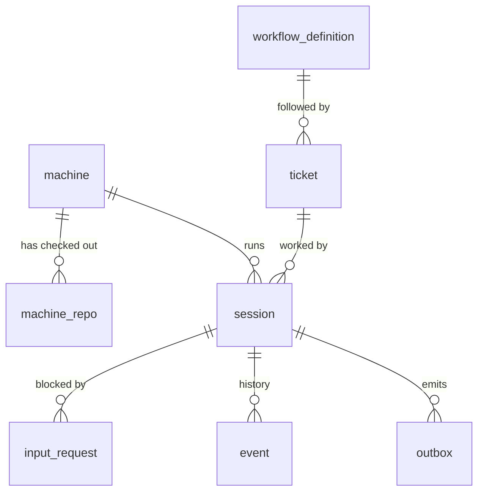

# 02 · Data model

`session` is the hub. It runs on a `machine`, works on a `ticket`, can be blocked by an `input_request`, and has an `event` history. `ticket` follows a `workflow_definition`. `machine_repo` belongs to `machine`.

## Tables

Types are indicative. The exact DDL lives in migrations (M1-T02), and this doc is updated when it diverges. The TypeScript row types are pinned in `packages/orchestrator/src/db/types.ts` (M1-T12, [10](10-contracts.md)); they use node-postgres' default parsing (`bigint`/`numeric` → string, `timestamptz` → Date).

### machine
| column | type | notes |
|---|---|---|
| id | text pk | stable daemon id |
| hostname, os, arch | text | |
| tags | text[] | e.g. `gpu`, `macos`, `build-server` |
| status | enum | `online` · `draining` · `offline` |
| last_heartbeat_at | timestamptz | lease liveness |
| cpu_total, mem_total_mb, disk_free_mb | int | from heartbeat |
| cpu_free, mem_free_mb | int | live usage, reported |
| budget_cpu, budget_mem_mb | int | advertised budget minus the owner reserve ([07](07-multi-session-isolation.md)) |
| max_sessions | int | hard cap |
| max_concurrent_builds | int | daemon build semaphore size |
| created_at, updated_at | timestamptz | |

### machine_repo
| column | type | notes |
|---|---|---|
| machine_id | fk machine | |
| repo | text | canonical remote, e.g. `github.com/org/app` |
| path | text | the **shared clone** (agents never edit it) |
| head_commit | text | |
| tree_clean | bool | describes the shared clone, not the worktrees |
| updated_at | timestamptz | |
| pk | (machine_id, repo) | |

### ticket
| column | type | notes |
|---|---|---|
| id | uuid pk | |
| external_ref | text | e.g. `JIRA-123` ([U-003](../tracking/UNKNOWNS.md)) |
| repo | text | target repo |
| title, body | text | |
| workflow_id, workflow_version | fk | version is null until pinned when the first session starts |
| parent_ticket_id | fk ticket null | child tickets from a plan state |
| required_tags | text[] | hard constraints for the claim |
| repo_allow_machines | text[] null | hard allow-list of machine ids for the claim ([04](04-scheduler.md)); `null` = any machine. Kept, nullable ([U-009](../tracking/UNKNOWNS.md), M1-T12) |
| status | enum | `ready` · `claimed` · `in_progress` · `done` · `failed` · `cancelled` |
| priority | int | |
| created_at, updated_at | timestamptz | the claim orders by `created_at` |

### workflow_definition
| column | type | notes |
|---|---|---|
| id | text | e.g. `pr_flow` |
| version | int | immutable once saved |
| definition | jsonb | see [05](05-workflow-engine.md) |
| created_at, created_by | | |
| pk | (id, version) | |

### session
| column | type | notes |
|---|---|---|
| id | uuid pk | |
| ticket_id | fk | |
| machine_id | fk null | null while parked/released |
| workflow_id, workflow_version | | pinned |
| workflow_state | text null | current FSM state name; null until the first `session.assigned` enters `start` |
| status | enum | `queued` · `assigned` · `running` · `needs_input` · `waiting_external` · `done` · `failed` · `lost` |
| lease_expires_at | timestamptz | renewed by heartbeat |
| fencing_token | bigint | monotonic, bumped on every (re)assignment |
| worktree_path, branch | text | branch is per session: `conductor/<ticket>/<session-short>` |
| claude_session_id | text | for resume |
| retry_counters | jsonb | per-loop counters, e.g. `{"build->implement": 2}` |
| spend_usd, wall_seconds | numeric | against the workflow budget. `spend_usd` grows only by positive deltas (below) |
| claude_spend_totals | jsonb | `{<claude_session_id>: <last cumulative total_usd>}`. Claude's `total_usd` is cumulative per Claude session and survives `--resume` ([ADR-0005](../adr/0005-claude-code-driver.md)), so a `spend` report adds `max(0, total − claude_spend_totals[id])` to `spend_usd` and stores the new total. Replays and duplicates are no-ops (`packages/shared/src/engine/spend.ts`) |
| context | jsonb | state results, e.g. `{"open_pr": {"pr_url": "…"}}` |
| port_range | int4range | allocated by the daemon |
| return_to | text null | state that routed into the current `human` state; the answer returns there ([05](05-workflow-engine.md#needs_input-semantics)) |
| state_visits | jsonb | `{<state>: <times entered>}`; the `visit_n` of connector idempotency keys ([05](05-workflow-engine.md#idempotency)) |
| state_entered_at | timestamptz | when the current state was entered |
| state_deadline | timestamptz null | when the current state's `timeout` fires; read by the timeout sweep (M1-T04) |
| waiting_for_build_slot | bool | card badge, **not** a status ([10](10-contracts.md)); set from session_event `build_slot` |
| created_at, updated_at | | |

### input_request
| column | type | notes |
|---|---|---|
| id | uuid pk | |
| session_id | fk | |
| kind | enum | `agent_question` · `budget_exceeded` · `retries_exhausted` · `timeout` · `approval` |
| question | text | shown as the card badge |
| return_to | text null | copy of `session.return_to` when created |
| answer | text null | |
| answered_by | text null | user id or `slack:<user>` |
| created_at, answered_at | | needs-input column sorts by created_at |

### event (append-only)
| column | type | notes |
|---|---|---|
| id | bigserial pk | also the SSE `Last-Event-ID` |
| session_id | fk null | null for machine-level events |
| type | text | e.g. `state.entered`, `outcome.exit_code`, `input.requested` |
| payload | jsonb | |
| fencing_token | bigint | stale tokens are rejected *before* insert |
| ts | timestamptz | |

Only state changes and summaries go here. **Raw terminal output does not** (see [U-005](../tracking/UNKNOWNS.md)).

### outbox
| column | type | notes |
|---|---|---|
| id | bigserial pk | |
| command_id | uuid unique | the daemon dedupes on this |
| target | text | `machine:<id>` or `connector:<name>` |
| kind | text | `start_session` · `send_input` · `run_cmd` · `kill` · `connector_call` (one engine `Effect` each, [10](10-contracts.md)) |
| session_id | fk session null | |
| payload | jsonb | |
| idempotency_key | text null | connectors: see [05](05-workflow-engine.md#idempotency) |
| status | enum | `pending` · `sent` · `acked` · `failed` |
| attempts, next_attempt_at | | |
| last_error | text null | |
| created_at | timestamptz | |
