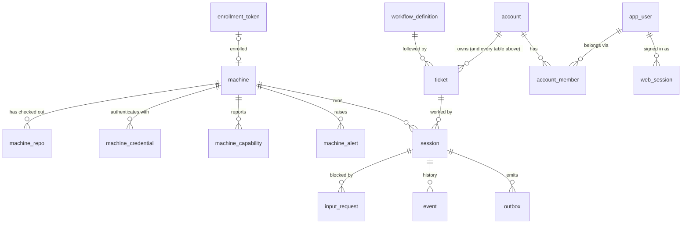

# 02 · Data model

`session` is the hub. It runs on a `machine`, works on a `ticket`, can be blocked by an `input_request`, and has an `event` history. `ticket` follows a `workflow_definition`. `machine_repo` belongs to `machine`. Every one of those rows belongs to an `account` ([ADR-0012](../adr/0012-hosted-multi-user-github-sign-in.md) §Tenancy); people (`app_user`) sign in ([ADR-0017](../adr/0017-own-sign-in-and-self-hosting.md)) and own their account through `account_member`.

## Tables

The exact DDL is `packages/orchestrator/migrations/1761100000000_initial-schema.sql` (M1-T02, plain node-pg-migrate SQL) plus the later migrations in that directory (`1761200000000_machine-claude-code-version.sql`, M1-T07; `1761500000000_ticket-kind.sql`, M1b-T04; `1761600000000_accounts-and-auth.sql`, M2-T03; `1761700000000_machine-credentials.sql`, M2-T09), and this doc is updated when it diverges. `packages/orchestrator/test/schema.test.ts` checks every column's name, pg type and nullability against the row types, and every enum against `shared/src/domain.ts`. Enums are Postgres enum types named `<table>_<column>` (`machine_status`, `ticket_status`, `ticket_kind`, `session_status`, `input_request_kind`, `outbox_kind`, `outbox_status`). Nullability follows the row types exactly (a `| null` field is a nullable column, everything else is `NOT NULL`), including columns this table doesn't mark null (e.g. `lease_expires_at`, `worktree_path`, `port_range`); `jsonb` maps default to `'{}'`, `text[]` to `'{}'`, counters and money to 0, timestamps to `now()`, uuid keys to `gen_random_uuid()`. The TypeScript row types are pinned in `packages/orchestrator/src/db/types.ts` (M1-T12, [10](10-contracts.md)); they use node-postgres' default parsing (`bigint`/`numeric` → string, `timestamptz` → Date, `bytea` → Buffer).

**Tenancy (M2-T03).** Every table carries `account_id uuid NOT NULL REFERENCES account (id)`, except the instance-level tables (`account`, `app_user`, `account_member`, `web_session`, `invite`, `password_reset`, `login_throttle`) and `pgmigrations`. `packages/orchestrator/test/schema-isolation.test.ts` enforces it (ADR-0012 §Proving isolation 1), so a new table either carries the column or joins that allow-list in review. Migration `1761600000000_accounts-and-auth` inserts the `local` account (`LOCAL_ACCOUNT_ID` = `00000000-0000-4000-8000-000000000001`, `packages/shared/src/domain.ts`) and adds `account_id` to the eight M1 tables with a constant `DEFAULT` of that id, which backfills every existing row into `local`. **The default is temporary** (TD-109): it lets M1 code keep inserting without naming an account, and M2-T21 drops it once every write is scoped. The down migration drops the column, the seven tables and the `machine_lost` kind (deleting any such requests), restoring the M1b schema. In the account_id rows below, "account_id (M2-T03)" means: uuid FK `account`, NOT NULL, backfilled to `local`, temporary default TD-109 until M2-T21, indexed (`<table>_account_id_idx`).

### machine
| column | type | notes |
|---|---|---|
| id | text pk | stable daemon id |
| hostname, os, arch | text | |
| tags | text[] | e.g. `gpu`, `macos`, `build-server` |
| status | enum | `online` · `draining` · `offline` |
| last_heartbeat_at | timestamptz | lease liveness |
| cpu_total, mem_total_mb, disk_free_mb | int | from heartbeat |
| cpu_free, mem_free_mb | int | live usage, reported |
| budget_cpu, budget_mem_mb | int | advertised budget minus the owner reserve ([07](07-multi-session-isolation.md)) |
| max_sessions | int | hard cap |
| max_concurrent_builds | int | daemon build semaphore size |
| last_seq | bigint null | highest daemon `seq` processed; the `(machine_id, seq)` dedupe and `registered.last_seq` ([10](10-contracts.md#daemon-seq-dedupe)) |
| claude_code_version | text null | `register.claude_code_version` (`claude --version`), stored on every register so stream-json drift can be tied to a CLI version ([U-015](../tracking/UNKNOWNS.md), [U-032](../tracking/UNKNOWNS.md)). null = the daemon couldn't run the CLI. M1-T07 migration |
| account_id | uuid fk account | M2-T03 (see Tenancy above) |
| name | text null | display name (M2-T09; rename is M2-T17's). Enrollment and the local-mode register set it to the hostname, the migration backfills it; null = show the hostname. Nullable because M1 inserts don't name it |
| daemon_version | text null | `register.daemon_version` (enrollment's first), written on every register |
| protocol_version | int null | `register.protocol_version` (absent = 1); null = never registered |
| revoked_at | timestamptz null | `revokeMachine` (M2-T09): its credentials stop upgrading (401) and `register` is closed 4003 in both modes |
| created_at, updated_at | timestamptz | |

### machine_repo
| column | type | notes |
|---|---|---|
| machine_id | fk machine | |
| repo | text | canonical remote, e.g. `github.com/org/app` |
| path | text | the **shared clone** (agents never edit it) |
| head_commit | text | |
| tree_clean | bool | describes the shared clone, not the worktrees. `DEFAULT true` since M2-T09: the M1 `repo_inventory` handler writes it until M2-T16, M2-T21 drops it |
| updated_at | timestamptz | |
| account_id | uuid fk account | M2-T03 (see Tenancy above) |
| default_branch | text null | M2-T09; from `inventory` (M2-T16) |
| mode | text | `CHECK (mode IN ('reference','checkout'))`, default `reference` (U-060); existing rows become `reference` |
| remote | text null | canonical remote (`CANONICAL_REMOTE_RE`); null = no allowed remote, listed but never routed to. With `inventory` (M2-T16), `path` is the user's checkout |
| pk | (machine_id, repo) | |

### enrollment_token
M2-T09, ADR-0013 §Enrollment. One-time, 30 minutes (`ENROLLMENT_TOKEN_TTL_MS`).
| column | type | notes |
|---|---|---|
| id | uuid pk | |
| account_id | uuid fk account | the account the machine joins (no default) |
| token_hash | bytea unique | SHA-256 of the 128-bit token (32 bytes, checked); the token is shown once, inside the install command |
| created_by | uuid null | audit user id ([U-042](../tracking/UNKNOWNS.md)); no FK because `local` mode's `LOCAL_USER_ID` has no `app_user` row; null = the CLI or conductor |
| created_at, expires_at | timestamptz | |
| used_at | timestamptz null | `enrollMachine` consumes it with `UPDATE … WHERE used_at IS NULL AND expires_at > now() RETURNING`, so two concurrent uses make one machine |
| used_by_machine | fk machine null | |

### machine_credential
M2-T09. Sent as `Authorization: Bearer <credential>` on every daemon WS upgrade.
| column | type | notes |
|---|---|---|
| id | uuid pk | |
| machine_id | fk machine | |
| account_id | uuid fk account | |
| secret_hash | bytea unique | SHA-256 of the 256-bit credential (32 bytes, checked); the credential is returned once by `enrollMachine` |
| created_at | timestamptz | |
| last_used_at | timestamptz null | updated on every authenticated upgrade |
| revoked_at | timestamptz null | set by `revokeMachine` |

### machine_capability
M2-T09 (10-contracts §Machines protocol v2, Storage). One row per element of `capabilityKeys(c)` for each reported capability: an authed cli gives `cli:<name>` **and** `cli:<name>:authed`; a repo-scoped skill or agent's key carries `@<repo>`, so `skill:review` and `skill:review@github.com/o/app` are separate rows. **Routing reads only `key`**; the other columns are for display. Written by the `inventory` ingest (M2-T16), replaced wholesale on each inventory.
| column | type | notes |
|---|---|---|
| machine_id | fk machine | cascades on machine delete |
| account_id | uuid fk account | |
| key | text | `capabilityKey` grammar |
| kind | text | `CHECK` `cli` · `mcp` · `skill` · `agent` · `claude` |
| name | text | (`claude` for the claude kind) |
| version | text null | cli / claude |
| detail | jsonb | display extras (e.g. `authed`, `repo`), default `{}`; never secrets |
| updated_at | timestamptz | |
| pk | (machine_id, key) | |

### machine_alert
M2-T09; written from the daemon's `alert` message (M2-T16).
| column | type | notes |
|---|---|---|
| id | uuid pk | |
| machine_id | fk machine | cascades on machine delete |
| account_id | uuid fk account | |
| session_id | fk session null | the session it was raised after, if any |
| kind | text | `CHECK (kind IN ('git_tamper'))` (`MachineAlertKind`) |
| detail | jsonb | `git_tamper`: `{repo, files}` |
| created_at | timestamptz | |
| cleared_at | timestamptz null | set by the owner (`POST /api/machines/alerts/:id/clear`) |

The migration's down drops these four tables and the new `machine` / `machine_repo` columns (and `tree_clean`'s default), restoring the M2-T03 schema; enrollments, credentials, capabilities and alerts are lost.

### ticket
| column | type | notes |
|---|---|---|
| id | uuid pk | |
| external_ref | text | e.g. `JIRA-123` ([U-003](../tracking/UNKNOWNS.md)) |
| repo | text | target repo |
| title, body | text | |
| workflow_id, workflow_version | fk | version is null until pinned when the first session starts. One composite FK to `workflow_definition (id, version)`, MATCH SIMPLE: checked only once the version is set |
| parent_ticket_id | fk ticket null | child tickets from a plan state |
| required_tags | text[] | hard constraints for the claim |
| repo_allow_machines | text[] null | hard allow-list of machine ids for the claim ([04](04-scheduler.md)); `null` = any machine. Kept, nullable ([U-009](../tracking/UNKNOWNS.md), M1-T12) |
| status | enum | `ready` · `claimed` · `in_progress` · `done` · `failed` · `cancelled` |
| priority | int | |
| kind | enum `ticket_kind` null | `work` · `personal` ([ADR-0011](../adr/0011-transition-rules.md)): filters transitions (`kinds`). NULL for tickets created before M1b, matching both kinds ([U-062](../tracking/UNKNOWNS.md)); new tickets must set it (create form until triage, M4). Added by migration `1761500000000_ticket-kind` (M1b-T04; existing rows keep NULL, the down migration drops the column and the type). `POST /api/tickets` returns it in `TicketDto.kind` and every card carries it (`BoardCard.kind`) |
| account_id | uuid fk account | M2-T03 (see Tenancy above) |
| created_at, updated_at | timestamptz | the claim orders by `created_at` |

### workflow_definition
| column | type | notes |
|---|---|---|
| id | text | e.g. `pr_flow` |
| version | int | immutable once saved |
| definition | jsonb | see [05](05-workflow-engine.md) |
| | | [ADR-0010](../adr/0010-one-workflow-columns-are-states.md): the orchestrator seeds `conductor` v1 (`docs/design/workflows/conductor.v1.json`, a copy in `packages/shared/src/workflow/conductor.ts`) on startup when no `conductor` version exists (one guarded INSERT, `ON CONFLICT DO NOTHING`: idempotent, safe on concurrent starts). Older workflows (`m1_*`) stay so their tickets still render |
| account_id | uuid fk account | M2-T03 (see Tenancy above). The primary key stays `(id, version)` here; M2-T12 makes it `(account_id, id, version)` |
| created_at, created_by | | |
| pk | (id, version) | |

### session
| column | type | notes |
|---|---|---|
| id | uuid pk | |
| ticket_id | fk | |
| machine_id | fk null | null while parked/released |
| workflow_id, workflow_version | | pinned |
| workflow_state | text null | current FSM state name; null until the first `session.assigned` enters `start`. During a gate step the synthetic label `<from> → <to> (review)` ([ADR-0009](../adr/0009-transition-requirements-review.md) transition review) or `<from> → <to> (entry)` ([ADR-0010](../adr/0010-one-workflow-columns-are-states.md) requirements to enter a column), which names no state |
| status | enum | `queued` · `assigned` · `running` · `needs_input` · `waiting_external` · `done` · `failed` · `lost` |
| lease_expires_at | timestamptz | renewed by heartbeat |
| fencing_token | bigint | default `nextval('fencing_seq')`: bumped on every claim / requeue, **and** by the EngineService wrapper on a non-ignored `start_session` `command.refused` (incl. `ack_timeout`), so a process that command spawned anyway is stale ([10](10-contracts.md#refusals)) |
| worktree_path, branch | text | branch is per session: `sessionBranch(ticket, session)` = `conductor/<ticket_id>/<first 8 of session_id>`, set by the claim. `worktree_path` (and `branch` again) from `session_event started` |
| claude_session_id | text | for resume. Always the worker's conversation: a requirements reviewer's id is kept in the review step, never here ([ADR-0009](../adr/0009-transition-requirements-review.md)) |
| agent_command_id | uuid null | `command_id` of the current `start_session`; `started` / `exit` with another id are ignored ([10](10-contracts.md#agent-process-correlation)) |
| agent_process_live | bool | a live Claude process exists for `agent_command_id`; false → an answer resumes via `start_session` instead of `send_input` |
| pending_answer | jsonb null | `{input_request_id, answer}`: set by apply on `input.provided`, used as the prompt of any resume `start_session`, cleared once the agent runs on it ([10](10-contracts.md#pending-answer)). A reopened session ([ADR-0008](../adr/0008-transcript-history-and-reopen.md)) is created with `{input_request_id: null, answer: <the human's text>}` |
| retry_counters | jsonb | per-loop counters, e.g. `{"build->implement": 2}`; a requirements gate's unmet loop counts under `"requirements:<from>:<outcome>"` |
| spend_usd, wall_seconds | numeric | against the workflow budget. `spend_usd` grows only by positive deltas (below). `wall_seconds` is maintained by apply: on each transition it adds `now − state_entered_at`, except for `human`/`event` states ([10](10-contracts.md#wall-time)) |
| claude_spend_totals | jsonb | `{<claude_session_id>: <last cumulative total_usd>}`. Claude's `total_usd` is cumulative per Claude session and survives `--resume` ([ADR-0005](../adr/0005-claude-code-driver.md)), so a `spend` report adds `max(0, total − claude_spend_totals[id])` to `spend_usd` and stores the new total. Replays and duplicates are no-ops (`packages/shared/src/engine/spend.ts`) |
| context | jsonb | state results, e.g. `{"open_pr": {"pr_url": "…"}}`, plus each review's last verdict under its label (`{"implement → build (review)": {"verdict": […]}}`). The PR conductor opened is recorded only under the reserved key `__pr` (`{"__pr": {"pr_url": "https://github.com/o/r/pull/7", "state": "waiting_external"}}`), written by the engine from open_pr's result and shown on the card; a `pr_url` in an agent's result is ignored ([ADR-0010](../adr/0010-one-workflow-columns-are-states.md)). Also holds the in-progress gate step under the reserved key `__entry` (below) |
| port_range | int4range | allocated by the daemon; `[base, base+count)` from `session_event started` |
| return_to | text null | state that routed into the current `human` state; the answer returns there ([05](05-workflow-engine.md#needs_input-semantics)) |
| state_visits | jsonb | `{<state>: <times entered>}`; the `visit_n` of connector idempotency keys ([05](05-workflow-engine.md#idempotency)) |
| state_entered_at | timestamptz | when the current state was entered |
| state_deadline | timestamptz null | when the current state's `timeout` fires; read by the timeout sweep (M1-T04) |
| waiting_for_build_slot | bool | card badge, **not** a status ([10](10-contracts.md)); set from session_event `build_slot` |
| account_id | uuid fk account | M2-T03 (see Tenancy above) |
| created_at, updated_at | | |

**Reopen (ADR-0008, no migration).** `POST /api/sessions/:id/reopen` inserts a new `queued` session for the ticket that copies the old one's `workflow_id`/`workflow_version`, `branch`, `claude_session_id`, `context` and `claude_spend_totals` (Claude's cost is cumulative across `--resume`, so only new spend is added), sets `pending_answer` to the human's text, and leaves everything else at its default (`retry_counters`, `state_visits`, `spend_usd`, `wall_seconds`, `worktree_path`…). Two sessions of one ticket then share a `branch`; the claim uses that to pin the new one to the old one's machine ([04](04-scheduler.md#2--claim-query-ticket-side)). The human's text is kept durably in an `operator.reopen` event row on the new session (`{text, reopened_from, actor}`). The gate step (`__entry`, or a legacy `__review`, below) is never carried.

**Gate step (ADR-0009, ADR-0010, no migration).** While a gate step runs (an ADR-0009 transition review, or the ADR-0010 requirements to enter a column), the snapshot's `step` field (`GateStepSchema` in `packages/shared/src/engine/types.ts`: `{kind: 'transition'|'entry', from, outcome, to, attachment, subject, claude_session_id, nudged, phase: 'checks'|'review'|'actions', index, head_sha}`) is stored inside `context` under the reserved key `__entry` (`STEP_CONTEXT_KEY`). Rows written before ADR-0010 have it under `__review` (`REVIEW_CONTEXT_KEY`); it is still read (as `kind: 'transition'`, `phase: 'review'`) and rewritten under `__entry`. Neither name, nor `__pr`, may be a state (validator rule 8). `toSnapshot` lifts it out and `writeSession` puts it back (`orchestrator/src/engine/rows.ts`). `GET /api/sessions/:id` leaves it out of `context`. Status stays `running` (no new `session_status` value) and the unmet / failed review questions use the existing `retries_exhausted` and `timeout` `input_request_kind`s, so neither enum changes.

Constraints: `CREATE SEQUENCE fencing_seq` (bigint) is the only source of fencing tokens, global across sessions. `CREATE UNIQUE INDEX session_one_live_per_ticket ON session (ticket_id) WHERE status NOT IN ('done', 'failed', 'lost')` enforces one live session per ticket (the claim re-uses a `queued` one, [10](10-contracts.md#claim)).

### input_request
| column | type | notes |
|---|---|---|
| id | uuid pk | |
| session_id | fk | |
| kind | enum | `agent_question` · `budget_exceeded` · `retries_exhausted` · `timeout` · `approval` · `machine_lost` (`MACHINE_LOST_KIND`: the session's machine was lost or revoked, [10](10-contracts.md#machines-protocol-v2); added by M2-T03) |
| question | text | shown as the card badge |
| return_to | text null | copy of `session.return_to` when created |
| answer | text null | |
| answered_by | text null | user id or `slack:<user>` |
| account_id | uuid fk account | M2-T03 (see Tenancy above) |
| created_at, answered_at | | needs-input column sorts by created_at |

### event (append-only)
| column | type | notes |
|---|---|---|
| id | bigserial pk | also the SSE `Last-Event-ID`. Board rows are inserted only via `insertBoardEvents` under `pg_advisory_xact_lock`, so they commit in id order ([10](10-contracts.md#board-events-and-the-event-table)) |
| session_id | fk null | null for machine-level events |
| type | text | an `EngineEvent.type` (e.g. `agent.exited`), `state.entered`, `operator.reopen` (ADR-0008, written by the reopen route, not an engine event), or a board SSE type (`card.upserted`, `card.moved`, `session.status`, `input.requested`, `input.answered`, `card.badge`: one row per SSE event, [10](10-contracts.md#board-events-and-the-event-table)) |
| payload | jsonb | |
| fencing_token | bigint null | stale tokens are rejected *before* insert; null on board-event rows |
| account_id | uuid fk account | M2-T03 (see Tenancy above) |
| ts | timestamptz | |

Only state changes and summaries go here. **Raw terminal output does not** (see [U-005](../tracking/UNKNOWNS.md)).

### outbox
| column | type | notes |
|---|---|---|
| id | bigserial pk | |
| command_id | uuid unique | the daemon dedupes on this |
| target | text | `machine:<id>` or `connector:<name>` |
| kind | enum | `start_session` · `send_input` · `send_message` · `run_cmd` · `run_action` · `kill` · `connector_call` (one engine `Effect` each, [10](10-contracts.md)). `send_message` was added by migration `1761300000000_outbox-send-message` ([ADR-0007](../adr/0007-live-messages-to-agents.md)), `run_action` (an entry action such as `open_pr`) by `1761400000000_outbox-run-action` ([ADR-0010](../adr/0010-one-workflow-columns-are-states.md)) |
| session_id | fk session null | |
| payload | jsonb | the WS command payload verbatim (`commandPayloadForEffect`). Once a `start_session` row is terminal (`acked`/`failed`) its `prompt` is set to JSON `null` in the same guarded UPDATE, other fields kept: the prompt can carry the `attach: output` command tail ([U-039](../tracking/UNKNOWNS.md)). A terminal `send_message` row gets the same treatment for its `text` (the message's record is its `operator.message` event row; [ADR-0007](../adr/0007-live-messages-to-agents.md)) |
| idempotency_key | text null | connectors and `run_action` rows: `<session_id>:<state>:<visit>`, see [05](05-workflow-engine.md#idempotency) |
| fencing_token | bigint null | `session.fencing_token` when the row was written; the WS envelope's token. A row below the session's current token is failed `stale_fencing_token`, not sent. null for `connector:` rows ([10](10-contracts.md#effect--ws-fields)) |
| status | enum | `pending` · `sent` · `acked` · `failed` ([10](10-contracts.md#outbox-state-machine): dispatcher writes `sent`, gateway writes `acked`/`failed`, all guarded) |
| attempts, next_attempt_at | | |
| account_id | uuid fk account | M2-T03 (see Tenancy above) |
| last_error | text null | |
| created_at | timestamptz | |

### account
Instance-level (not on the isolation check). ADR-0012 §Tenancy.
| column | type | notes |
|---|---|---|
| id | uuid pk | `LOCAL_ACCOUNT_ID` is the `local` account, inserted by the migration: every pre-M2 row, `local` mode, and the bootstrap admin's claim (U-056) |
| name | text | a personal account is named after its owner's `display_name` |
| created_at | timestamptz | |

**account_member**: `account_id` fk account, `user_id` fk app_user, `role` text `CHECK (role IN ('owner','member'))`, `created_at`; pk `(account_id, user_id)`, index on `user_id`. Personal accounts only in M2 (U-051): each user owns exactly one account and nobody else is a member.

### app_user
Instance-level. ADR-0017 §Auth. `local` mode's `LOCAL_USER_ID` is virtual: no row.
| column | type | notes |
|---|---|---|
| id | uuid pk | |
| email | text | as entered; unique on `lower(email)` (`app_user_email_key`). Plain `text`, no citext extension |
| display_name | text | |
| password_hash | text | PHC string `$argon2id$v=19$m=…,t=…,p=…$salt$hash`, so its parameters travel with it |
| is_admin | bool | instance role, default false; an admin still sees only their own account's data |
| disabled_at | timestamptz null | |
| password_changed_at | timestamptz | default `now()` |
| created_at | timestamptz | |

### web_session
Instance-level. One signed-in browser.
| column | type | notes |
|---|---|---|
| id_hash | bytea pk | SHA-256 of the cookie's 32 random bytes (`CHECK octet_length = 32`); the cookie value is never stored |
| user_id | fk app_user | |
| account_id | fk account | the account the session acts in |
| created_at, last_seen_at | timestamptz | `last_seen_at` is updated at most every 5 minutes; 7 days idle ends it |
| expires_at | timestamptz | 30 days absolute |
| user_agent, ip | text null | shown in the account menu; `ip` is text (the trusted client IP, ADR-0017 §Rate limiting) |

### invite
Instance-level. One-time sign-up link.
| column | type | notes |
|---|---|---|
| id | uuid pk | |
| token_hash | bytea unique | SHA-256 of the 256-bit token (32 bytes, checked) |
| created_by | fk app_user null | null = the CLI (`conductor-admin`) |
| email | text null | set → sign-up must use this email |
| is_admin | bool | the new user is an admin |
| claims_account | fk account null | only bootstrap sets it (`LOCAL_ACCOUNT_ID`): sign-up claims that account instead of creating one |
| created_at, expires_at | timestamptz | default 7 days, max 30 |
| used_at, used_by | null | `used_by` fk app_user |
| revoked_at | timestamptz null | |

### password_reset
Instance-level. One-time, 1 hour.
| column | type | notes |
|---|---|---|
| id | uuid pk | |
| token_hash | bytea unique | SHA-256 of the token (32 bytes, checked) |
| user_id | fk app_user | |
| created_by | fk app_user null | the admin, or null for the CLI |
| created_at, expires_at | timestamptz | |
| used_at | timestamptz null | a used reset revokes all of the user's sessions |

### login_throttle
Instance-level. ADR-0017 §Rate limiting, layer 3: keyed by the normalised email **string**, whether or not a user has it, so a lockout reveals nothing.
| column | type | notes |
|---|---|---|
| email_norm | text pk | |
| failures | int | consecutive failures, default 0; 10 lock the email; a success resets the row |
| lockouts | int | lockouts so far, default 0: the lock lasts 15 min × 2^(lockouts − 1), capped at 24 h. Not in ADR-0017's sketch; the doubling needs it |
| locked_until | timestamptz null | `conductor-admin unlock` clears it |
| updated_at | timestamptz | |

## Indexes

Besides primary keys and `outbox.command_id UNIQUE`: `ticket (status, priority)`, `session (status)`, `session_one_live_per_ticket` ([session](#session)), `session (ticket_id, created_at DESC)` (the claim's affinity lookup, [04](04-scheduler.md)), `input_request (session_id) WHERE answer IS NULL`, `event (session_id, id)`, and `outbox (next_attempt_at) WHERE status = 'pending'` (the dispatcher's scan). M2-T03: `<table>_account_id_idx` on `account_id` for each of the eight M1 tables, except `event (account_id, id)` (the per-account SSE replay); `app_user (lower(email))` unique; `web_session (user_id)` and `(expires_at)`; `account_member (user_id)`; `invite.token_hash` and `password_reset.token_hash` unique. M2-T09: `<table>_account_id_idx` on each of its four tables; `enrollment_token.token_hash` and `machine_credential.secret_hash` unique; `machine_credential (machine_id)`; `machine_alert (machine_id) WHERE cleared_at IS NULL` (`machine_alert_open_idx`). `machine_repo.machine_id`, `machine_capability.machine_id` and `machine_alert.machine_id` cascade on machine delete; every other FK is plain (no cascade).
