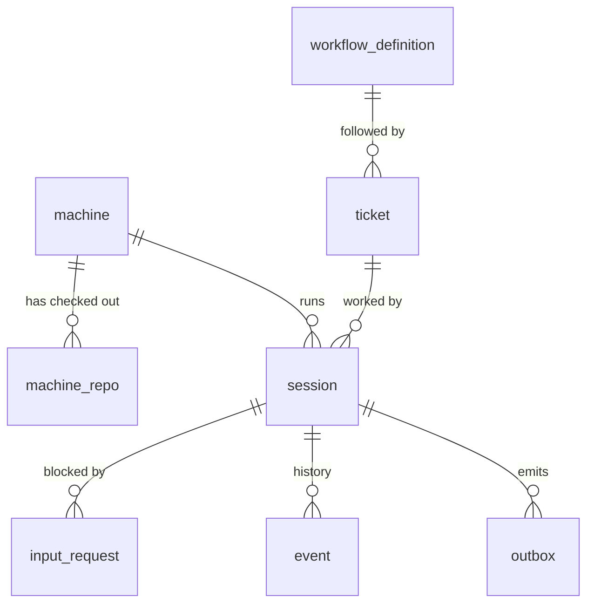

# 02 · Data model

`session` is the hub. It runs on a `machine`, works on a `ticket`, can be blocked by an `input_request`, and has an `event` history. `ticket` follows a `workflow_definition`. `machine_repo` belongs to `machine`.

## Tables

The exact DDL is `packages/orchestrator/migrations/1761100000000_initial-schema.sql` (M1-T02, plain node-pg-migrate SQL) plus the later migrations in that directory (`1761200000000_machine-claude-code-version.sql`, M1-T07), and this doc is updated when it diverges. `packages/orchestrator/test/schema.test.ts` checks every column's name, pg type and nullability against the row types, and every enum against `shared/src/domain.ts`. Enums are Postgres enum types named `<table>_<column>` (`machine_status`, `ticket_status`, `session_status`, `input_request_kind`, `outbox_kind`, `outbox_status`). Nullability follows the row types exactly (a `| null` field is a nullable column, everything else is `NOT NULL`), including columns this table doesn't mark null (e.g. `lease_expires_at`, `worktree_path`, `port_range`); `jsonb` maps default to `'{}'`, `text[]` to `'{}'`, counters and money to 0, timestamps to `now()`, uuid keys to `gen_random_uuid()`. The TypeScript row types are pinned in `packages/orchestrator/src/db/types.ts` (M1-T12, [10](10-contracts.md)); they use node-postgres' default parsing (`bigint`/`numeric` → string, `timestamptz` → Date).

### machine
| column | type | notes |
|---|---|---|
| id | text pk | stable daemon id |
| hostname, os, arch | text | |
| tags | text[] | e.g. `gpu`, `macos`, `build-server` |
| status | enum | `online` · `draining` · `offline` |
| last_heartbeat_at | timestamptz | lease liveness |
| cpu_total, mem_total_mb, disk_free_mb | int | from heartbeat |
| cpu_free, mem_free_mb | int | live usage, reported |
| budget_cpu, budget_mem_mb | int | advertised budget minus the owner reserve ([07](07-multi-session-isolation.md)) |
| max_sessions | int | hard cap |
| max_concurrent_builds | int | daemon build semaphore size |
| last_seq | bigint null | highest daemon `seq` processed; the `(machine_id, seq)` dedupe and `registered.last_seq` ([10](10-contracts.md#daemon-seq-dedupe)) |
| claude_code_version | text null | `register.claude_code_version` (`claude --version`), stored on every register so stream-json drift can be tied to a CLI version ([U-015](../tracking/UNKNOWNS.md), [U-032](../tracking/UNKNOWNS.md)). null = the daemon couldn't run the CLI. M1-T07 migration |
| created_at, updated_at | timestamptz | |

### machine_repo
| column | type | notes |
|---|---|---|
| machine_id | fk machine | |
| repo | text | canonical remote, e.g. `github.com/org/app` |
| path | text | the **shared clone** (agents never edit it) |
| head_commit | text | |
| tree_clean | bool | describes the shared clone, not the worktrees |
| updated_at | timestamptz | |
| pk | (machine_id, repo) | |

### ticket
| column | type | notes |
|---|---|---|
| id | uuid pk | |
| external_ref | text | e.g. `JIRA-123` ([U-003](../tracking/UNKNOWNS.md)) |
| repo | text | target repo |
| title, body | text | |
| workflow_id, workflow_version | fk | version is null until pinned when the first session starts. One composite FK to `workflow_definition (id, version)`, MATCH SIMPLE: checked only once the version is set |
| parent_ticket_id | fk ticket null | child tickets from a plan state |
| required_tags | text[] | hard constraints for the claim |
| repo_allow_machines | text[] null | hard allow-list of machine ids for the claim ([04](04-scheduler.md)); `null` = any machine. Kept, nullable ([U-009](../tracking/UNKNOWNS.md), M1-T12) |
| status | enum | `ready` · `claimed` · `in_progress` · `done` · `failed` · `cancelled` |
| priority | int | |
| created_at, updated_at | timestamptz | the claim orders by `created_at` |

### workflow_definition
| column | type | notes |
|---|---|---|
| id | text | e.g. `pr_flow` |
| version | int | immutable once saved |
| definition | jsonb | see [05](05-workflow-engine.md) |
| created_at, created_by | | |
| pk | (id, version) | |

### session
| column | type | notes |
|---|---|---|
| id | uuid pk | |
| ticket_id | fk | |
| machine_id | fk null | null while parked/released |
| workflow_id, workflow_version | | pinned |
| workflow_state | text null | current FSM state name; null until the first `session.assigned` enters `start` |
| status | enum | `queued` · `assigned` · `running` · `needs_input` · `waiting_external` · `done` · `failed` · `lost` |
| lease_expires_at | timestamptz | renewed by heartbeat |
| fencing_token | bigint | default `nextval('fencing_seq')`: bumped on every claim / requeue, **and** by the EngineService wrapper on a non-ignored `start_session` `command.refused` (incl. `ack_timeout`), so a process that command spawned anyway is stale ([10](10-contracts.md#refusals)) |
| worktree_path, branch | text | branch is per session: `sessionBranch(ticket, session)` = `conductor/<ticket_id>/<first 8 of session_id>`, set by the claim. `worktree_path` (and `branch` again) from `session_event started` |
| claude_session_id | text | for resume |
| agent_command_id | uuid null | `command_id` of the current `start_session`; `started` / `exit` with another id are ignored ([10](10-contracts.md#agent-process-correlation)) |
| agent_process_live | bool | a live Claude process exists for `agent_command_id`; false → an answer resumes via `start_session` instead of `send_input` |
| pending_answer | jsonb null | `{input_request_id, answer}`: set by apply on `input.provided`, used as the prompt of any resume `start_session`, cleared once the agent runs on it ([10](10-contracts.md#pending-answer)) |
| retry_counters | jsonb | per-loop counters, e.g. `{"build->implement": 2}` |
| spend_usd, wall_seconds | numeric | against the workflow budget. `spend_usd` grows only by positive deltas (below). `wall_seconds` is maintained by apply: on each transition it adds `now − state_entered_at`, except for `human`/`event` states ([10](10-contracts.md#wall-time)) |
| claude_spend_totals | jsonb | `{<claude_session_id>: <last cumulative total_usd>}`. Claude's `total_usd` is cumulative per Claude session and survives `--resume` ([ADR-0005](../adr/0005-claude-code-driver.md)), so a `spend` report adds `max(0, total − claude_spend_totals[id])` to `spend_usd` and stores the new total. Replays and duplicates are no-ops (`packages/shared/src/engine/spend.ts`) |
| context | jsonb | state results, e.g. `{"open_pr": {"pr_url": "…"}}` |
| port_range | int4range | allocated by the daemon; `[base, base+count)` from `session_event started` |
| return_to | text null | state that routed into the current `human` state; the answer returns there ([05](05-workflow-engine.md#needs_input-semantics)) |
| state_visits | jsonb | `{<state>: <times entered>}`; the `visit_n` of connector idempotency keys ([05](05-workflow-engine.md#idempotency)) |
| state_entered_at | timestamptz | when the current state was entered |
| state_deadline | timestamptz null | when the current state's `timeout` fires; read by the timeout sweep (M1-T04) |
| waiting_for_build_slot | bool | card badge, **not** a status ([10](10-contracts.md)); set from session_event `build_slot` |
| created_at, updated_at | | |

Constraints: `CREATE SEQUENCE fencing_seq` (bigint) is the only source of fencing tokens, global across sessions. `CREATE UNIQUE INDEX session_one_live_per_ticket ON session (ticket_id) WHERE status NOT IN ('done', 'failed', 'lost')` enforces one live session per ticket (the claim re-uses a `queued` one, [10](10-contracts.md#claim)).

### input_request
| column | type | notes |
|---|---|---|
| id | uuid pk | |
| session_id | fk | |
| kind | enum | `agent_question` · `budget_exceeded` · `retries_exhausted` · `timeout` · `approval` |
| question | text | shown as the card badge |
| return_to | text null | copy of `session.return_to` when created |
| answer | text null | |
| answered_by | text null | user id or `slack:<user>` |
| created_at, answered_at | | needs-input column sorts by created_at |

### event (append-only)
| column | type | notes |
|---|---|---|
| id | bigserial pk | also the SSE `Last-Event-ID`. Board rows are inserted only via `insertBoardEvents` under `pg_advisory_xact_lock`, so they commit in id order ([10](10-contracts.md#board-events-and-the-event-table)) |
| session_id | fk null | null for machine-level events |
| type | text | an `EngineEvent.type` (e.g. `agent.exited`), `state.entered`, or a board SSE type (`card.upserted`, `card.moved`, `session.status`, `input.requested`, `input.answered`, `card.badge`: one row per SSE event, [10](10-contracts.md#board-events-and-the-event-table)) |
| payload | jsonb | |
| fencing_token | bigint null | stale tokens are rejected *before* insert; null on board-event rows |
| ts | timestamptz | |

Only state changes and summaries go here. **Raw terminal output does not** (see [U-005](../tracking/UNKNOWNS.md)).

### outbox
| column | type | notes |
|---|---|---|
| id | bigserial pk | |
| command_id | uuid unique | the daemon dedupes on this |
| target | text | `machine:<id>` or `connector:<name>` |
| kind | enum | `start_session` · `send_input` · `run_cmd` · `kill` · `connector_call` (one engine `Effect` each, [10](10-contracts.md)) |
| session_id | fk session null | |
| payload | jsonb | the WS command payload verbatim (`commandPayloadForEffect`). Once a `start_session` row is terminal (`acked`/`failed`) its `prompt` is set to JSON `null` in the same guarded UPDATE, other fields kept: the prompt can carry the `attach: output` command tail ([U-039](../tracking/UNKNOWNS.md)) |
| idempotency_key | text null | connectors: see [05](05-workflow-engine.md#idempotency) |
| fencing_token | bigint null | `session.fencing_token` when the row was written; the WS envelope's token. A row below the session's current token is failed `stale_fencing_token`, not sent. null for `connector:` rows ([10](10-contracts.md#effect--ws-fields)) |
| status | enum | `pending` · `sent` · `acked` · `failed` ([10](10-contracts.md#outbox-state-machine): dispatcher writes `sent`, gateway writes `acked`/`failed`, all guarded) |
| attempts, next_attempt_at | | |
| last_error | text null | |
| created_at | timestamptz | |

## Indexes

Besides primary keys and `outbox.command_id UNIQUE`: `ticket (status, priority)`, `session (status)`, `session_one_live_per_ticket` ([session](#session)), `session (ticket_id, created_at DESC)` (the claim's affinity lookup, [04](04-scheduler.md)), `input_request (session_id) WHERE answer IS NULL`, `event (session_id, id)`, and `outbox (next_attempt_at) WHERE status = 'pending'` (the dispatcher's scan). `machine_repo.machine_id` cascades on machine delete; every other FK is plain (no cascade).
