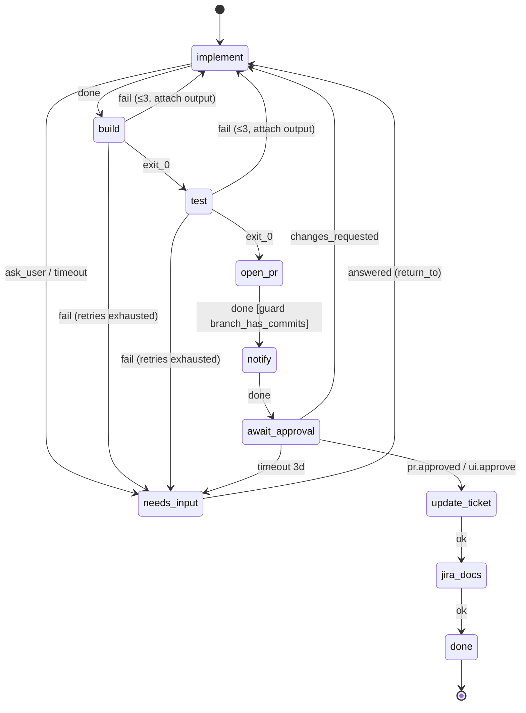

# 05 · Workflow engine

Users design an FSM, stored as **versioned JSON** in `workflow_definition`. The engine is a **pure function** `apply(sessionState, event) → (nextSessionState, effects[])`. A thin transactional shell persists the result through the outbox.

## Definition schema

```jsonc
{
  "id": "pr_flow",
  "version": 1,
  "start": "implement",
  "budget": { "usd": 5, "minutes": 120, "max_loop_retries": 3 },
  "on_budget_exceeded": "needs_input",
  "states": {
    "<name>": {
      "type": "agent | command | event | connector | human | terminal",
      // type-specific config (below)
      "guard": "<guard name>",           // optional, checked before leaving on success
      "timeout": "30m",                   // optional; fires the "timeout" outcome
      "on": { "<outcome>": "<state>" | { "goto": "<state>", "attach": "output", "retries": 3, "else": "<state>" } }
    }
  }
}
```

### State types
| type | Executed by | Config | Outcomes |
|---|---|---|---|
| `agent` | daemon → Claude Code | `prompt` template **or** `skill`, `tools` allow-list, `input` (refs like `$open_pr.pr_url`), `result` keys expected | `done` (via `complete_state`), `ask_user`, `timeout` |
| `command` | daemon, no model | `cmd`, optional `cwd`, `timeout`. Runs through the build semaphore ([07](07-multi-session-isolation.md)) | `exit_0`, `fail` |
| `event` | orchestrator, waits | `wait_for: [event names]`, `park`, `release_machine`, `timeout` | each event name, `timeout` |
| `connector` | orchestrator | `action` / `actions[]`, `args`, `idempotency` | `ok`, `error` |
| `human` | user via UI/Slack | — | `answered` (returns to the state the session came from, unless the answer selects a target) |
| `terminal` | — | — | — |

### Outcomes, not opinions
- Command states transition on **exit code**.
- Agent states transition when the agent calls the structured **`complete_state`** tool with a `result`. The orchestrator then checks the state's `guard` (e.g. `branch_has_commits`) before it moves on. A failed guard is treated as the `fail` outcome of that state, or `needs_input` if none exists.
- The engine never interprets the model's free text.

### Retry loops
`{ "goto": "implement", "attach": "output", "retries": 3, "else": "needs_input" }` means: on `fail`, go back to `implement` with the command output attached to the prompt. The counter key is `"<from>-><goto>"` in `session.retry_counters`. Once the counter reaches `retries`, take `else`. `budget.max_loop_retries` is the default cap when a loop doesn't set one.

### `needs_input` semantics
`needs_input` is a `human` state. On entry the engine writes an `input_request` with `kind` set to the reason (`agent_question`, `retries_exhausted`, `budget_exceeded`, `timeout`) and remembers `return_to` (the state that sent it there). When the answer arrives, the engine returns to `return_to` with the answer attached. The UI can also offer "abort" (→ `failed`) or "skip to <state>".

### Ticket breakdown (planning)
A `triage` agent state returns `{size: "small"|"large"}`. A guard routes large tickets to a `plan` state. That state returns `child_tickets[]`, which the orchestrator creates (each `ready`, with `parent_ticket_id`), and then the parent waits on an `event` state `children.done`. Not in `pr_flow`; see [U-010](../tracking/UNKNOWNS.md).

## Execution (event-sourced, outbox)

```
on event E for session S (fencing token checked):
  BEGIN
    S0 := SELECT … FOR UPDATE
    (S1, effects) := apply(S0, E)          -- pure, unit-tested exhaustively
    INSERT event(E); UPDATE session := S1
    INSERT outbox(effects…)                -- commands carry command_id (+ idempotency_key)
  COMMIT
dispatcher: SELECT pending outbox rows FOR UPDATE SKIP LOCKED → send → mark sent / acked
```

- Exactly-once state changes, at-least-once command delivery. The daemon dedupes on `command_id`.
- Crash between commit and send: a restarted orchestrator replays pending outbox rows.

## Versioning
- A session is **pinned** to `(workflow_id, version)` when it starts. Editing a workflow saves a new version and never changes a running session.
- An explicit **migrate** action moves a session to a new version, provided its current state exists there.

## Validation on save (M1-T03)
1. JSON schema valid; `start` exists; every `on` target exists.
2. Every state is reachable from `start`.
3. Every state can reach a `terminal` or `human` state.
4. Every cycle passes through a transition with `retries`, or is otherwise covered by `max_loop_retries` (no unbudgeted loops).
5. `$ref` inputs (`$open_pr.pr_url`) point at a state that lists that key in `result` and comes earlier on every path.
6. `event` states with `release_machine` must have a `timeout`.
7. Every name in an agent state's `tools` is a key of `TOOL_ALIASES` (`TOOL_ALIAS_NAMES`, [10](10-contracts.md#tools)); an unknown alias is an error.

A `guard` name is not checked in M1: the guard registry is empty and an unregistered guard passes at runtime (TD-017, [10](10-contracts.md#guards)). Once guards are registered, an unregistered name becomes an error.

## Idempotency

Connector calls carry `idempotency_key = "<session_id>:<state>:<visit_n>"`. `visit_n` is the number of times the session has *entered* that state. A retry of the same visit dedupes; a deliberate re-entry (after `changes_requested` → … → `update_ticket` again) is a new visit.
- **Ticket set_status / Azure update_build**: these are naturally idempotent (setting a value), and the key is also stored in the connector's dedupe table.
- **Jira create_task**: *not* naturally idempotent. Before creating, search for an existing issue labelled `conductor-idem:<key>`, and create it with that label.
- **Slack post (agent skill)**: can't be deduped, so **an occasional duplicate is accepted** and documented.

## Reference workflow
[workflows/pr_flow.v1.json](workflows/pr_flow.v1.json) is the workshop's 8-state chain:


