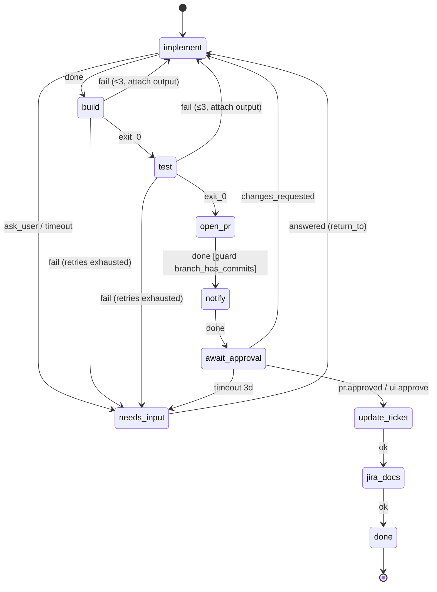

# 05 · Workflow engine

Users design an FSM, stored as **versioned JSON** in `workflow_definition`. The engine is a **pure function** `apply(sessionState, event) → (nextSessionState, effects[])`. A thin transactional shell persists the result through the outbox.

## Definition schema

```jsonc
{
  "id": "pr_flow",
  "version": 1,
  "start": "implement",
  "budget": { "usd": 5, "minutes": 120, "max_loop_retries": 3 },
  "on_budget_exceeded": "needs_input",
  "states": {
    "<name>": {
      "type": "agent | command | event | connector | human | terminal",
      // type-specific config (below)
      "guard": "<guard name>",           // optional, checked before leaving on success
      "timeout": "30m",                   // optional; fires the "timeout" outcome
      "on": { "<transition name>": "<state>" | { "goto": "<state>", "attach": "output", "retries": 3, "else": "<state>", /* ADR-0011 fields below */ } }
    }
  }
}
```

### Transition object ([ADR-0011](../adr/0011-transition-rules.md))
Each key of `on` is a **transition name**; the value is a state name (shorthand for `{goto}`) or an object. Old definitions parse unchanged. Schema: `TransitionObjectSchema` in `shared/src/workflow/schema.ts`; contract index: [10 §Transitions](10-contracts.md#transitions-adr-0011).

```jsonc
"ready_for_testing": {
  "goto": "waiting_external",          // a state, or "$return_to" (RETURN_TO) on a human-state transition
  "title": "Ready for testing",        // button / timeline label; default: the name humanised
  "when": "The work is complete …",    // ≤ 1 000 chars; listed in the agent's prompt
  "actor": "agent",                    // agent | human | system; inferred when omitted (below)
  "kinds": ["work"],                   // non-empty; omitted = both kinds
  "question": false,                   // true: a move into a human state that asks; the reason is the question
  "requires": {
    "checks": [{ "name": "Tests pass", "cmd": "npm test", "timeout": "10m" }],  // ≤ 20
    "setup": "npm ci",                 // ADR-0010: omitted = auto-detect, "" = none
    "review": { "items": ["…"], "model": "…" },                                  // the ADR-0009 reviewer
    "actions": ["open_pr"],            // update_jira / slack_message parse, refused by the validator until M5
    "conditions": [                    // 1..10, each with enabled? (default true) and label?
      { "type": "pr_checks_green" },
      { "type": "pr_approvals", "min": 1 },
      { "type": "pr_merged" },
      { "type": "azure_pipeline_succeeded", "pipeline": "ci", "enabled": false },  // M5
      { "type": "jira_fields_set", "fields": ["resolution"], "enabled": false }    // M5, 1..20 fields
    ],
    "condition_timeout": "3d",         // → on_unmet.else when conditions stay pending (U-063)
    "condition_poll": "2m"             // first poll interval, default 2m (DEFAULT_CONDITION_POLL), backoff to 15m
  },
  "on_unmet": { "goto": "implementing", "instruction": "…", "retries": 3, "else": "needs_input" }
}
```

- **Actor inference** (`transitionActor(def, state, name, t)`): the explicit `actor`; else `system` for `timeout`, `exit_0`, `fail`, `ok`, `error`, `budget_exceeded` and an event state's `wait_for` names; else by the state's type: `agent` on an agent state, `human` on a human or event state, `system` on a command or connector state. The validator (rule 10, M1b-T02) rejects an explicit `actor: "agent"` on a non-agent state.
- **Counting**: see [§Counting](#counting-adr-0011).
- **Kinds**: `ticket.kind` (`work` | `personal` | null) filters transitions; a null kind matches every transition ([U-062](../tracking/UNKNOWNS.md)).
- **Fallbacks**: `ask_user` stays a declared outcome on every agent state (U-061); `ask_user`, `timeout` and `budget_exceeded` (FALLBACK_TRANSITION_NAMES) never run requirements.
- **Legacy**: ADR-0009 `requirements` (on a transition) and ADR-0010 `entry` (on a state) still parse, and old versions execute them as before. `foldLegacyRequirements(def)` (`shared/src/workflow/fold.ts`) rewrites them into `requires` + `on_unmet` (an `entry` goes onto every non-fallback transition into that state); the editor calls it when it saves a new version.
- Graph rules (actor fits the state, question targets, bounded conditions, available actions) are the validator's, not the schema's: [§Validation on save](#validation-on-save-m1-t03).

### State types
| type | Executed by | Config | Outcomes |
|---|---|---|---|
| `agent` | daemon → Claude Code | `prompt` template **or** `skill`, `tools` allow-list, `input` (refs like `$open_pr.pr_url`), `result` keys expected | ADR-0011: any agent-actor transition, named in `complete_state {transition, reason, result}` (no name = `done`); `ask_user`, `timeout` |
| `command` | daemon, no model | `cmd`, optional `cwd`, `timeout`. Runs through the build semaphore ([07](07-multi-session-isolation.md)) | `exit_0`, `fail` |
| `event` | orchestrator, waits | `wait_for: [event names]`, `park`, `release_machine`, `timeout` | each event name, `timeout` |
| `connector` | orchestrator | `action` / `actions[]`, `args`, `idempotency` | `ok`, `error` |
| `human` | user via UI/Slack | — | `answered` (returns to the state the session came from, unless the answer selects a target). ADR-0011: its human-actor transitions, one button each (`answer` → `$return_to`, …) |
| `terminal` | — | — | — |

### Outcomes, not opinions
- Command states transition on **exit code**.
- Agent states transition when the agent calls the structured **`complete_state`** tool with a `result`. The orchestrator then checks the state's `guard` (e.g. `branch_has_commits`) before it moves on. A failed guard is treated as the `fail` outcome of that state, or `needs_input` if none exists.
- The engine never interprets the model's free text.

### Retry loops
`{ "goto": "implement", "attach": "output", "retries": 3, "else": "needs_input" }` means: on `fail`, go back to `implement` with the command output attached to the prompt. The counter key is `"<from>-><goto>"` in `session.retry_counters`. Once the counter reaches `retries`, take `else`. `budget.max_loop_retries` is the default cap when a loop doesn't set one.

### Counting (ADR-0011)
`isCountedTransition(t)` (`shared/src/workflow/transition-rules.ts`) decides which transitions are counted `"<from>-><goto>"` failure loops: only an object with `attach`, `retries` or `else`. Every other transition (a state name, or an object with only `when` / `kinds` / `question` / `requires` / `on_unmet` / `title` / `actor`, or ADR-0009 `requirements`) is a plain forward move with no failure-loop counter. Retries of a transition's requirements count under `move:<from>:<name>` (`moveCounterKey`), never under `<from>-><goto>`. The engine (M1b-T03) and the validator's loop analysis (rule 4, M1b-T02) must both use this helper rather than "is it an object".

### Transitions (ADR-0011, M1b-T03)
How `apply()` takes a named transition. Code: `shared/src/engine/transitions.ts` (which transition), `move-step.ts` (its requirements), `apply.ts` (dispatch, the shared gate-step machinery).

- **Agent** (`agent.complete_state {transition, reason, result}`, `planAgentTransition`):
  - no name → `done`. If the state declares no `done`, the M1 `done` outcome runs unchanged (unmapped → the fallback human);
  - `ask_user` named → to a human through `ask_user`, the reason as the question;
  - a name that isn't a transition of the state, isn't agent-actor, or doesn't match the ticket's kind (null kind matches both, U-062) is **routed**, not ignored: through `ask_user` to needs_input (`agent_question`, question `unknownTransitionQuestion(name)` plus "Its reason: …" when given; the U-028 path);
  - a `question: true` transition → its target (a human state) opens an `agent_question` whose question is the reason (a stand-in if empty). The state's `result` keys and guard are not checked: it is not a finished step;
  - any other transition: `result` keys, then the guard (failed → `fail`), `context.<state> = result`, then it is taken.
- **Human** (`human.transition {name, text, actor, input_request_id}`, `planHumanTransition`): accepted from a human state while `needs_input`, or an event state while `waiting_external`; else `wrong_status` (also during any gate step). Unknown name → `unknown_transition`; not human-actor or wrong kind → `transition_not_allowed` (both 409). `$return_to` resolves to `return_to` (else `def.start`). Into the asking agent (`return_to`) the text is its answer exactly as `input.provided` delivers one (`send_input` to a live parked process, else the pending answer of a resume; no text → `"[<name>]"`). Into another agent state the text is an "Answer from a human" in the rendered prompt. Anywhere else it is only the move's reason. `/input` (`input.provided`) is unchanged: it is the same delivery, with no transition name and no requirements.
- **Counting**: a counted transition (`isCountedTransition`) counts `<from>-><goto>` first; every other object is a plain forward move.
- **Move step**: a taken transition with `requires` (and not one of FALLBACK_TRANSITION_NAMES) enters a gate step `{kind: 'move', transition, actor, reason}` labelled `moveStateLabel(from, to, name)`, with the ADR-0010 machinery as is: the worker is killed and detached, the fencing token bumps, checks run in a fresh checkout and bind `head_sha`, then the fenced reviewer (its prompt names the checked commit), then `run_action` actions with `expected_sha`. Differences from an entry step:
  - spec = the transition's `requires` + `on_unmet` (without `on_unmet`: retries 0, `else` = the fallback human); checks = `requires.checks`, else the pin check when the step reviews or acts, else none;
  - counter `move:<from>:<name>`; feedback heading "Requirements for <title> were not met:"; questions say `take "<title>" (<from> → <to>)`;
  - a move action's idempotency key is `<session>:<label>:<visit>` (two transitions may share a target);
  - `update_jira` / `slack_message` (refused by the validator until M5) go straight to `else`;
  - then the **conditions phase**: [§Conditions](#conditions-adr-0011-m1b-t08).
  
  Passed → the target is entered with the move record; a `question: true` target opens the agent's question; a human move's text reaches an agent target as an answer. Human moves run requirements too; the routes to a human (fallbacks, budget, `on_unmet`) never do.
- **Moves record**: `state_entered` carries `transition`, `reason`, `actor` for a named transition (an agent's named one, `ask_user` named, a human move, a move step and its pass). Unnamed and system outcomes, fallbacks and ADR-0009/0010 steps keep the M1 record `{from, to, visit}`.
- **Prompt** (`render.ts`): a state whose agent transitions go beyond `done` / `ask_user` (`promptTransitions`) ends with "## How to finish": each allowed transition for the ticket's kind as `- <name>: <when>` (question ones add "Your `reason` is the question for the human"; `ask_user` gets a default `when`), then how to call `complete_state` with `transition`, `reason` and `result`. `start_session.transitions` is the same list. Older states keep "When you are done" and send no list. A `kind: 'work'` ticket's agent prompts also get "## Work repository" (commit only what makes sense to developers who don't use conductor; no workflow or agent configuration, no conductor notes). A `$ref` input that was never produced (a human move skipped its producer, validator rule 5) is listed as "`<name>`: not produced (a person moved this ticket here directly). Work out what's needed from the ticket." instead of a value (neutral: it also reaches M1 workflows and non-coding states).

### Conditions (ADR-0011, M1b-T08)
The last phase of a move step: external facts (`requires.conditions`) re-checked on the user's machine until all are met, one turns false, or `condition_timeout` passes. Code: `shared/src/engine/conditions.ts` (the pure parts), the conditions handlers in `apply.ts`.

- **Start** (after checks, review and actions): no **enabled** condition → pass (disabled ones are skipped, never sent). Otherwise:
  - the session is **paused** (U-059): status `waiting_external`, the worker already ended by the step, the card in the source column with the checklist `step.conditions` (one status per declared condition; disabled ones `disabled`). The step's time so far is banked; the wait itself never counts toward `wall_seconds`;
  - `conditions_deadline` = now + `condition_timeout`; `conditions_poll_ms` = `condition_poll` (default 2m);
  - enabled PR conditions (`pr_checks_green`, `pr_approvals`, `pr_merged`) with no `context.__pr.pr_url` (only open_pr writes it, ADR-0010 hardening) are **failed** at once with the detail "conductor has no pull request for this ticket…" → as a failed condition below. Nothing hangs on a PR that doesn't exist;
  - else one `run_action {action: 'evaluate_conditions', args: {conditions (enabled, in order), pr_url, branch, head_sha?}}` to the **session's machine** (M1b; ADR-0016's "any online machine of the account" is M2). `head_sha` is the step's checked and pushed commit (`expected_sha`), omitted when there is none (a conditions-only move): with it, the daemon fails every PR condition if someone pushed to the branch. The enabled conditions show `running`;
  - the timer (`state_deadline`) = min(now + poll, `conditions_deadline`).
- **`action.completed` evaluate_conditions** (accepted only while an evaluation is in flight): results match the enabled conditions by position; each status, value and detail is stored with `checked_at`, and the note is cleared. Then:
  - any `failed` → `on_unmet.goto` with the evidence (`- <type>: failed (<detail>; last value <v>)`), counted under `move:<from>:<name>`; exhausted → `on_unmet.else` listing it (U-063);
  - all `met` → the target is entered, as any passed move;
  - else (`pending`; `unsupported` counts as pending) → re-arm: the interval doubles after an unchanged answer (same value and detail for every condition), up to 15 min (`MAX_CONDITION_POLL`), and goes back to `condition_poll` when anything changed.
  - An `error`, or a result of the wrong shape / length / types, is no answer: still pending, a note on the checklist ("the last check failed: …"), re-armed.
- **`command.refused` run_action** while in flight: still pending (not a requeue), note `CONDITIONS_NO_MACHINE_NOTE` ("waiting for a machine to check conditions"), re-armed; the next poll sends a new evaluation (U-058).
- **`timer.fired`**:
  - at `conditions_deadline` → `on_unmet.else`, kind `timeout`, nothing killed; the question is the checklist ("The conditions to take "<title>" (<from> → <to>) were not all met within <timeout>:" then `- <label>: <status> (<value>): <detail>` per condition, the note, "Retry, skip, or abort?");
  - no machine, or the last evaluation still unanswered → nothing is sent, note `CONDITIONS_NO_MACHINE_NOTE`, re-armed; the timeout keeps running (U-058). The dispatcher never refuses a `run_action` to an offline machine (only start_session ack timeouts become `command.refused`); the command waits in the outbox and is delivered when the machine is back, so re-sending would pile them up;
  - else a new evaluation.
- **Other events**: an `external.event` awaited by the **source** event state (e.g. `ui.approve` on Waiting external) is still taken: the step ends; the event's own transition (the move being checked) enters its target directly, any other is taken as usual. Budget and cancel end the step as in any gate step. Everything else is ignored as in any gate step (human moves `wrong_status`).
- **Bounded**: every path ends at the target, `on_unmet.goto` (counted) or a human by `conditions_deadline` (property test in `apply.conditions.test.ts`).

### Requirements gates ([ADR-0009](../adr/0009-transition-requirements-review.md))
A transition object may carry `requirements: {items[1..30], on_unmet: {goto, instruction?, retries 0..10 = 2, else = "needs_input"}, model?}`:

```json
"done": { "goto": "build",
          "requirements": { "items": ["New code paths have unit tests"],
                            "on_unmet": { "goto": "implement", "instruction": "Add the tests first.", "retries": 2 } } }
```

- **Review step.** An outcome that selects a gated transition does not enter the target. The session enters a review step: `workflow_state` = `"<from> → <to> (review)"` (a label, not a state), status stays `running` (the board shows the label), the step's details live in `session.review` (stored in `context.__review`, [02](02-data-model.md#session)), and a 10-minute deadline (`REVIEW_TIMEOUT`) is armed. Wall time spent reviewing counts toward `budget.minutes` like the source state's.
- **The reviewer** is one `start_session` with `review: true`: a **fresh** Claude session (`resume_claude_session_id: null`, never the worker's), tools `['review']` (Read/Glob/Grep plus the exact git inspection commands in `REVIEW_GIT_COMMANDS`, no edit tools), always `--permission-mode dontAsk` (only those pre-approved rules run, whatever the user's mode; the one exception to ADR-0006), the gate's `model`, cwd = the session worktree. Its prompt (`renderReviewPrompt`, `shared/src/engine/review.ts`) names the transition, the ticket, what the source state reported (its `complete_state` result, or the command's detail and output tail), the numbered items and the allowed git commands, and asks for `complete_state {result: {verdict: [{item, met, reason}]}}`. Its `claude_session_id` event goes to `review.claude_session_id`; `session.claude_session_id` stays the worker's. Its spend counts (per Claude session id, as always).
- **Outcome** (the reviewer's `complete_state`). A verdict is valid when `verdict` is an array of `{item: string, met: boolean, reason?: string}` that answers every item (matched by text, ignoring case and whitespace, else by position when the counts match). The verdict is kept in `context["<from> → <to> (review)"]`.
  - all met → enter `to` (with the transition's `attach: output` attachment, if it had one);
  - otherwise, while `retry_counters["requirements:<from>:<outcome>"] < on_unmet.retries` → increment it and enter `on_unmet.goto`. An agent target's prompt gets a `## Requirements not met` section: "Requirements for <from> → <to> were not met:", each unmet item with its reason, then `instruction`. The worker resumes its own conversation;
  - exhausted → `on_unmet.else`, an input_request `retries_exhausted` whose question lists the unmet items and reasons.
- **Failures.** No usable verdict (malformed, `ask_user`, the reviewer exiting) → one nudge: a `start_session` resuming the **reviewer's own** conversation with what was wrong (a fresh reviewer if its id never arrived). A second failure, the daemon's `no_outcome` (it already nudged, U-028), → `else` (`retries_exhausted`, "produced no verdict"). The timeout → `else` (`timeout`, "review timed out"). Both kill the reviewer.
- **While reviewing** every other event is ignored: a worker's late `exit` (`command_id_mismatch`), `command.exited`, `external.event`, `input.provided`, and live messages (`operator.message` → `wrong_status`, 409: the reviewer judges on its own). `budget.exceeded` leaves the review (killing the reviewer) for `on_budget_exceeded`; cancel fails the session. A refused reviewer start requeues the session; the re-claim starts a fresh reviewer.
- **Leaving** the step puts `workflow_state` back to `from` before entering the next state, so a human target's `return_to` is `from` (answering resumes the worker), and `state_entered.from` is the review label.
- **Counting.** A transition object that carries only `requirements` (no `attach`/`retries`/`else`) is a plain forward transition: its `goto` leg has no `"<from>-><goto>"` counter. With any of those keys the existing retry-loop counting applies first, and the gate reviews the `goto` leg it selects.
- Only outcomes go through gates: a human's "skip to <state>" and `answered` routes do not.
- **One step representation with ADR-0010.** The review step is a gate step `{kind: 'transition', phase: 'review'}` (below); old versions keep working unchanged. Entering, leaving or switching a gate step bumps the session's fencing token in the wrapper ([10](10-contracts.md#engineservice-wrapper)), so a still-alive worker can never report into the step (e.g. supply the verdict), and a finished reviewer can never report into the next visit.

### Requirements to enter a column ([ADR-0010](../adr/0010-one-workflow-columns-are-states.md))
Every state may have `title` (its board column title) and `entry`: `{checks?: [{name, cmd, timeout?}], review?: {items, model?}, actions?: ['open_pr'], on_unmet: {goto, instruction?, retries 0..10 = 2, else = "needs_input"}}` (at least one check, review or action). The definition's `columns` lists the board's columns (state names, left to right).

- **Entry step.** An outcome (an agent's `done`, a command's exit, an event, a human's answer or "skip to") that selects a state with `entry` does not enter it. The session enters an entry step: `workflow_state` = `"<from> → <to> (entry)"`, status `running`, `session.step` = `{kind: 'entry', from, outcome, to, phase, index, …}` (stored in `context.__entry`, [02](02-data-model.md#session)). The worker's process is killed (a `kill` targeting exactly its `start_session`), detached (`agent_command_id = null`) and fenced off (token bump), so it can't keep writing the worktree while it is checked. The card stays in `from`'s column, badged `checking`.
- **Phases, in order, one command at a time:**
  1. `checks`: one `run_cmd` per check in the worktree (`state` = the label, timeout = the check's or 15m, enforced by the daemon). An entry without checks gets an implicit first check "Committed work" (`true`), so its commit is always pinned. Every check runs in a **fresh, conductor-owned checkout of the one commit under check** (Ben, 2026-10-26), never in the agent's worktree: the daemon fetches the branch into an ephemeral private repo, requires its tip to equal that commit, checks it out, runs `entry.setup` once (omitted = auto-detect: `package-lock.json` → `npm ci`, `package.json` → `npm install`; `''` = none; a failed setup is unmet with its output), then the checks in order, and deletes it. Each check is also a `require_clean` `run_cmd` (an early, friendly pre-check, no longer the security boundary): **only committed changes are checked and pushed**, so a worktree with uncommitted changes (`git status --porcelain --untracked-files=all`, hooks and fsmonitor off; .gitignore'd build outputs don't count) is not checked at all. It is **unmet** ("Uncommitted changes in the worktree: commit your work; only committed changes are checked and pushed", the status lines as evidence, counted under `entry:<to>`), back to `on_unmet.goto`, where the agent can commit. `implement_template` tells the agent to commit everything before finishing. On a clean tree the daemon reports the worktree `HEAD` with each exit (`cmd_exit.head_sha`); the first check's is recorded as `step.head_sha`, the commit under check, and a later check seeing a different or unknown `HEAD` is unmet ("the branch moved while the checks ran"). Exit 0 → the next check. A non-zero exit or a timeout is **unmet**: the check's name, command, how it failed and its output tail are the evidence, and the rest don't run.
  2. `review` (if set): the ADR-0009 reviewer reused exactly (fresh, `review: true`, tools `['review']`, forced dontAsk, the review `model`, a 10-minute deadline, one nudge on no verdict), its prompt naming the column being entered and the checked commit (`step.head_sha`). Unmet items and their reasons are the evidence.
  3. `actions`: one `run_action` per action through the outbox, idempotency key `<session>:<to>:<visit>` (the step's visit, so a retry after unmet is a new key), a 10-minute deadline (`ENTRY_ACTION_TIMEOUT`). `open_pr`'s args are `{title: ticket title, body: the source state's summary + the ticket ref + "Opened by conductor."}` and `expected_sha` = `step.head_sha` (an entry with checks but no recorded commit pushes nothing: → `else`). The daemon pushes exactly that commit, refusing when the branch tip differs. Its result `{pr_url}` must be a `https://github.com/<o>/<r>/pull/<n>` URL (else a failed action) and is recorded only as `context.__pr = {pr_url, state}`; an agent's `pr_url` is never the PR.
  All pass → enter `to` (with the outcome's `attach: output` attachment, if any; `state_entered.from` = the label).
- **Unmet** (a check or review item) → while `retry_counters["entry:<to>"] < on_unmet.retries` → increment and enter `on_unmet.goto`; an agent target's prompt gets `## Requirements not met`: "Requirements to enter <title> were not met:", each unmet item with its reason and output tail, then `instruction`. Exhausted → `on_unmet.else` (`retries_exhausted`), the question listing what is unmet with the output tails.
- **Failures that aren't the agent's fault** go straight to `on_unmet.else`: an action's error ("Conductor could not open the pull request (open_pr) to enter …: <error>"), a refused check or action, an action or review timeout (`timeout`; the running action/reviewer is killed), a review with no verdict after the nudge.
- **While checking** every other event is ignored: worker events (`unexpected_event` outside the review phase; a stale token never reaches apply), `input.provided`, `external.event`, and live messages (`operator.message` → `wrong_status`, 409). `budget.exceeded` leaves the step for `on_budget_exceeded`; cancel fails the session; a reopen ([ADR-0008](../adr/0008-transcript-history-and-reopen.md)) strips the step. A requeue (no machine) re-runs the current phase on the next claim. Wall time in the step counts like the source state's; the reviewer's spend counts as always.
- An entry step is entered only from a real state. The routes to a human (fallback, budget, `on_unmet`) and a passed entry step enter their target directly.

### `needs_input` semantics
`needs_input` is a `human` state. On entry the engine writes an `input_request` with `kind` set to the reason (`agent_question`, `retries_exhausted`, `budget_exceeded`, `timeout`) and remembers `return_to` (the state that sent it there). When the answer arrives, the engine returns to `return_to` with the answer attached. The UI can also offer "abort" (→ `failed`) or "skip to <state>".

### Ticket breakdown (planning)
A `triage` agent state returns `{size: "small"|"large"}`. A guard routes large tickets to a `plan` state. That state returns `child_tickets[]`, which the orchestrator creates (each `ready`, with `parent_ticket_id`), and then the parent waits on an `event` state `children.done`. Not in `pr_flow`; see [U-010](../tracking/UNKNOWNS.md).

## Execution (event-sourced, outbox)

```
on event E for session S (fencing token checked):
  BEGIN
    S0 := SELECT … FOR UPDATE
    (S1, effects) := apply(S0, E)          -- pure, unit-tested exhaustively
    INSERT event(E); UPDATE session := S1
    INSERT outbox(effects…)                -- commands carry command_id (+ idempotency_key)
  COMMIT
dispatcher: SELECT pending outbox rows FOR UPDATE SKIP LOCKED → send → mark sent / acked
```

- Exactly-once state changes, at-least-once command delivery. The daemon dedupes on `command_id`.
- Crash between commit and send: a restarted orchestrator replays pending outbox rows.
- The EngineService (`orchestrator/src/engine/`, M1-T04b) wakes the dispatcher right after a commit that wrote outbox rows; otherwise it polls (500 ms). The timeout sweep polls `session.state_deadline <= now` (1 s) and feeds `timer.fired`; an expired deadline that apply ignores is disarmed (guarded `state_deadline = NULL`) so it isn't re-fired every tick.

### Prompt render
**One renderer: `renderPrompt` in `shared/src/engine/render.ts`, called by `apply()`** ([U-040](../tracking/UNKNOWNS.md), M1-T07; the EngineService wrapper's `engine/prompt.ts` was deleted). It is pure, so apply stays pure, and the `start_session` effect's `prompt` is final: the wrapper copies it into the outbox payload unchanged. An agent state's `prompt` is either the built-in template `ticket_template` (the ticket's title, body, repo and external ref) or literal text with `{{ticket.title|body|repo|external_ref}}` and `{{state}}` substituted (unknown placeholders are left as-is); a `skill` state gets an instruction to run that skill plus the ticket. Then, in order: the state's `input` (literals, and `$state.key` resolved from `session.context`) as an `## Inputs` list, the failed step's output tail on an `attach: output` retry, the human's answer (a fresh, non-resumed start after needs_input), and how to finish (`complete_state` with the state's `result` keys, or `ask_user`). A resume `start_session` whose prompt is `pending_answer.answer` sends the human's text verbatim, never rendered ([10](10-contracts.md#pending-answer)). [ADR-0010](../adr/0010-one-workflow-columns-are-states.md) adds two templates: `plan_template` (the ticket, then: read the repo and write a plan; no changes, builds or commits; finish with `{plan, summary}`) and `implement_template` (the ticket, then: follow the plan under Inputs, add tests, commit but don't push, finish with a `summary` used as the PR description). An unmet gate or entry step adds its `## Requirements not met` section before the answer.

## Versioning
- A session is **pinned** to `(workflow_id, version)` when it starts. Editing a workflow saves a new version and never changes a running session.
- An explicit **migrate** action moves a session to a new version, provided its current state exists there.

## Validation on save (M1-T03)
1. JSON schema valid; `start` exists; every `on` target exists.
2. Every state is reachable from `start`.
3. Every state can reach a `terminal` or `human` state.
4. Every cycle passes through a transition with `retries`, or is otherwise covered by `max_loop_retries` (no unbudgeted loops).
5. `$ref` inputs (`$open_pr.pr_url`) point at a state that lists that key in `result` and comes earlier on every path.
6. `event` states with `release_machine` must have a `timeout`.
7. Every name in an agent state's `tools` is a key of `TOOL_ALIASES` (`TOOL_ALIAS_NAMES`, [10](10-contracts.md#tools)); an unknown alias is an error.
8. Requirements gates ([ADR-0009](../adr/0009-transition-requirements-review.md)): a gate only on transitions out of `agent` and `command` states (path `states.<from>.on.<outcome>.requirements`); `on_unmet.else` is a `human` state (`….requirements.on_unmet.else`); no state is named `__review` or `__entry`. The schema (rule 1) already bounds `items` (1–30, none blank: `….requirements.items[.<n>]`) and `on_unmet.retries` (integer 0–10), and rule 1 checks that `on_unmet.goto` / `else` exist. A transition into a `terminal` state may carry a gate.

9. Entry requirements and columns ([ADR-0010](../adr/0010-one-workflow-columns-are-states.md)): `columns` names existing states, each once (`columns.<i>`); the `conductor` workflow has `columns` listing every state (`columns`); no `entry` on the start state (it is entered by a claim, not an outcome, so the requirements would never run: `states.<start>.entry`) or on a `human` state (failure paths reach a human unconditionally); `entry.on_unmet.else` is a `human` state; `entry.on_unmet.goto` has no `entry` of its own (no nested steps; it can't be the state itself); check commands are not blank (`….entry.checks.<i>.cmd`); check names and actions are unique. The schema bounds `on_unmet.retries` (0–10), the counts, and requires at least one check, review or action; rule 1 checks that `on_unmet.goto` / `else` exist (`states.<s>.entry.on_unmet.goto`). `entry` on a terminal state (Done) is allowed.

Rules 10–14 are the transition rules of [ADR-0011](../adr/0011-transition-rules.md) (M1b-T02, `shared/src/workflow/validate-transitions.ts`). Each error path points into the transition, e.g. `states.<s>.on.<name>.requires.conditions.1`:

10. **The actor fits the state.**
    - An explicit `actor: agent` only on an `agent` state (`….actor`). The inferred actor already follows the state type.
    - `actor: human` only on `human` and `event` states (`….actor`).
    - `goto: "$return_to"` only on a `human` state's transition (`….goto`), and only one a human takes (`….actor`). It is never an `else` or `on_unmet` target (`….on_unmet.goto`), since those are entered directly.
11. **Questions.** `question: true` only on a transition into a `human` state (`….question`).
12. **Every agent state can ask.** It declares `ask_user` into a `human` state, or at least one agent-actor `question: true` transition (`states.<s>`).
13. **Bounded requirements.**
    - `requires` names at least one check, review, action or condition (`….requires`). `setup` needs checks. Check commands aren't blank, and check names and actions are unique (the rule 9 checks).
    - Any `requires` has an `on_unmet` (`….on_unmet`). `conditions` need a `condition_timeout` (`….requires.condition_timeout`).
    - `on_unmet.else` is a `human` state. `on_unmet.goto` is not the transition's own target, and isn't a state with an ADR-0010 `entry` (no nested steps).
    - An `on_unmet` without `requires` (or ADR-0009 `requirements`) is an error.
    - The fallback routes to a human (`ask_user`, `timeout`, `budget_exceeded`) never carry `requires`.
14. **What M1b can run.**
    - The `update_jira` and `slack_message` actions are "not available yet" (M5) (`….requires.actions.<i>`).
    - So is an **enabled** condition whose type isn't in `AVAILABLE_CONDITION_TYPES` (`….requires.conditions.<i>`). It is an error, not a warning, because the editor has no warning channel. Declare it with `enabled: false` until M5.
    - A transition into the start state can't carry `requires` (`….requires`).

ADR-0011 changes how rules 1–5 read the graph:
- **Edges.** A transition's `on_unmet.goto` / `else` are edges too. `$return_to` is not an edge, like `answered`.
- **Rule 4.** Uses `isCountedTransition` ([§Counting](#counting-adr-0011)): only an object with `attach`, `retries` or `else` has a bounded `goto` leg. A plain object (`{goto, when}`, or one with only `requires`) is a plain edge. A requirements `on_unmet.goto` leg is bounded by its `move:` counter; its `else` leg is not. A human-actor transition is bounded wherever it is, e.g. `back_to_implementing` out of Waiting external.
- **Rule 5.** The producer completes on any **completing** transition: an agent-actor transition out of the agent state that is neither a question nor a fallback (`done`, `plan_ready`, …). A human-actor move is an operator override, like "skip to". It is not a path the ref must hold on: an unresolved ref renders `(missing)`. Without that, conductor v2's Needs input → Waiting external → back to Implementing would fail rule 5 after a planning question.

Error paths are arrays (`['states', 'implement', 'on', 'done', 'requirements', 'on_unmet', 'else']`); the REST API dot-joins them. A transition that is neither a string nor a valid object is reported at the field inside the object (the zod union is flattened), so the web editor can map it to the edge.

How T03 (`shared/src/workflow/validate.ts`) reads rules 1–5:
- The graph is the explicit `on` transitions (a string target, or an object's `goto` and `else`, and a gate's `on_unmet.goto` and `on_unmet.else`), plus each `entry`'s `on_unmet.goto` and `else` as edges out of the state being entered (both bounded: the goto leg by its counter, the else leg ends at a human). For rule 4 a gate's `on_unmet.goto` leg is bounded (its counter), its `else` leg is not, and a gate-only object's `goto` leg is a plain edge. Implicit routes (human `answered` → `return_to`, failed guard / budget → `needs_input`, UI "skip to") are not edges. `on_budget_exceeded` must exist (rule 1) and counts as reachable (rule 2). Rules 2–5 are skipped while a rule 1 error stands; 6 and 7 always run.
- Rule 4: a cycle is bounded if it takes an object transition's `goto` leg (counter capped at `retries`, else `budget.max_loop_retries`), an edge out of a `human` state, or an `event` state's edge on one of its `wait_for` events (externally triggered, e.g. `pr.changes_requested`). A cycle of only plain transitions, `else` legs, or event `timeout` edges is unbudgeted.
- Rule 5: `$<state>.<key>` must name an agent state whose `result` lists `key`, and the referencing state must be unreachable from `start` once that state's `done` edges are removed (it has completed on every path).

A `guard` name is not checked in M1: the guard registry is empty and an unregistered guard passes at runtime (TD-017, [10](10-contracts.md#guards)). Once guards are registered, an unregistered name becomes an error.

## Idempotency

Connector calls and entry actions (`run_action`, [ADR-0010](../adr/0010-one-workflow-columns-are-states.md)) carry `idempotency_key = "<session_id>:<state>:<visit_n>"` (for an entry action, `visit_n` is the entry step's visit: each attempt to enter is a new visit; `open_pr` also reuses the existing PR for the branch, so a repeat is harmless). `visit_n` is the number of times the session has *entered* that state. A retry of the same visit dedupes; a deliberate re-entry (after `changes_requested` → … → `update_ticket` again) is a new visit.
- **Ticket set_status / Azure update_build**: these are naturally idempotent (setting a value), and the key is also stored in the connector's dedupe table.
- **Jira create_task**: *not* naturally idempotent. Before creating, search for an existing issue labelled `conductor-idem:<key>`, and create it with that label.
- **Slack post (agent skill)**: can't be deduped, so **an occasional duplicate is accepted** and documented.

## Reference workflows
[workflows/conductor.v1.json](workflows/conductor.v1.json) is **the one workflow** ([ADR-0010](../adr/0010-one-workflow-columns-are-states.md)), seeded on startup: `planning` (agent, start, read-only tools, `plan_template`, result `{plan, summary}`) → `implementing` (agent, `implement_template`, input `plan: $planning.plan`) → `waiting_external` (event, `ui.approve`; entry: checks "Build passes" `npm run build` and "Tests pass" `npm test`, action `open_pr`, unmet → `implementing`, 3 retries, else `needs_input`) → `done`; `ask_user` / `timeout` → `needs_input`. `columns`: planning, implementing, needs_input, waiting_external, done. Older workflows below stay valid; new tickets use `conductor`.

[workflows/m1_basic.v1.json](workflows/m1_basic.v1.json) is the M1 chain (implement → build → test → done). [workflows/m1_reviewed.v1.json](workflows/m1_reviewed.v1.json) is the same with a requirements gate on implement → build ("New code paths have unit tests", "No TODO comments in changed files"; unmet → back to implement, 2 retries, then needs_input), the e2e's gated scenario.

## Reference workflow (pr_flow)
[workflows/pr_flow.v1.json](workflows/pr_flow.v1.json) is the workshop's 8-state chain:


