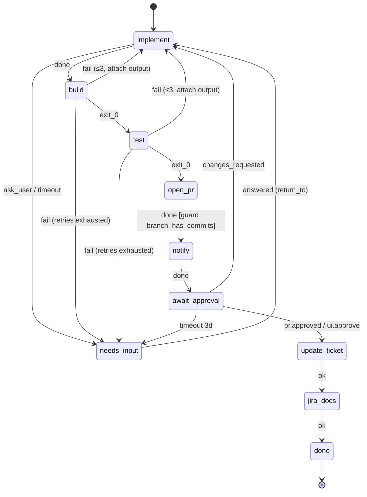

# 05 · Workflow engine

Users design an FSM, stored as **versioned JSON** in `workflow_definition`. The engine is a **pure function** `apply(sessionState, event) → (nextSessionState, effects[])`. A thin transactional shell persists the result through the outbox.

## Definition schema

```jsonc
{
  "id": "pr_flow",
  "version": 1,
  "start": "implement",
  "budget": { "usd": 5, "minutes": 120, "max_loop_retries": 3 },
  "on_budget_exceeded": "needs_input",
  "states": {
    "<name>": {
      "type": "agent | command | event | connector | human | terminal",
      // type-specific config (below)
      "guard": "<guard name>",           // optional, checked before leaving on success
      "timeout": "30m",                   // optional; fires the "timeout" outcome
      "on": { "<transition name>": "<state>" | { "goto": "<state>", "attach": "output", "retries": 3, "else": "<state>", /* ADR-0011 fields below */ } },
      "ticket_editable": true             // optional; may people edit the ticket in this column (below)
    }
  },
  "queued_ticket_editable": true,         // optional; the same for the implicit Queued column
  "mcp": { "mode": "inherit", "deny": ["claude.ai Gmail"] }  // optional; agents' MCP servers (below)
}
```

**MCP servers per workflow ([ADR-0029](../adr/0029-agents-inherit-mcp-servers.md)).** `mcp` (the workflow, and any agent state, whose own `mcp` replaces the workflow's) says which of the machine owner's MCP servers and claude.ai connectors a worker agent gets besides conductor's: `{ "mode": "inherit" }` (the default when absent everywhere) gives it all of them, `deny` removes named servers (as Claude Code lists them: `claude.ai Atlassian`, `plugin:azure:azure`), and `{ "mode": "none" }` gives it only conductor's. Requirements reviewers and QA states always get `none` (`resolveMcpPolicy`, `shared/src/workflow/mcp.ts`).

**Editing the ticket per column.** `ticket_editable` (every state) and `queued_ticket_editable` (the workflow, for Queued) say whether a person may edit the ticket's title, body, priority and kind while its card is in that column (`PATCH /api/tickets/:id`, [03](03-protocols.md#rest-indicative)). When absent: Queued and `human` states are editable, every other type (agent, command, connector, event, terminal) is read-only; an unknown state is read-only (`ticketEditable`, `shared/src/workflow/editable.ts`). Reading the ticket is always allowed. The engine reads the ticket row on every apply (`toSnapshot`), so an edit reaches the **next** prompt it renders (the next agent state, a reviewer, a fresh conversation), never an agent process already running; the UI says so on an agent column and suggests a live message.

### Transition object ([ADR-0011](../adr/0011-transition-rules.md))
Each key of `on` is a **transition name**; the value is a state name (shorthand for `{goto}`) or an object. Old definitions parse unchanged. Schema: `TransitionObjectSchema` in `shared/src/workflow/schema.ts`; contract index: [10 §Transitions](10-contracts.md#transitions-adr-0011).

```jsonc
"ready_for_testing": {
  "goto": "waiting_external",          // a state, or "$return_to" (RETURN_TO) on a human-state transition
  "title": "Ready for testing",        // button / timeline label; default: the name humanised
  "when": "The work is complete …",    // ≤ 1 000 chars; listed in the agent's prompt
  "actor": "agent",                    // agent | human | system; inferred when omitted (below)
  "kinds": ["work"],                   // non-empty; omitted = both kinds
  "question": false,                   // true: a move into a human state that asks; the reason is the question
  "requires": {
    "checks": [{ "name": "Tests pass", "cmd": "npm test", "timeout": "10m" }],  // ≤ 20
    "setup": "npm ci",                 // ADR-0010: omitted = auto-detect, "" = none
    "review": { "items": ["…"], "model": "…" },                                  // the ADR-0009 reviewer
    "actions": ["open_pr"],            // update_jira / slack_message parse, refused by the validator until M5
    "conditions": [                    // 1..10, each with enabled? (default true) and label?
      { "type": "pr_checks_green", "no_checks_after": "5m" },  // no_checks_after optional (ADR-0025, U-072)
      { "type": "pr_approvals", "min": 1 },
      { "type": "pr_merged" },
      { "type": "azure_pipeline_succeeded", "pipeline": "ci", "enabled": false },  // M5
      { "type": "jira_fields_set", "fields": ["resolution"], "enabled": false }    // M5, 1..20 fields
    ],
    "condition_timeout": "3d",         // → on_unmet.else when conditions stay pending (U-063)
    "condition_poll": "2m"             // first poll interval, default 2m (DEFAULT_CONDITION_POLL), backoff to 15m
  },
  "on_unmet": { "goto": "implementing", "instruction": "…", "retries": 3, "else": "needs_input" }
}
```

- **Actor inference** (`transitionActor(def, state, name, t)`): the explicit `actor`; else `system` for `timeout`, `exit_0`, `fail`, `ok`, `error`, `budget_exceeded` and an event state's `wait_for` names; else by the state's type: `agent` on an agent state, `human` on a human or event state, `system` on a command or connector state. The validator (rule 10, M1b-T02) rejects an explicit `actor: "agent"` on a non-agent state.
- **Counting**: see [§Counting](#counting-adr-0011).
- **Kinds**: `ticket.kind` (`work` | `personal` | null) filters transitions; a null kind matches every transition ([U-062](../tracking/UNKNOWNS.md)).
- **Fallbacks**: `ask_user` stays a declared outcome on every agent state (U-061); `ask_user`, `timeout` and `budget_exceeded` (FALLBACK_TRANSITION_NAMES) never run requirements.
- **Legacy**: ADR-0009 `requirements` (on a transition) and ADR-0010 `entry` (on a state) still parse, and old versions execute them as before. `foldLegacyRequirements(def)` (`shared/src/workflow/fold.ts`) rewrites them into `requires` + `on_unmet` (an `entry` goes onto every non-fallback transition into that state); the editor calls it when it saves a new version.
- Graph rules (actor fits the state, question targets, bounded conditions, available actions) are the validator's, not the schema's: [§Validation on save](#validation-on-save-m1-t03).

### State types
| type | Executed by | Config | Outcomes |
|---|---|---|---|
| `agent` | daemon → Claude Code | `prompt` template **or** `skill`, `tools` allow-list, `mcp` ([ADR-0029](../adr/0029-agents-inherit-mcp-servers.md)), `input` (refs like `$open_pr.pr_url`), `result` keys expected | ADR-0011: any agent-actor transition, named in `complete_state {transition, reason, result}` (no name = `done`); `ask_user`, `timeout` |
| `command` | daemon, no model | `cmd`, optional `cwd`, `timeout`. Runs through the build semaphore ([07](07-multi-session-isolation.md)) | `exit_0`, `fail` |
| `event` | orchestrator, waits | `wait_for: [event names]`, `park`, `release_machine`, `timeout` | each event name, `timeout` |
| `connector` | orchestrator | `action` / `actions[]`, `args`, `idempotency` | `ok`, `error` |
| `human` | user via UI/Slack | — | `answered` (returns to the state the session came from, unless the answer selects a target). ADR-0011: its human-actor transitions, one button each (`answer` → `$return_to`, …) |
| `terminal` | — | — | — |

### Outcomes, not opinions
- Command states transition on **exit code**.
- Agent states transition when the agent calls the structured **`complete_state`** tool with a `result`. The orchestrator then checks the state's `guard` (e.g. `branch_has_commits`) before it moves on. A failed guard is treated as the `fail` outcome of that state, or `needs_input` if none exists.
- The engine never interprets the model's free text.

### Retry loops
`{ "goto": "implement", "attach": "output", "retries": 3, "else": "needs_input" }` means: on `fail`, go back to `implement` with the command output attached to the prompt. The counter key is `"<from>-><goto>"` in `session.retry_counters`. Once the counter reaches `retries`, take `else`. `budget.max_loop_retries` is the default cap when a loop doesn't set one.

### Counting (ADR-0011)
`isCountedTransition(t)` (`shared/src/workflow/transition-rules.ts`) decides which transitions are counted `"<from>-><goto>"` failure loops: only an object with `attach`, `retries` or `else`. Every other transition (a state name, or an object with only `when` / `kinds` / `question` / `requires` / `on_unmet` / `title` / `actor`, or ADR-0009 `requirements`) is a plain forward move with no failure-loop counter. Retries of a transition's requirements count under `move:<from>:<name>` (`moveCounterKey`), never under `<from>-><goto>`. The engine (M1b-T03) and the validator's loop analysis (rule 4, M1b-T02) must both use this helper rather than "is it an object".

### Transitions (ADR-0011, M1b-T03)
How `apply()` takes a named transition. Code: `shared/src/engine/transitions.ts` (which transition), `move-step.ts` (its requirements), `apply.ts` (dispatch, the shared gate-step machinery).

- **Agent** (`agent.complete_state {transition, reason, result}`, `planAgentTransition`):
  - no name → `done`. If the state declares no `done`, the M1 `done` outcome runs unchanged (unmapped → the fallback human);
  - `ask_user` named → to a human through `ask_user`, the reason as the question;
  - a name that isn't a transition of the state, isn't agent-actor, or doesn't match the ticket's kind (null kind matches both, U-062) is **routed**, not ignored: through `ask_user` to needs_input (`agent_question`, question `unknownTransitionQuestion(name)` plus "Its reason: …" when given; the U-028 path);
  - a `question: true` transition → its target (a human state) opens an `agent_question` whose question is the reason (a stand-in if empty). The state's `result` keys and guard are not checked: it is not a finished step. A non-empty `result` is still written to `context[<state>]` (as a completing transition would), so the human can read what they are asked about, e.g. `plan_needs_approval`'s plan ([06 §Plan approval](06-human-input.md#plan-approval)); an empty one leaves the context alone;
  - a `handoff: true` transition (ADR-0037 P8) → the same as a question (result kept, `return_to` set, keys and guard not checked), but the request's kind is `handoff` and its text is the agent's summary of finished work for review (stand-in `The agent handed off "<title>" without a summary.`). It is not the state's way to ask (rule 12). With `requires`, the move step runs first and the target opens the `handoff` request;
  - any other transition: `result` keys, then the guard (failed → `fail`), `context.<state> = result`, then it is taken.
- **Human** (`human.transition {name, text, actor, input_request_id}`, `planHumanTransition`): accepted from a human state while `needs_input`, or an event state while `waiting_external`; else `wrong_status` (also during any gate step). Unknown name → `unknown_transition`; not human-actor or wrong kind → `transition_not_allowed` (both 409). `$return_to` resolves to `return_to` (else `def.start`). Into the asking agent (`return_to`) the text is its answer exactly as `input.provided` delivers one (`send_input` to a live parked process, else the pending answer of a resume; no text → `"[<name>]"`). Into another agent state the text is an "Answer from a human" in the rendered prompt. Anywhere else it is only the move's reason. `/input` (`input.provided`) is unchanged: it is the same delivery, with no transition name and no requirements.
- **Fresh conversation** (`human.fresh_conversation {text, actor, input_request_id}`, not a workflow transition): from the same parked position as a `$return_to` answer (`needs_input` in a human state, `return_to` an agent state, no gate step, not revoked; else `wrong_status`). It ends a live parked process, forgets `claude_session_id` (`conversation_reset`, `user_requested`) and enters `return_to` with the text as the answer, so the start renders the full state prompt in a new Claude conversation. Recorded as a move `fresh_conversation` by `human`. Details: [10 §Fresh conversation](10-contracts.md#fresh-conversation).
- **Counting**: a counted transition (`isCountedTransition`) counts `<from>-><goto>` first; every other object is a plain forward move.
- **Move step**: a taken transition with `requires` (and not one of FALLBACK_TRANSITION_NAMES) enters a gate step `{kind: 'move', transition, actor, reason}` labelled `moveStateLabel(from, to, name)`, with the ADR-0010 machinery as is: the worker is killed and detached, the fencing token bumps, checks run in a fresh checkout and bind `head_sha`, then the fenced reviewer (its prompt names the checked commit), then `run_action` actions with `expected_sha`. Differences from an entry step:
  - spec = the transition's `requires` + `on_unmet` (without `on_unmet`: retries 0, `else` = the fallback human); checks = `requires.checks`, else the pin check when the step reviews or acts, else none;
  - counter `move:<from>:<name>`; feedback heading "Requirements for <title> were not met:"; questions say `take "<title>" (<from> → <to>)`;
  - a move action's idempotency key is `<session>:<label>:<visit>` (two transitions may share a target);
  - `update_jira` / `slack_message` (refused by the validator until M5) go straight to `else`;
  - first, with `requires.concurrency`, the **held phase** ([§Self-healing primitives](#self-healing-primitives-adr-0037-proposed), P4);
  - then the **conditions phase**: [§Conditions](#conditions-adr-0011-m1b-t08).
  
  Passed → the target is entered with the move record; a `question: true` target opens the agent's question; a human move's text reaches an agent target as an answer. Human moves run requirements too; the routes to a human (fallbacks, budget, `on_unmet`) never do.
- **Repo check overrides** (ADR-0030) <a id="repo-check-overrides-adr-0030"></a>: a ticket whose repo has a `repo_checks` row runs that row's checks and `setup` instead of the definition's at every gate step (entry or move) that has at least one declared check (`applyRepoChecks`); the pin check, condition-only and review-only steps are unchanged. The EngineService reads the row with the session (`SessionSnapshot.repo_checks`), and `enterStep` pins it on the step (`GateStep.repo_checks`), so an edit mid-step can't shift `index`; the next attempt reads it again. The board's checklist shows the pinned checks' names.
- **Notify** <a id="notify"></a> (legacy mode: no workflow `notify` policy, ADR-0037 P6 otherwise, [§Self-healing primitives](#self-healing-primitives-adr-0037-proposed)): a transition object with `notify: true` (the Workflow view's Notify select, "Every time") notifies the account's users when it is taken. apply sets `state_entered.notify = <transition name>` on the entry into a real state that the transition leads to: its `goto`, a counted loop's `goto` or its `else` when retries run out, a human move, or the target entered after an entry step or move step passes (`passStep` / `passMove` find the transition again from the step's source state). The gate-step labels themselves, the fallback human state, `budget.exceeded` and `on_unmet` routes never notify (they are not the flagged transition; needs-input covers them). A string transition carries no flag: the editor turns it into an object. The EngineService wrapper turns `notify` into a `transition.notified` board event (in-tab) and `push_transition` Web Push rows ([10 §Web Push](10-contracts.md#web-push)). A flagged transition into a human state that also asks a question gives two notifications (the transition's and needs-input's, with different tags).
- **Moves record**: `state_entered` carries `transition`, `reason`, `actor` for a named transition (an agent's named one, `ask_user` named, a human move, a move step and its pass). Unnamed and system outcomes, fallbacks and ADR-0009/0010 steps keep the M1 record `{from, to, visit}`.
- **Prompt** (`render.ts`): a state whose agent transitions go beyond `done` / `ask_user` (`promptTransitions`) ends with "## How to finish": each allowed transition for the ticket's kind as `- <name>: <when>` (question ones add "Your `reason` is the question for the human"; `ask_user` gets a default `when`), then how to call `complete_state` with `transition`, `reason` and `result`. `start_session.transitions` is the same list. Older states keep "When you are done" and send no list. A `kind: 'work'` ticket's agent prompts also get "## Work repository" (commit only what makes sense to developers who don't use conductor; no workflow or agent configuration, no conductor notes). A `$ref` input that was never produced (a human move skipped its producer, validator rule 5) is listed as "`<name>`: not produced (a person moved this ticket here directly). Work out what's needed from the ticket." instead of a value (neutral: it also reaches M1 workflows and non-coding states).

### Conditions (ADR-0011, M1b-T08)
The last phase of a move step: external facts (`requires.conditions`) re-checked on the user's machine until all are met, one turns false, or `condition_timeout` passes. Code: `shared/src/engine/conditions.ts` (the pure parts), the conditions handlers in `apply.ts`.

- **Start** (after checks, review and actions): no **enabled** condition → pass (disabled ones are skipped, never sent). Otherwise:
  - the session is **paused** (U-059): status `waiting_external`, the worker already ended by the step, the card in the source column with the checklist `step.conditions` (one status per declared condition; disabled ones `disabled`). The step's time so far is banked; the wait itself never counts toward `wall_seconds`;
  - `conditions_deadline` = now + `condition_timeout`; `conditions_poll_ms` = `condition_poll` (default 2m); `conditions_started_at` = now (a step persisted before the field existed sets it when it resumes);
  - enabled PR conditions (`pr_checks_green`, `pr_approvals`, `pr_merged`, `pr_screenshots`) with no `context.__pr.pr_url` (only open_pr writes it, ADR-0010 hardening) are **failed** at once with the detail "conductor has no pull request for this ticket…" → straight to `on_unmet.else` (a human, kind `retries_exhausted`, the failed conditions listed), **not counted** and never `on_unmet.goto`: the agent can't create conductor's PR, so a retry would only use up retries (lead decision). Nothing is sent and nothing hangs on a PR that doesn't exist;
  - else one `run_action {action: 'evaluate_conditions', args: {conditions (enabled, in order, without the engine-only `no_checks_after`), pr_url, branch, head_sha?}}` to the **session's machine** (M1b; ADR-0016's "any online machine of the account" is M2). `head_sha` is the step's checked and pushed commit (`expected_sha`), omitted when there is none (a conditions-only move): with it, the daemon fails every PR condition if someone pushed to the branch. The enabled conditions show `running`;
  - the timer (`state_deadline`) = min(now + poll, `conditions_deadline`).
- **`action.completed` evaluate_conditions** (accepted only while an evaluation is in flight): results match the enabled conditions by position; each status, value and detail is stored with `checked_at`, and the note is cleared. **No-CI grace** (ADR-0025, U-072): a `pr_checks_green` with `no_checks_after` whose answer is pending with the value `NO_PR_CHECKS_VALUE` (`"0/0 passed"`: the PR reports no checks at all) at least `no_checks_after` after `conditions_started_at` is stored as `met`, detail "no CI checks reported within <duration>". Checks that exist but are still running stay pending. A failing check's detail names it with its https link (`failing: test (https://…)`). A check cancelled before GitHub ever assigned it a runner (the daemon asks `gh api …/actions/jobs/<id>` about each CANCELLED Actions job, WF-T05) still fails the condition but is named apart as `infrastructure, not a test failure` (no runner was assigned; rerun the job), so the agent reruns it instead of debugging it. Then:
  - any `failed` → `on_unmet.goto` with the evidence (`- <type>: failed (<detail>; last value <v>)`), counted under `move:<from>:<name>`; exhausted → `on_unmet.else` listing it (U-063);
  - all `met` → the target is entered, as any passed move;
  - else (`pending`; `unsupported` counts as pending) → re-arm: the interval doubles after an unchanged answer (same value and detail for every condition), up to 15 min (`MAX_CONDITION_POLL`), and goes back to `condition_poll` when anything changed.
  - An `error`, or a result of the wrong shape / length / types, is no answer: still pending, a note on the checklist ("the last check failed: …"), re-armed.
- **`command.refused` run_action** while in flight: still pending (not a requeue), note `CONDITIONS_NO_MACHINE_NOTE` ("waiting for a machine to check conditions"), re-armed; the next poll sends a new evaluation (U-058).
- **`timer.fired`**:
  - at `conditions_deadline` → `on_unmet.else`, kind `timeout`, nothing killed; the question is the checklist ("The conditions to take "<title>" (<from> → <to>) were not all met within <timeout>:" then `- <label>: <status> (<value>): <detail>` per condition, the note, "Retry, skip, or abort?");
  - no machine, or the last evaluation still unanswered → nothing is sent, note `CONDITIONS_NO_MACHINE_NOTE`, re-armed; the timeout keeps running (U-058). The dispatcher never refuses a `run_action` to an offline machine (only start_session ack timeouts become `command.refused`); the command waits in the outbox and is delivered when the machine is back, so re-sending would pile them up;
  - else a new evaluation.
- **Other events**: an `external.event` awaited by the **source** event state (e.g. `ui.approve` on Waiting external) is still taken: the step ends; the event's own transition (the move being checked) enters its target directly, any other is taken as usual. Budget and cancel end the step as in any gate step. Everything else is ignored as in any gate step (human moves `wrong_status`).
- **`operator.message`** ([ADR-0027](../adr/0027-messages-while-waiting-on-pr-checks.md)), when the **source** is an agent state: the step ends (nothing killed; an evaluation in flight comes back `unexpected_event`) and the source is entered again with the text as the pending answer, the same Claude conversation resumed (`state_entered.transition` `message`, actor `human`, reason the text). Not counted. The agent finishes the move again, which runs the whole step again. Out of an event state, `wrong_status`.
- **Bounded**: every path ends at the target, `on_unmet.goto` (counted) or a human by `conditions_deadline` (property test in `apply.conditions.test.ts`); a message's pass back needs a human each time.

### Requirements gates ([ADR-0009](../adr/0009-transition-requirements-review.md))
A transition object may carry `requirements: {items[1..30], on_unmet: {goto, instruction?, retries 0..10 = 2, else = "needs_input"}, model?}`:

```json
"done": { "goto": "build",
          "requirements": { "items": ["New code paths have unit tests"],
                            "on_unmet": { "goto": "implement", "instruction": "Add the tests first.", "retries": 2 } } }
```

- **Review step.** An outcome that selects a gated transition does not enter the target. The session enters a review step: `workflow_state` = `"<from> → <to> (review)"` (a label, not a state), status stays `running` (the board shows the label), the step's details live in `session.review` (stored in `context.__review`, [02](02-data-model.md#session)), and a 10-minute deadline (`REVIEW_TIMEOUT`) is armed. Wall time spent reviewing counts toward `budget.minutes` like the source state's.
- **The reviewer** is one `start_session` with `review: true`: a **fresh** Claude session (`resume_claude_session_id: null`, never the worker's), tools `['review']` (Read/Glob/Grep plus the exact git inspection commands in `REVIEW_GIT_COMMANDS`, no edit tools), always `--permission-mode dontAsk` (only those pre-approved rules run, whatever the user's mode; the one exception to ADR-0006), the gate's `model`, cwd = the session worktree. Its prompt (`renderReviewPrompt`, `shared/src/engine/review.ts`) names the transition, the ticket, what the source state reported (its `complete_state` result, or the command's detail and output tail), the numbered items and the allowed git commands, and asks for `complete_state {result: {verdict: [{item, met, reason}]}}`. Its `claude_session_id` event goes to `review.claude_session_id`; `session.claude_session_id` stays the worker's. Its spend counts (per Claude session id, as always).
- **Outcome** (the reviewer's `complete_state`). A verdict is valid when `verdict` is an array of `{item: string, met: boolean, reason?: string}` that answers every item (matched by text, ignoring case and whitespace, else by position when the counts match). The verdict is kept in `context["<from> → <to> (review)"]`.
  - all met → enter `to` (with the transition's `attach: output` attachment, if it had one);
  - otherwise, while `retry_counters["requirements:<from>:<outcome>"] < on_unmet.retries` → increment it and enter `on_unmet.goto`. An agent target's prompt gets a `## Requirements not met` section: "Requirements for <from> → <to> were not met:", each unmet item with its reason, then `instruction`. The worker resumes its own conversation;
  - exhausted → `on_unmet.else`, an input_request `retries_exhausted` whose question lists the unmet items and reasons.
- **Failures.** No usable verdict (malformed, `ask_user`, the reviewer exiting) → one nudge: a `start_session` resuming the **reviewer's own** conversation with what was wrong (a fresh reviewer if its id never arrived). A second failure, the daemon's `no_outcome` (it already nudged, U-028), → `else` (`retries_exhausted`, "produced no verdict"). The timeout → `else` (`timeout`, "review timed out"). Both kill the reviewer.
- **While reviewing** every other event is ignored: a worker's late `exit` (`command_id_mismatch`), `command.exited`, `external.event`, `input.provided`, and live messages (`operator.message` → `wrong_status`, 409: the reviewer judges on its own). `budget.exceeded` leaves the review (killing the reviewer) for `on_budget_exceeded`; cancel fails the session. A refused reviewer start requeues the session; the re-claim starts a fresh reviewer.
- **Leaving** the step puts `workflow_state` back to `from` before entering the next state, so a human target's `return_to` is `from` (answering resumes the worker), and `state_entered.from` is the review label.
- **Counting.** A transition object that carries only `requirements` (no `attach`/`retries`/`else`) is a plain forward transition: its `goto` leg has no `"<from>-><goto>"` counter. With any of those keys the existing retry-loop counting applies first, and the gate reviews the `goto` leg it selects.
- Only outcomes go through gates: a human's "skip to <state>" and `answered` routes do not.
- **One step representation with ADR-0010.** The review step is a gate step `{kind: 'transition', phase: 'review'}` (below); old versions keep working unchanged. Entering, leaving or switching a gate step bumps the session's fencing token in the wrapper ([10](10-contracts.md#engineservice-wrapper)), so a still-alive worker can never report into the step (e.g. supply the verdict), and a finished reviewer can never report into the next visit.

### Requirements to enter a column ([ADR-0010](../adr/0010-one-workflow-columns-are-states.md))
Every state may have `title` (its board column title) and `entry`: `{checks?: [{name, cmd, timeout?}], review?: {items, model?}, actions?: ['open_pr'], on_unmet: {goto, instruction?, retries 0..10 = 2, else = "needs_input"}}` (at least one check, review or action). The definition's `columns` lists the board's columns (state names, left to right).

- **Entry step.** An outcome (an agent's `done`, a command's exit, an event, a human's answer or "skip to") that selects a state with `entry` does not enter it. The session enters an entry step: `workflow_state` = `"<from> → <to> (entry)"`, status `running`, `session.step` = `{kind: 'entry', from, outcome, to, phase, index, …}` (stored in `context.__entry`, [02](02-data-model.md#session)). The worker's process is killed (a `kill` targeting exactly its `start_session`), detached (`agent_command_id = null`) and fenced off (token bump), so it can't keep writing the worktree while it is checked. The card stays in `from`'s column, badged `checking`.
- **Phases, in order, one command at a time:**
  1. `checks`: one `run_cmd` per check in the worktree (`state` = the label, timeout = the check's or 15m, enforced by the daemon). An entry without checks gets an implicit first check "Committed work" (`true`), so its commit is always pinned. Every check runs in a **fresh, conductor-owned checkout of the one commit under check** (Ben, 2026-10-26), never in the agent's worktree: the daemon fetches the branch into an ephemeral private repo, requires its tip to equal that commit, checks it out, runs `entry.setup` once (omitted = auto-detect from the committed lockfile, M2-T30: `pnpm-lock.yaml` → `pnpm install --frozen-lockfile`, `yarn.lock` → `yarn install --immutable`, `package-lock.json` → `npm ci`, a bare `package.json` → `npm install`; `''` = none; a failed setup is unmet with its output), then the checks in order, and deletes it. In a pnpm or yarn repo a check written for npm runs with that manager: `npm run <script>` / `npm run-script <script>` → `pnpm run <script>`, `npm test` → `pnpm test` (likewise `yarn`), at the start of each `&&` / `||` / `;` segment; other commands run as written. A setup or check that needs a package manager missing from the daemon's PATH is unmet with a message naming it. Each check is also a `require_clean` `run_cmd` (an early, friendly pre-check, no longer the security boundary): **only committed changes are checked and pushed**, so a worktree with uncommitted changes (`git status --porcelain --untracked-files=all`, hooks and fsmonitor off; .gitignore'd build outputs don't count) is not checked at all. It is **unmet** ("Uncommitted changes in the worktree: commit your work; only committed changes are checked and pushed", the status lines as evidence, counted under `entry:<to>`), back to `on_unmet.goto`, where the agent can commit. `implement_template` tells the agent to commit everything before finishing. On a clean tree the daemon reports the worktree `HEAD` with each exit (`cmd_exit.head_sha`); the first check's is recorded as `step.head_sha`, the commit under check, and a later check seeing a different or unknown `HEAD` is unmet ("the branch moved while the checks ran"). Exit 0 → the next check. A non-zero exit or a timeout is **unmet**: the check's name, command, how it failed and its output tail are the evidence, and the rest don't run.
  2. `review` (if set): the ADR-0009 reviewer reused exactly (fresh, `review: true`, tools `['review']`, forced dontAsk, the review `model`, a 10-minute deadline, one nudge on no verdict), its prompt naming the column being entered and the checked commit (`step.head_sha`). Unmet items and their reasons are the evidence.
  3. `actions`: one `run_action` per action through the outbox, idempotency key `<session>:<to>:<visit>` (the step's visit, so a retry after unmet is a new key), a 10-minute deadline (`ENTRY_ACTION_TIMEOUT`). `open_pr`'s args are `{title: ticket title, body: the source state's summary + the ticket ref + "Opened by conductor."}` and `expected_sha` = `step.head_sha` (an entry with checks but no recorded commit pushes nothing: → `else`). The daemon pushes exactly that commit, refusing when the branch tip differs. Its result `{pr_url}` must be a `https://github.com/<o>/<r>/pull/<n>` URL (else a failed action) and is recorded only as `context.__pr = {pr_url, state}`; an agent's `pr_url` is never the PR.
  All pass → enter `to` (with the outcome's `attach: output` attachment, if any; `state_entered.from` = the label).
- **Unmet** (a check or review item) → while `retry_counters["entry:<to>"] < on_unmet.retries` → increment and enter `on_unmet.goto`; an agent target's prompt gets `## Requirements not met`: "Requirements to enter <title> were not met:", each unmet item with its reason and output tail, then `instruction`. Exhausted → `on_unmet.else` (`retries_exhausted`), the question listing what is unmet with the output tails.
- **Setup failures: whose problem is it?** A fresh checkout's setup that fails (a non-zero exit, a timeout, or a package manager missing from PATH) is triaged before anything is counted. **Chosen equivalent** of "run the same setup on the base branch's tip in its own fresh checkout": the daemon that ran it does that at once, in the same `run_cmd` (no new command, phase or outbox round trip), and reports it in the same `cmd_exit`: `setup_cmd` (the setup that ran, after lockfile auto-detect), `setup_on_base` and `base_ref`. The base is the session clone's `origin/HEAD` target (TD-181: the orchestrator doesn't send the repo's default branch), fetched first with a 60 s best-effort `git fetch origin <base>` (a failed fetch uses the ref the clone has), checked out like the commit under check (`freshBaseCheckout` / `fresh_base_checkout`). `fail`: the base's tip is the commit under check, or the setup fails there too (or needs a missing manager); `pass`: it exits 0 there, or the base needs no setup; `unknown`: no `origin/HEAD`, a fetch or checkout error, or a kill. The probe's checkout is always removed; its lines go to the session output as `conductor: base probe: …`. A failed setup can therefore take up to twice its timeout.
  - The message (`setupFailureMessage`, `engine/setup-failure.ts`) names, in order: "Setup failed before any check ran: `<cmd>` (<source>)." where the source is the repo checks override for `<repo>` (saved `<updated_at>` by `<updated_by>`, from `session.repo_checks_meta`, pinned on the step as `step.repo_checks_meta`), the workflow's checks at the gate, or "auto-detected from the lockfile"; then how it failed and which check didn't run; then one sentence on what to do. Its first line is the **summary** the board and `get_ticket`'s status line show (`setupFailureSummary`).
  - `setup_on_base: fail` → **conductor's check config**: straight to `on_unmet.else`, input-request kind `check_config`, the message plus the setup's output tail as the question, recorded as an engine move (`check_failed`), and **not counted** against `on_unmet.retries`. The gate is kept in `context.__check_config` (`CHECK_CONFIG_KEY`: kind, from, outcome, to, transition, actor, reason, and the human state and visit it waits in). A reopen strips it.
  - `pass`, `unknown` or absent (an older daemon) → the branch's problem, as before: unmet `Setup`, counted, back to `on_unmet.goto`, with the same message as the reason and the output tail as evidence. The item is marked `config`, so the feedback adds `PROPOSE_CHECKS_HINT`: if it is conductor's config after all, the agent asks with `proposed_checks` instead of retrying.
  - **`gate.retry {actor}`** re-runs that gate from its source state with the session's **current** repo checks (`enterStep` pins them), only while the session still waits in that visit of the human state (else `wrong_status`); the wrapper answers the open request with `[$retry_checks]`. It comes from the card's **Retry checks** button (`$retry_checks`, `RETRY_CHECKS`, added by `humanTransitionsOfCard` while a `check_config` request is open; the transition route and MCP `take_transition` map it) and from the orchestrator after **any** change to that repo's checks (REST PUT/DELETE `/api/repo-checks`, MCP `set_repo_checks` / `clear_repo_checks`, an applied `repo_checks` proposal: `afterRepoChecksChanged`). A retry that fails again lands back on the human with the same message, uncounted, so the loop is bounded by people.
- **Failures that aren't the agent's fault** go straight to `on_unmet.else`: an action's error ("Conductor could not open the pull request to enter …: <error>"), a refused check or action, an action or review timeout (`timeout`; the running action/reviewer is killed), a review with no verdict after the nudge.
- **While checking** every other event is ignored: worker events (`unexpected_event` outside the review phase; a stale token never reaches apply), `input.provided`, `external.event`, and live messages (`operator.message` → `wrong_status`, 409; in the conditions phase out of an agent state a message resumes the agent, [§Conditions](#conditions-adr-0011-m1b-t08)). `budget.exceeded` leaves the step for `on_budget_exceeded`; cancel fails the session; a reopen ([ADR-0008](../adr/0008-transcript-history-and-reopen.md)) strips the step. A requeue (no machine) re-runs the current phase on the next claim. Wall time in the step counts like the source state's; the reviewer's spend counts as always.
- An entry step is entered only from a real state. The routes to a human (fallback, budget, `on_unmet`) and a passed entry step enter their target directly.

### `needs_input` semantics
`needs_input` is a `human` state. On entry the engine writes an `input_request` with `kind` set to the reason (`agent_question`, `retries_exhausted`, `budget_exceeded`, `timeout`) and remembers `return_to` (the state that sent it there). When the answer arrives, the engine returns to `return_to` with the answer attached. The UI can also offer "abort" (→ `failed`) or "skip to <state>".

### Lost machines ([U-068](../tracking/UNKNOWNS.md), M2-T06)
The orchestrator sends `machine.lost {machine_id, reason}` when a session's machine is gone (M2-T20: a lease past its grace, a revoke, a pinned machine offline too long). The status × event table, the questions and the human's options are in [10-contracts §Machines protocol v2, "Lost machines"](10-contracts.md#machines-protocol-v2); `planMachineLost` (`engine/machine-lost.ts`) implements the table row for row, and apply carries it out. How apply reads it:
- **(A) park.** A running gate step is left first (`return_to` is its `from`). The session enters the fallback human state (`fallbackHumanState`: `needs_input` if it is human, else the first human state) with an `input_request` of kind `machine_lost` and **no deadline**. `return_to` is the state it was in (null for a never-started session), `machine_id` is kept (a queued session takes the event's), `agent_process_live` becomes false and `context.__machine_lost` gets the mark. A queued session's ticket goes to `in_progress`. The `kill {reason: 'machine_lost'}` is emitted only for `lease_expired` / `pinned_machine_offline` from `assigned` / `running` / `waiting_external`. Without any human state the session fails (killing only as above).
- **(B) revoked while parked or pinned.** If the session is parked (`needs_input`), the mark's reason becomes `revoked` and a new `machine_lost` request is written with the same `return_to`; nothing else changes. If it is queued with the mark (the human pressed Continue and it is waiting for its machine), it is parked as in (A), with no kill, in the fallback human state. Its `return_to` is the state it was requeued in, which is the first park's `return_to`, so the request's `return_to` is unchanged in substance.
- **Continue.** When a human move (the `$return_to` "Continue on <machine>" or any other) or an answer leaves a lost-machine park for a state that needs the machine (agent, command, or a move step), apply sets `machine_id` to null. `enter` then requeues (status `queued`, ticket `ready`, the answer kept as the pending answer) and the mark stays, so the claim (M2-T16) offers the session only to `mark.machine_id`. A move to a state that needs no machine (event, human, terminal) clears the mark.
- **The mark is cleared** on the next matching `session.started`, at `session.assigned` when the re-emit has no `start_session` (a command, a check phase, an event or a human state: no `started` will ever come), and when the session becomes terminal (a reopen copies the context).
- **The unread answer.** A `pending_answer` the agent never ran on (a reopen message, an earlier Continue) is kept under `context.__machine_lost_answer` through the park, and the next Continue or answer into an agent state delivers it first, labelled (`combineLostAnswer`; 10-contracts has the format). A Continue with no text delivers it alone.
- **Revoked = Cancel only.** While the mark's reason is `revoked`, apply refuses `human.transition` (`transition_not_allowed`), `input.provided` and `human.fresh_conversation` (`wrong_status`); the card offers no transitions. `operator.cancel` works as always.
- **Fencing.** apply never changes `fencing_token`; the EngineService wrapper bumps it after an applied `machine.lost` (M2-T20), so the old worker's late events are stale.
- **Card.** While the open request's kind is `machine_lost` and the machine can continue, `humanTransitionsOfCard` titles each `$return_to` button `machineLostContinueTitle(mark.machine_name)`.

**Routing needs ([ADR-0013](../adr/0013-machine-enrollment-inventory-routing.md) §Routing).** `requiredCapabilities(def, kind)` (`workflow/capabilities.ts`) is the sorted union of: `claude` for any agent state or reviewer; for every transition whose `kinds` match (null = both), each `requires.actions` entry and each **enabled** condition mapped through the registry (`open_pr` and the `pr_*` conditions → `cli:gh:authed`; `azure_pipeline_succeeded` → `cli:az:authed`; `jira_fields_set` / `update_jira` → `cli:jira:authed`, a placeholder until [U-065](../tracking/UNKNOWNS.md); `slack_message` → `mcp:slack`); and each state's ADR-0010 `entry` actions. There is no reachability analysis, and connector states add nothing until M5.

### Follow-up tickets ([ADR-0034](../adr/0034-agent-proposed-follow-up-tickets.md))
An agent may add optional `proposed_tickets: [{title, repo, why}]` to its `complete_state` result; a person approves or dismisses each one ([06 §Proposed tickets](06-human-input.md#proposed-tickets)). The engine does nothing special with the key: it is stored in `context.<state>` like any extra key and read back by `proposalsOfContext`. An agent state's optional `follow_ups: {enabled, max (1..10, default 3), guidance?}` (`FollowUpsSchema`, agent states only) sets how its agent is asked:
- **unset**: the built-in `plan_template` / `implement_template` instructions carry a one-line hint (`PROPOSALS_HINT`), other prompts nothing; up to 3 are read per state;
- **`enabled: true`**: the prompt gets a `## Follow-up tickets (optional)` section before How to finish (`renderFollowUps`: the key, the ticket's repo as the example `repo`, at most `max`, then `guidance`) in place of the hint; up to `max` are read;
- **`enabled: false`**: no hint and no section; none are read from that state.

A planning result may also carry optional `files: ["<path glob>", …]`: the repo-relative paths the plan expects to create or edit (ADR-0037 P4). The built-in `plan_template` asks for it, under a `## Files` heading in the plan and as the result key. Like `proposed_tickets` it is never a required key and is stored verbatim; `plannedFilesOf` (`PlannedFilesSchema`: `PathGlobSchema` entries that are repo-relative, at most 200) parses it on read, and a list that doesn't parse reads as null (no evidence). `get_ticket_artifacts what=plan` returns it.

### Pages ([ADR-0038](../adr/0038-pages-planning-artifacts.md))
An agent state's `result` may list, at most once, the result kind `{"pages": {"max": 1..5}}` (`PagesResultSchema`) next to its required keys. The agent may then add `"pages": [{"url", "title", "expires_at"?}]` (`PageRef`: https, or http on loopback; title ≤ 200) to its `complete_state` result. The kind is never required: the engine stores the key in `context.<state>` like `proposed_tickets`, and `pagesOfContext` reads it back up to `max`, dropping malformed entries. `resultKeys(state)` (the string entries) is what "missing keys", the prompts and rule 5 use. With the kind, the prompt gets `## Pages (optional)` before How to finish (`renderPages`). If the state also has the `pages` tool, the section says how to publish one with `publish_page` (conductor hosts it at `/p/:id` for 7 days; [06 §Pages](06-human-input.md#pages)). Without the kind, prompts are unchanged.

### Self-healing primitives ([ADR-0037](../adr/0037-workflow-primitives-for-self-healing-process.md), proposed)
The schema and the validator are in `packages/shared` (T1): every field below parses, and rule 14 refuses it as "not available yet" until its own ticket marks it available (`AVAILABLE_WORKFLOW_FEATURES`; the three new condition types in `AVAILABLE_CONDITION_TYPES`). T5 made the three condition types and `no_checks` available and runs them (below); T6 made `watch` available; T3, T4 and T8 made `handoff`, the notify policy and `instructions` available; T7 made `requires.concurrency` available. Every one of them is off, or behaves exactly as today, until a definition sets it.

- **`watch`** (P1) on `human` and `event` states: `{poll?, conditions, on_broken}`.
  - The conditions are re-checked while the ticket sits in the state: every `poll` (default 2m, backing off to 15m), and at once when a PR on the same repo merges or conductor pushes the branch.
  - A `failed` condition (never `pending`) takes `on_broken`. Either it moves the ticket to `goto` (counted under `watch:<state>`, then `else`, a human state; `return_to: $self` brings the next completion back), or it sends one `notify: escalate` per stay.
  - A watch's conditions are evaluated **in order, short-circuiting** at the first one that is not `met`, so a later (costlier) condition runs only when the earlier ones hold. `requires.conditions` still evaluate all of them.
  - `cmd` conditions run in the fresh checkout of the PR head, as `requires.checks` does. `needs: checkout` skips the repo setup.
  - **Engine (T6, `apply.ts` §watch, `engine/watch.ts`).**
    - Entering a watched state (in `enter()`, also a re-claim of a parked one) arms it: `context.__watch` (`WatchRuntime`: the state, its visit, one `ConditionStatus` per condition, `poll_ms`, a note, `escalated`) and `session.watch_deadline = now + poll`. The first check is one poll after entry. Leaving the state (`enter`, `enterStep`, `failSession`) disarms both, so a late answer finds nothing `running`. A watch never kills a process.
    - The watch sweep (`sweep.ts`) feeds `watch.fired {state, deadline}`; it is `stale_timer` unless the state, the deadline and the parked status (human `needs_input`, event `waiting_external`) all match. Each check: the engine-only conditions before the first daemon one (`age_below`) are answered here (`prefixVerdict`); if one is not met, nothing is sent. Otherwise one `run_action evaluate_conditions` with `short_circuit: true`, never pinned to a commit (`expected_sha: null`, no `head_sha`: a human pushing to a PR in review is not a break), `setup` = the repo checks' setup.
    - The answer (`action.completed` outside a gate step) is merged (`mergeResults`) and judged in declared order (`inOrderOutcome`). `met` and `pending` re-arm, the poll doubling while the answer is unchanged (capped at 15m) and dropping back to `poll` on a change. An error, a refusal, an unusable result, no machine or an evaluation still in flight re-arm with a note on the card. Only `failed` takes `on_broken`.
    - The move form is an engine move (`cause: watch_broken`, `actor: system`, no transition, the failed conditions as the reason) into `goto`, counted under `retry_counters["watch:<state>"]`; the failed conditions and the resolved instruction reach an agent target as its feedback (as `on_unmet`). Over `retries`, `else` (a human state, rule 19) with `cause: retries_exhausted`. Every path ends at a human.
    - `return_to: $self` (or a state) sets `session.return_to` and `context.__watch_return`. Agent transitions can't name `$return_to`, so "comes back" is a hand-off: the agent's next `handoff: true` transition lands in the marked state instead of its own `goto` (its `requires` still run). The marker is cleared on any landing in a human or terminal state and by a human's move.
    - The escalate form emits one `watch_escalated` effect per stay (`escalated`, reset when the state is entered again) and keeps watching; the wrapper writes a `watch.escalated` event row and a push (always, in legacy mode too), keyed `watch_escalate:<session>:<state>:<visit>`.
    - When a watch moves the ticket out of a human state, the wrapper closes the question it waited on (`answered_by: system`).
  - **Nudge** (`watch-nudge.ts`, Q1): in the transaction of a successful `merge_pr` or `open_pr` action, or of a human move into a terminal state from a state with `context.__pr`, the wrapper sets `watch_deadline = now` on every other live watched session of the account on the same repo; the sweep (every second) checks them. No webhook.
- **Conditions** (P2, available since T5): `cmd {name, cmd, timeout?, needs: checkout|setup = setup}`, `pr_mergeable` and `age_below {max}`. `age_below` is engine-side and allowed only in a watch.
  - `cmd` runs on the machine whose daemon holds the session's worktree, in a fresh checkout of the commit conductor pushed (`head_sha`), else the PR head gh reported, else the worktree's HEAD (ADR-0030's checkout, never the agent's worktree). One checkout per evaluation; the setup (the repo's own when it has repo checks, else `requires.setup`) runs once, only for `needs: setup`. Exit 0 is `met`; another exit or the timeout (default 15m) is `failed`, the detail the output tail. No worktree on that machine, a moved branch or a failed setup is `pending`: a condition never fails on missing evidence. The failure evidence names it by its `name`, never the command.
  - `pr_mergeable`: GitHub's `mergeable` (`gh pr view --json mergeable,mergeStateStatus`): MERGEABLE `met`, CONFLICTING `failed`, UNKNOWN `pending`; merged `met`, closed `failed`. A PR condition, so without conductor's PR it fails at once like the others.
  - `age_below` is never sent to the daemon: `mergeResults` answers it from `state_entered_at` (`evaluateAgeBelow`), and the daemon's results match the remaining enabled conditions by position (`daemonIndexes`).
  - **No-CI policy** (P3): `pr_checks_green.no_checks {policy: pass|fail|require_mergeable, after}`. A stored `no_checks_after: X` folds to `{policy: pass, after: X}` (`noChecksPolicy`). After `after` with no checks reported: `pass` met, `fail` failed, `require_mergeable` met only if the same evaluation reported `mergeable: MERGEABLE` (the daemon adds it to the `pr_checks_green` result when the policy is set); CONFLICTING failed, UNKNOWN pending. `no_checks` is sent to the daemon, `no_checks_after` is not.
  - **Short-circuit.** `evaluate_conditions` takes `short_circuit: true` (a watch's, T6): the daemon evaluates in order and reports every condition after the first non-`met` one as `skipped` (a `ConditionStatus` that counts as pending). `requires.conditions` never set it.
- **`requires.concurrency`** (P4, available since T7): `{key, max_in_flight, scope, order, overlap?, hold_timeout}`. Code: `engine/concurrency.ts` (pure), the held handlers in `apply.ts`, `orchestrator/src/engine/concurrency.ts` (the wrapper side).
  - **Held phase.** A move whose transition has it starts in phase `held`, before `checks` (`step.started_at` set; `step.hold = {behind: [], since, deadline: since + hold_timeout}`). Paused like the conditions phase: status `waiting_external`, the worker ended, no wall time, no machine needed (a re-claim keeps waiting). apply arms `state_deadline = now` ("check me").
  - **Holders.** apply can't see other sessions. The EngineService wrapper answers a held step's `timer.fired` with `concurrency.checked {state, deadline, holders}`, computed in its transaction under `pg_advisory_xact_lock(hashtext('concurrency:<account>:<repo>'))` (`holdersOf`): the account's other live sessions on the ticket's repo (and kind, for `$repo+$kind`) that are (a) in a `scope` state, (b) in a move step past `held` on its way into a scope state, or (c) held too on its way into a scope state and ahead in the queue (older `step.started_at`, then session id). (c) makes release oldest first, and two held moves never wait on each other.
  - **`overlap: planned_files`** holds only when both sessions have a planning `files` list (`sessionPlannedFiles`: the plan's state, `plannedFilesOf`) and the lists intersect (`globsOverlap`: equal, one matches the other as a path, or two wildcard globs whose literal leading segments are prefix-compatible, TD-220). A session without `files` neither holds nor is held: no evidence, no hold. Without `overlap`, the key alone holds.
  - **Verdict** (`heldVerdict`): fewer holders than `max_in_flight` → release: on to `checks` (a requeue first without a machine); at or above it → wait (`hold.behind` = the holders' ticket ids, oldest first), re-checked every `condition_poll` (default 2m), never past the hold's deadline; at the deadline → `on_unmet.else`, kind `timeout`, cause `timeout`, the question naming the holders. A raw `timer.fired` in `held` (not translated) only times it out.
  - **Release triggers.** In the transaction of any session that leaves a real state or ends (and of a watch nudge: `merge_pr`, `open_pr`), the wrapper sets `state_deadline = now` on the same repo's held moves (`nudgeSameRepoHolds`); the sweep fires within a second.
  - **Records.** A move that was really held (`step.held`) lands with `cause: 'concurrency_released'` and its own transition name; for P6 it notifies as that transition (the PR-ready hand-off arriving late), not as an engine move. The hold itself is silent: no request, no push. `hold_changed` effects write `concurrency.held` / `concurrency.released {cause: concurrency_released|timeout|left, held_ms}` event rows. A message while held hands the ticket back to the agent, as in the conditions phase; a lost machine parks it like the conditions phase.
  - **Card.** `checking.phase = 'held'`, label "Queued behind #<short id>, …" (`checking.hold`), and a first "One at a time" checklist item. Insights: `get_process_metrics.queued` (holds, time, by cause); held minutes are taken out of the move step's stays, so they are never a slow state.
- **`instructions`** (P5, available since T8): a workflow-level map. `$instructions.<slug>` refs are accepted in `on_unmet.instruction` and `on_broken.instruction`, and as `presets` on human buttons with `text`.
  - A ref resolves when the move is taken, against the session's pinned version (`resolveInstruction(st.def, …)` in `stepUnmet`), and the text is frozen into the feedback the prompt shows. The prompt never shows a ref. The watch engine (T6) resolves `on_broken.instruction` the same way.
  - A button's `presets` reach the card as `HumanTransitionOption.presets` (`{slug, label, text}`), resolved from the pinned version: chips that fill the text box, which stays editable. `get_ticket` lists them too.
  - Insights counts review replies that equal a saved reply (trimmed) per reply, and the ones typed by hand where one was offered (`ProcessMetrics.presets`).
- **`notify`** (P6, available since T4): a workflow-level `{default, engine_moves, coalesce?}`. Transition `notify` widens to `boolean | 'never' | 'once' | 'every' | 'inherit'` (`true` ≡ every, `false` ≡ never, absent ≡ inherit).
  - Without the block, legacy mode applies: every input_request pushes, plus `notify: true` transitions ([§Notify](#notify)). Nothing is recorded.
  - With it, `notifyDecision` (`engine/notify.ts`) judges each real landing once in `enter()`: a named transition (cause `transition`) takes its own mode, else `default`; `once` pushes the first take of that transition name on the ticket (`notified_transitions`, carried by a reopen), `every` each take, `never` none. Every other cause is an engine move: silent under `engine_moves: never`, even into a human state (`retries_exhausted`, `timeout`, `on_unmet.else`); under `inherit`, the mode of the transition it was taken for, else `default`. A machine-lost re-ask is an engine move too.
  - The decision `{via, mode, decision}` goes on `state_entered.notify_decision` (payload `notify`) and on the input request it opens. The wrapper sends the question when the landing opens a request, else the transition, never both; with `coalesce`, one push per ticket, state and window. `watch_escalate` (T6) and permission prompts always push.
- **`cause`** (P7, in since T2) on every `state_entered`: `transition`, `start`, `check_failed`, `review_unmet`, `action_failed`, `condition_unmet`, `condition_timeout`, `watch_broken`, `concurrency_released`, `timeout`, `retry`, `retries_exhausted`, `budget_exceeded`, `machine_lost`, `answer_routed` or `fallback`. Engine moves (every cause but `transition`, `start` and `answer_routed`) are recorded with `actor: system` and the gate's (or outcome's) transition name; `EnterOpts.record` is required, so `apply()` can't enter a state without one. Rows before T2 have no cause; their engine routes read as actor `engine`.
- **`handoff: true`** (P8) on a transition into a human state: an input_request of kind `handoff`, with the reason as the summary. It is exclusive with `question`.

### Ticket breakdown (planning)
A `triage` agent state returns `{size: "small"|"large"}`. A guard routes large tickets to a `plan` state. That state returns `child_tickets[]`, which the orchestrator creates (each `ready`, with `parent_ticket_id`), and then the parent waits on an `event` state `children.done`. Not in `pr_flow`; see [U-010](../tracking/UNKNOWNS.md).

## Execution (event-sourced, outbox)

```
on event E for session S (fencing token checked):
  BEGIN
    S0 := SELECT … FOR UPDATE
    (S1, effects) := apply(S0, E)          -- pure, unit-tested exhaustively
    INSERT event(E); UPDATE session := S1
    INSERT outbox(effects…)                -- commands carry command_id (+ idempotency_key)
  COMMIT
dispatcher: SELECT pending outbox rows FOR UPDATE SKIP LOCKED → send → mark sent / acked
```

- Exactly-once state changes, at-least-once command delivery. The daemon dedupes on `command_id`.
- Crash between commit and send: a restarted orchestrator replays pending outbox rows.
- The EngineService (`orchestrator/src/engine/`, M1-T04b) wakes the dispatcher right after a commit that wrote outbox rows; otherwise it polls (500 ms). The timeout sweep polls `session.state_deadline <= now` (1 s) and feeds `timer.fired`; an expired deadline that apply ignores is disarmed (guarded `state_deadline = NULL`) so it isn't re-fired every tick.

### Prompt render
**One renderer: `renderPrompt` in `shared/src/engine/render.ts`, called by `apply()`** ([U-040](../tracking/UNKNOWNS.md), M1-T07; the EngineService wrapper's `engine/prompt.ts` was deleted). It is pure, so apply stays pure, and the `start_session` effect's `prompt` is final: the wrapper copies it into the outbox payload unchanged. An agent state's `prompt` is either the built-in template `ticket_template` (the ticket's title, body, repo and external ref) or literal text with `{{ticket.title|body|repo|external_ref}}` and `{{state}}` substituted (unknown placeholders are left as-is); a `skill` state gets an instruction to run that skill plus the ticket. Then, in order: the state's `input` (literals, and `$state.key` resolved from `session.context`) as an `## Inputs` list, the failed step's output tail on an `attach: output` retry, the human's answer (a fresh, non-resumed start after needs_input), and how to finish (`complete_state` with the state's `result` keys, or `ask_user`). A resume `start_session` whose prompt is `pending_answer.answer` sends the human's text verbatim, never rendered ([10](10-contracts.md#pending-answer)). [ADR-0010](../adr/0010-one-workflow-columns-are-states.md) adds two templates: `plan_template` (the ticket, then: read the repo and write a plan; no changes, builds or commits; end it with a `## Files` list, `PLAN_FILES_INSTRUCTION`; finish with `{plan, summary, files}`) and `implement_template` (the ticket, then: follow the plan under Inputs, add tests, commit but don't push, finish with a `summary` used as the PR description). [ADR-0037 §4](../adr/0037-workflow-primitives-for-self-healing-process.md) (C2) adds the rules the process review found agents missing, as exported constants in `render.ts`:
- `implement_template` gets a **scope** paragraph (`IMPLEMENT_SCOPE_INSTRUCTION`): do only what the Goal and Functional requirements ask; anything else becomes a `proposed_tickets` entry with a one-line why, never a commit in this PR; a requirement that needs an out-of-scope change is asked about with `ask_user`, naming the change. In a state with `follow_ups: {enabled: false}` it reads `IMPLEMENT_SCOPE_NO_PROPOSALS_INSTRUCTION` instead (a `Follow-ups` line in the summary), since that state reads no proposals.
- `implement_template` gets a **testing** paragraph (`IMPLEMENT_TESTS_INSTRUCTION`): when restructuring UI or changing a widely matched type, update the affected tests with each change and run them, not in one batch at the end.
- The ticket section shows `Size: S|M|L` when the ticket has one ([06 §Kanban columns](06-human-input.md#kanban-columns-the-workflows-states)). `plan_template` on an `L` ticket adds `PLAN_SIZE_INSTRUCTION`: unless the body says otherwise, plan the first shippable piece and put the rest in `proposed_tickets` (with follow-ups off, `PLAN_SIZE_NO_PROPOSALS_INSTRUCTION`: ask whether to split). Nothing else enforces the size.

Repo-specific rules (e.g. conductor's `scripts/test-*.js` trigger warning) go in the repo's own `CLAUDE.md`, never the shared templates. An unmet gate or entry step adds its `## Requirements not met` section before the answer. `implement_template` also carries `CHECK_CONFIG_HINT`: a check or setup that fails because of conductor's check config is not the agent's to retry; it proposes the fix with `ask_user`'s `proposed_checks`, which a human applies (06 §Agent-proposed repo checks). A `Setup` item marked `config` in the feedback adds `PROPOSE_CHECKS_HINT` after the instruction.

## Versioning
- A session is **pinned** to `(workflow_id, version)` when it starts. Editing a workflow saves a new version and never changes a running session.
- An explicit **migrate** action moves a session to a new version, provided its current state exists there.
- **Re-pin when no agent runs** (M2-T34, Ben 2026-10-29; `orchestrator/src/engine/repin.ts`). A ticket follows the newest version of its workflow at the two moments no agent process is live, so a workflow fix reaches tickets already on the board (UX-11 was reopened on conductor v2 and closed itself again through v2's personal `done`):
  - **Reopen** (`reopenVersion`, [ADR-0008](../adr/0008-transcript-history-and-reopen.md)): the new session and the ticket take the newest version when it has `def.start` (a reopen always enters it), else keep the old session's. The `operator.reopen` row records `workflow_version: {from, to}` when it changed.
  - **A human acting on a parked session** (`repinParked`, in the EngineService wrapper before apply): on `input.provided`, `human.transition` or `human.fresh_conversation`, a session in a `human` or `event` state with `agent_process_live = false` moves to the newest version when that version has the same state with the same type, its `return_to` state, the answer's `goto`, and the named move. The session and ticket rows change in the event's transaction, a `workflow.repinned {from, to}` event row is written, and apply runs on the new definition. A machine event (`external.event`, a command result) never re-pins, nor does anything aimed at a running agent.

## Validation on save (M1-T03)
1. JSON schema valid; `start` exists; every `on` target exists.
2. Every state is reachable from `start`.
3. Every state can reach a `terminal` or `human` state.
4. Every cycle passes through a transition with `retries`, or is otherwise covered by `max_loop_retries` (no unbudgeted loops).
5. `$ref` inputs (`$open_pr.pr_url`) point at a state that lists that key in `result` and comes earlier on every path. No state lists `proposed_tickets` in `result` (`states.<s>.result.<i>`, ADR-0034): follow-ups are optional by design. Nor `pages` as a string key (ADR-0038): pages are asked for with the `{"pages": {"max": n}}` kind.
6. `event` states with `release_machine` must have a `timeout`.
7. Every name in an agent state's `tools` is a key of `TOOL_ALIASES` (`TOOL_ALIAS_NAMES`, [10](10-contracts.md#tools)); an unknown alias is an error.
8. Requirements gates ([ADR-0009](../adr/0009-transition-requirements-review.md)): a gate only on transitions out of `agent` and `command` states (path `states.<from>.on.<outcome>.requirements`); `on_unmet.else` is a `human` state (`….requirements.on_unmet.else`); no state is named `__review` or `__entry`. The schema (rule 1) already bounds `items` (1–30, none blank: `….requirements.items[.<n>]`) and `on_unmet.retries` (integer 0–10), and rule 1 checks that `on_unmet.goto` / `else` exist. A transition into a `terminal` state may carry a gate.

9. Entry requirements and columns ([ADR-0010](../adr/0010-one-workflow-columns-are-states.md)): `columns` names existing states, each once (`columns.<i>`); the `conductor` workflow has `columns` listing every state (`columns`); no `entry` on the start state (it is entered by a claim, not an outcome, so the requirements would never run: `states.<start>.entry`) or on a `human` state (failure paths reach a human unconditionally); `entry.on_unmet.else` is a `human` state; `entry.on_unmet.goto` has no `entry` of its own (no nested steps; it can't be the state itself); check commands are not blank (`….entry.checks.<i>.cmd`); check names and actions are unique. The schema bounds `on_unmet.retries` (0–10), the counts, and requires at least one check, review or action; rule 1 checks that `on_unmet.goto` / `else` exist (`states.<s>.entry.on_unmet.goto`). `entry` on a terminal state (Done) is allowed.

Rules 10–14 are the transition rules of [ADR-0011](../adr/0011-transition-rules.md) (M1b-T02, `shared/src/workflow/validate-transitions.ts`). Each error path points into the transition, e.g. `states.<s>.on.<name>.requires.conditions.1`:

10. **The actor fits the state.**
    - An explicit `actor: agent` only on an `agent` state (`….actor`). The inferred actor already follows the state type.
    - `actor: human` only on `human` and `event` states (`….actor`).
    - `goto: "$return_to"` only on a `human` state's transition (`….goto`), and only one a human takes (`….actor`). It is never an `else` or `on_unmet` target (`….on_unmet.goto`), since those are entered directly.
11. **Questions.** `question: true` only on a transition into a `human` state (`….question`).
12. **Every agent state can ask.** It declares `ask_user` into a `human` state, or at least one agent-actor `question: true` transition (`states.<s>`).
13. **Bounded requirements.**
    - `requires` names at least one check, review, action or condition (`….requires`). `setup` needs checks. Check commands aren't blank, and check names and actions are unique (the rule 9 checks).
    - Any `requires` has an `on_unmet` (`….on_unmet`). `conditions` need a `condition_timeout` (`….requires.condition_timeout`).
    - `on_unmet.else` is a `human` state. `on_unmet.goto` is not the transition's own target, and isn't a state with an ADR-0010 `entry` (no nested steps).
    - An `on_unmet` without `requires` (or ADR-0009 `requirements`) is an error.
    - The fallback routes to a human (`ask_user`, `timeout`, `budget_exceeded`) never carry `requires`.
14. **What M1b can run.**
    - The `update_jira` and `slack_message` actions are "not available yet" (M5) (`….requires.actions.<i>`).
    - So is an **enabled** condition whose type isn't in `AVAILABLE_CONDITION_TYPES` (`….requires.conditions.<i>`). It is an error, not a warning, because the editor has no warning channel. Declare it with `enabled: false` until M5.
    - A transition into the start state can't carry `requires` (`….requires`).
    - An agent state's known tool alias outside `AVAILABLE_TOOL_ALIASES` (`states.<s>.tools.<i>`), or result kind outside `AVAILABLE_RESULT_KINDS` (`states.<s>.result.<i>`), is "not available yet" (`checkAvailability`, ADR-0038 under ADR-0037's pattern). `pages` (alias and kind) is available.
    - So is an ADR-0037 primitive outside `AVAILABLE_WORKFLOW_FEATURES` (`no_checks` since T5, `instructions` since T8: the map, its refs and `presets`; the `notify` block and string `notify` values since T4; `requires.concurrency` since T7), at its path: `watch` (`states.<s>.watch`), `requires.concurrency`, the `instructions` map (`instructions`), `$instructions.<slug>` refs and `presets`, the `notify` block (`notify`) and string transition `notify` values, `handoff: true`. A watch's enabled conditions are checked like `requires.conditions`.
    - So is the ADR-0039 feature `bases` (not available until B2): the `bases` map (`bases`), `base_default` (`base_default`), and every `$base` / `$base_sha` use at its field (rule 27's sites). A ticket's `base` and a planning result's `base` are refused the same way by `ticketBaseProblems` / `planBaseProblems` (the create and PATCH routes answer 400 at path `base`).
    - Every "not available yet" refusal is `checkAvailability`'s; `validateWorkflow(def, {allowUnavailable: true})` skips them all (tests and drafts only; no save path sets it). The start-state refusal above is not one of them.

Rules 15–16 are the review-and-merge rules of [ADR-0020](../adr/0020-review-and-merge-flow.md) (M2r-T02, the same file). The PR actions `inspect_pr`, `merge_pr` and `close_pr` are available (`AVAILABLE_TRANSITION_ACTIONS`), so rule 14 doesn't refuse them. Neither rule fires on a definition without the new fields or `merge_pr` (v1, v2):

15. **Done only through a merge** (ADR-0020 §6). In a *merge-aware* definition (one that names `merge_pr` in any transition's `requires.actions`), every transition into a `terminal` state, except the fallbacks (`ask_user`, `timeout`, `budget_exceeded`), carries `merge_pr` or `close_pr` in `requires.actions`. The error is at `….requires.actions`, or at the transition for a string one. A counted `else` into a terminal state bypasses the merge too, so it is refused (`….else`). `on_unmet.else` is already a human state (rule 13).
16. **Review-and-merge fields** (ADR-0020 §2, §3, §5).
    - `role: "qa"` never on the start state (`states.<s>.role`). The schema allows `role` only on agent states, so on any other state it is a rule 1 error.
    - A qa state's `tools` are exactly `["qa"]` (`states.<s>.tools`). `checkout` is only on a qa state (`states.<s>.checkout`).
    - `attach: "result"` only on transitions out of agent states (`….attach`).
    - `text` only on a human-actor transition (`….text`).
    - `requires.approvals` only on a human-actor transition that carries `merge_pr` (`….requires.approvals`). Approval ids are unique (`….requires.approvals.<i>.id`).
    - `on_unmet.routes` targets are validated like `on_unmet.goto`. A missing one is rule 1's, `$return_to` is rule 10's, and a terminal state or one with an `entry` is refused (`….on_unmet.routes.<reason>`). Unknown reasons (anything but `head_moved` and `conflict`) are refused by the schema (rule 1).
17. **A PR reaches Done only through a human** (M2-T34, Ben 2026-10-29). An agent-actor transition whose `requires.actions` has `open_pr` can't `goto` a terminal state (`….goto`), nor fall back to one (`….else`), unless it waits for a human on that PR: an enabled `pr_approvals` or `pr_merged` condition. conductor v2 and v3 break it (their personal `done`), so the seed accepts rule 17 errors only on a *superseded* shipped version (`SUPERSEDED_RULE_EXEMPTIONS`); the newest shipped version and every saved definition must pass.
18. **A column that unfinished tickets are in can't be removed** (UXR-67). Saving a version that drops a state of the latest stored version is refused while a session of that workflow is in it and not `done`, `failed` or `lost` (path `states.<name>`): parked and reopened tickets follow the newest version, so they would be stranded. It needs the database, so the orchestrator checks it on every save (`removedStatesInUse`, called by `insertWorkflowVersion`), not `validateWorkflow`. The workflow designer shows the same reason up front ([11 §The workflow's shape](11-web-ui.md#the-workflows-shape-uxr-67)).

Rules 19–25 are [ADR-0037](../adr/0037-workflow-primitives-for-self-healing-process.md#validation-on-save-new-rules-1925)'s, in `validate-primitives.ts` (`checkPrimitives`, T1). They judge the fields rule 14 still refuses, so a definition gets both until a primitive is available:
- 19, watch targets and bounds (`on_broken.goto` not the watched state and without `entry`, `else` a human state, `return_to` `$self` or a state, `poll` ≥ 30s, unique `cmd` names). The `goto` leg is a bounded edge (counter `watch:<state>`) and `else` a plain edge, so rules 1–4 see them;
- 20, concurrency only on an agent-actor transition, `scope` existing non-terminal states, each once;
- 21, every `$instructions.<slug>` ref and `presets` slug resolves; `presets` only on a human-actor transition with `text`;
- 22, `question` ⊕ `handoff`, a hand-off only into a human state (for rule 5 it doesn't complete the state, like a question; for rule 12 it isn't a way to ask);
- 23, a string transition `notify` (`inherit` / `once` / `every` / `never`) needs the workflow `notify` block; `coalesce` ≤ 1d;
- 24, `age_below` only in a watch;
- 25, `no_checks` ⊕ `no_checks_after`.

`docs/design/workflows/conductor.v6.draft.json` passes `validateWorkflow(draft)` as is since T7 made `requires.concurrency` available, the last ADR-0037 primitive it uses (`conductor.v6-draft.test.ts`).

The live `conductor` workflow v6 (ADR-0037 T9) is that draft without `requires.concurrency`, which waits on U-120 (are planning `files` reliable?), plus the 2026-11-11 retrospective edits (the planner's default policy on `scope_changed` / `needs_product_context`, and reviewer items on `personal_pr_ready_for_review`; [ADR-0037 §Draft v6](../adr/0037-workflow-primitives-for-self-healing-process.md#draft-v6-and-repo-checks-fr-3)): `docs/design/workflows/conductor.v6.json`, which passes `validateWorkflow` with no options. `conductor.v6.test.ts` checks it equals the draft minus concurrency plus those edits. A v7 edit adds concurrency once U-120 passes.

Rules 26–27 are [ADR-0039](../adr/0039-base-refs.md#validation-on-save-rules-2627)'s (base refs), in `validate-bases.ts` (`checkBases`, B1):
- 26, `base_default` needs `bases`, and each of its values names a key of `bases` (`base_default.<kind>`). A ticket's or plan's base name is checked against the same map when it is set (`ticketBaseProblems`, `planBaseProblems`);
- 27, `$base` / `$base_sha` in a check `cmd`, a `cmd` condition (`requires` or `watch`), an `instructions` text or a literal `on_unmet` / `on_broken` instruction needs the workflow's `bases`. A definition can't know a repo's default branch, so declaring `bases` (at least `{"default": {"ref": "$default_branch"}}`) is the opt-in.

**Warnings.** `validateWorkflow` also returns `warnings` (same shape as errors, present only when non-empty), which never block a save. Today there is one: a `cmd` base without `pr_into` (`bases.<name>.pr_into`, numbered 26), because B2 refuses a sha result it can't open a PR from. The save routes don't return warnings yet (B3).

`docs/design/workflows/conductor.v7.draft.json` (v6 plus `bases`) passes with `allowUnavailable` and one warning (`conductor.v7-draft.test.ts`).

ADR-0011 changes how rules 1–5 read the graph:
- **Edges.** A transition's `on_unmet.goto` / `else` are edges too. `$return_to` is not an edge, like `answered`.
- **Routes (ADR-0020).** Each `on_unmet.routes.<reason>` target is an edge too. Like `on_unmet.goto`, it is bounded for rule 4, because it shares the move counter.
- **Rule 4.** Uses `isCountedTransition` ([§Counting](#counting-adr-0011)): only an object with `attach`, `retries` or `else` has a bounded `goto` leg. A plain object (`{goto, when}`, or one with only `requires`) is a plain edge. A requirements `on_unmet.goto` leg is bounded by its `move:` counter; its `else` leg is not. A human-actor transition is bounded wherever it is, e.g. `back_to_implementing` out of Waiting external.
- **Rule 5.** The producer completes on any **completing** transition: an agent-actor transition out of the agent state that is neither a question nor a fallback (`done`, `plan_ready`, …). A human-actor move is an operator override, like "skip to". It is not a path the ref must hold on: an unresolved ref renders `(missing)`. Without that, conductor v2's Needs input → Waiting external → back to Implementing would fail rule 5 after a planning question.

Error paths are arrays (`['states', 'implement', 'on', 'done', 'requirements', 'on_unmet', 'else']`); the REST API dot-joins them. A transition that is neither a string nor a valid object is reported at the field inside the object (the zod union is flattened), so the web editor can map it to the edge.

How T03 (`shared/src/workflow/validate.ts`) reads rules 1–5:
- The graph is the explicit `on` transitions (a string target, or an object's `goto` and `else`, and a gate's `on_unmet.goto` and `on_unmet.else`), plus each `entry`'s `on_unmet.goto` and `else` as edges out of the state being entered (both bounded: the goto leg by its counter, the else leg ends at a human). For rule 4 a gate's `on_unmet.goto` leg is bounded (its counter), its `else` leg is not, and a gate-only object's `goto` leg is a plain edge. Implicit routes (human `answered` → `return_to`, failed guard / budget → `needs_input`, UI "skip to") are not edges. `on_budget_exceeded` must exist (rule 1) and counts as reachable (rule 2). Rules 2–5 are skipped while a rule 1 error stands; 6 and 7 always run.
- Rule 4: a cycle is bounded if it takes an object transition's `goto` leg (counter capped at `retries`, else `budget.max_loop_retries`), an edge out of a `human` state, or an `event` state's edge on one of its `wait_for` events (externally triggered, e.g. `pr.changes_requested`). A cycle of only plain transitions, `else` legs, or event `timeout` edges is unbudgeted.
- Rule 5: `$<state>.<key>` must name an agent state whose `result` lists `key`, and the referencing state must be unreachable from `start` once that state's `done` edges are removed (it has completed on every path).

A `guard` name is not checked in M1: the guard registry is empty and an unregistered guard passes at runtime (TD-017, [10](10-contracts.md#guards)). Once guards are registered, an unregistered name becomes an error.

## Idempotency

Connector calls and entry actions (`run_action`, [ADR-0010](../adr/0010-one-workflow-columns-are-states.md)) carry `idempotency_key = "<session_id>:<state>:<visit_n>"` (for an entry action, `visit_n` is the entry step's visit: each attempt to enter is a new visit; `open_pr` also reuses the existing PR for the branch, so a repeat is harmless). `visit_n` is the number of times the session has *entered* that state. A retry of the same visit dedupes; a deliberate re-entry (after `changes_requested` → … → `update_ticket` again) is a new visit.
- **Ticket set_status / Azure update_build**: these are naturally idempotent (setting a value), and the key is also stored in the connector's dedupe table.
- **Jira create_task**: *not* naturally idempotent. Before creating, search for an existing issue labelled `conductor-idem:<key>`, and create it with that label.
- **Slack post (agent skill)**: can't be deduped, so **an occasional duplicate is accepted** and documented.

## Reference workflows
[workflows/conductor.v1.json](workflows/conductor.v1.json) is **the one workflow** ([ADR-0010](../adr/0010-one-workflow-columns-are-states.md)), seeded on startup: `planning` (agent, start, read-only tools, `plan_template`, result `{plan, summary}`) → `implementing` (agent, `implement_template`, input `plan: $planning.plan`) → `waiting_external` (event, `ui.approve`; entry: checks "Build passes" `npm run build` and "Tests pass" `npm test`, action `open_pr`, unmet → `implementing`, 3 retries, else `needs_input`) → `done`; `ask_user` / `timeout` → `needs_input`. `columns`: planning, implementing, needs_input, waiting_external, done. Older workflows below stay valid; new tickets use `conductor`.

[workflows/conductor.v2.json](workflows/conductor.v2.json) (`CONDUCTOR_V2`, [ADR-0011 §Default conductor v2](../adr/0011-transition-rules.md#default-conductor-v2), M1b-T09) keeps v1's states, columns and budget and moves the rules onto named transitions. Planning: `plan_ready` → Implementing; `scope_changed`, `plan_needs_approval`, `needs_product_context`, `impossible` → Needs input (questions). Implementing: `needs_approval_to_message` (question); `pr_ready_for_review` (work only; question; checks build + test, the work-commit review, `open_pr`) and its twin `personal_pr_ready_for_review` (personal only; the same without the review, since personal repos may commit conductor-specific changes; a null-kind ticket sees both, and the review runs only if the agent takes the work one); `ready_for_testing` (work only → Waiting external; checks, review, `open_pr`, then conditions `pr_checks_green` + `pr_approvals ≥ 1`, Jira and Azure declared with `enabled: false` until M5, `condition_timeout` 3d); `done` (personal only → Done; checks, `open_pr`). Unmet → back to Implementing, 3 retries, else Needs input. The **work-commit review item** (`WORK_COMMIT_REVIEW_ITEM`, Ben 2026-10-26) is on every transition a work ticket takes to ship code: "The change contains nothing conductor-specific (no workflow or agent configuration, no notes for conductor); everything committed is useful to the other developers on this repository." Needs input (human): `answer` → `$return_to`, `waiting_on_someone` → Waiting external, `done` → Done; cancel stays the operator route (U-061). Waiting external: `ui.approve` → Done (system), `back_to_implementing` (`actor: human`, explicit). Both agent states keep the `ask_user` / `timeout` fallbacks.

[workflows/conductor.v3.json](workflows/conductor.v3.json) (`CONDUCTOR_V3`, [ADR-0025](../adr/0025-ci-gated-review-and-activity-aware-timeouts.md), M2-T31a) is v2 with two changes. (1) **CI gates review**: every shipping transition out of Implementing (`pr_ready_for_review`, `personal_pr_ready_for_review`, `ready_for_testing`, `done`) has `pr_checks_green` with `no_checks_after: 5m`; the review hand-offs and `done` poll every minute for at most 2h, `ready_for_testing` keeps its approval, 2m and 3d. A red check goes back to Implementing with the failing checks and their links; the instruction is `V3_UNMET_INSTRUCTION` (fix, commit, finish again; read a failed PR check's log first with `gh pr checks <pr>` / `gh run view <run-id> --log-failed`). (2) **Longer ceilings**: Planning 60m, Implementing 2h, `budget.minutes` 240. A state `timeout` is one wall clock per visit of the state, covering everything the agent does (its own test runs included); ADR-0025 part 2 (M2-T31b) adds the inactivity timeout.

[workflows/conductor.v4.json](workflows/conductor.v4.json) (`CONDUCTOR_V4`, M2-T34) is v3 without Implementing's personal `done`, and the latest default: an unedited v3 (or older) is upgraded to it on startup (`seedConductorWorkflow` walks v1 → v2 → v3 → v4). That transition let the agent close its own ticket the moment conductor opened the PR, before CI or the user saw it (ticket UX-11, twice). A personal ticket now leaves Implementing with a PR only through `personal_pr_ready_for_review` (checks, `open_pr`, green PR checks, then Needs input, `when` = `V4_PERSONAL_SHIP_WHEN`), and the user takes Needs input's `done`. Validator rule 17 keeps it so.

**Seed** (`orchestrator/src/engine/seed.ts`). On start (and silently on `POST /api/tickets` for `conductor`): insert v1 if no version exists; then, while the latest version is an unedited shipped one, insert the next shipped one (v2, v3, v4; the v1 → v2 step as follows). If the latest version is 1 and its parsed definition deep-equals `CONDUCTOR_V1_DEF` (ignoring `version`), insert v2 (`created_by = 'conductor'`, only while no version above 1 exists, `ON CONFLICT DO NOTHING`), so an empty database gets v1 then v2 and concurrent starts insert one v2. A database whose latest is the user's own version is never touched: the start logs "A newer default conductor workflow is available", and `GET /api/workflows/conductor` carries `default_available: 2` while no stored version is the shipped v2 (null otherwise, and for every other id). Any saved version that isn't a shipped one at its own version number, over REST or the MCP `save_workflow`, stops the seed for good; `adopt_default_workflow` (MCP, instance admins; on the web, the Workflow page's "newer default available" banner, `POST /api/workflows/conductor/default`, UXR-87) saves the newest shipped definition as the next version, which clears `default_available` but does not restart auto-seeding, because the version number no longer matches ([ADR-0030 §Amendment](../adr/0030-per-repo-checks-and-mcp-workflow-tools.md#amendment-2026-11-02-save_workflow)).

**Shipped workflows: `routine`** ([ADR-0032](../adr/0032-recurring-tickets.md)). [workflows/routine.v1.json](workflows/routine.v1.json) (`ROUTINE_V1`, `shared/src/workflow/routine.ts`) is the workflow of recurring tickets (schedules): `running` (agent, start, tools read/edit/bash/git, a literal prompt with `{{ticket.title}}` / `{{ticket.body}}` / `{{ticket.repo}}`, result `{report}`, 60m) → `done` (the job is done, or nothing needed doing) or `needs_decision` (question) → `needs_input`; `ask_user` / `timeout` → `needs_input`. Needs input (human): `answer` → `$return_to`, `done` → Done. Budget $3 / 90 min. No PR and no checks: the prompt says the checkout is only a working directory (no commits, pushes or PRs unless the job says to), and to escalate instead of guessing on anything outward-facing. It needs only `claude` on the machine; the schedule's machine pin (`ticket.repo_allow_machines`) puts it on the machine whose skills, plugins and CLIs the job uses. On the board, `running` falls into the agent column (Implementing) and `needs_input` / `done` are the conductor columns of the same name. It is seeded on start by `seedRoutineWorkflow` (the same rules as `conductor`'s seed, `seedShippedWorkflow`; an edited latest version is kept silently), and silently by `POST /api/tickets` and the schedule routes when they name it.

[workflows/m1_basic.v1.json](workflows/m1_basic.v1.json) is the M1 chain (implement → build → test → done). [workflows/m1_reviewed.v1.json](workflows/m1_reviewed.v1.json) is the same with a requirements gate on implement → build ("New code paths have unit tests", "No TODO comments in changed files"; unmet → back to implement, 2 retries, then needs_input), the e2e's gated scenario.

## Reference workflow (pr_flow)
[workflows/pr_flow.v1.json](workflows/pr_flow.v1.json) is the workshop's 8-state chain:


